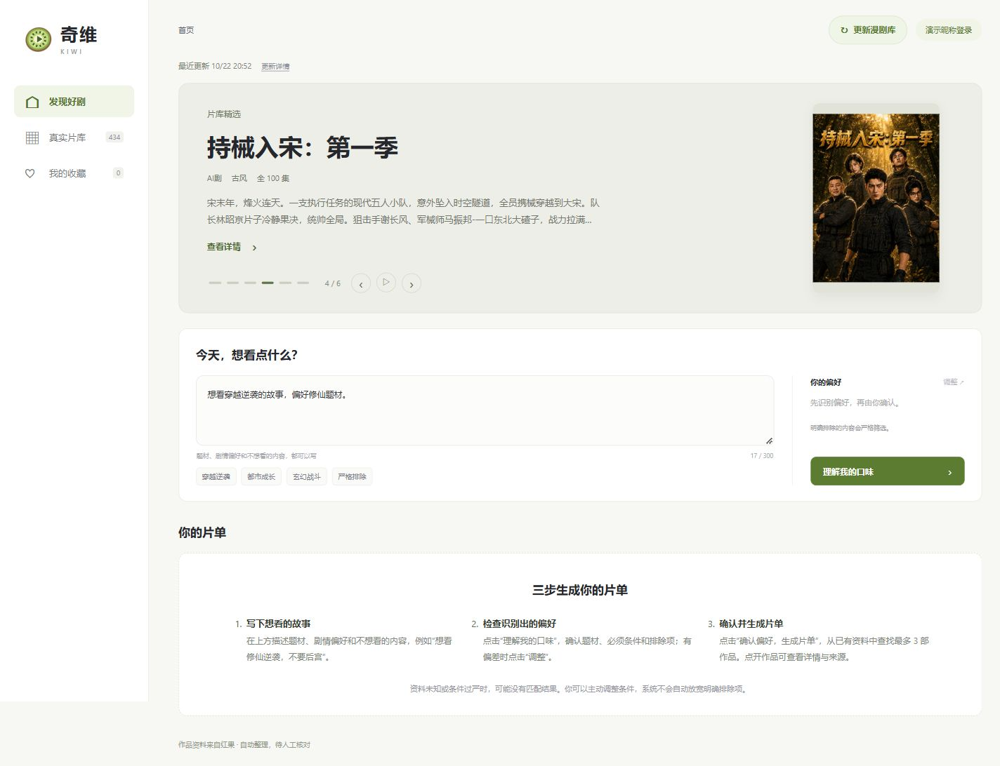
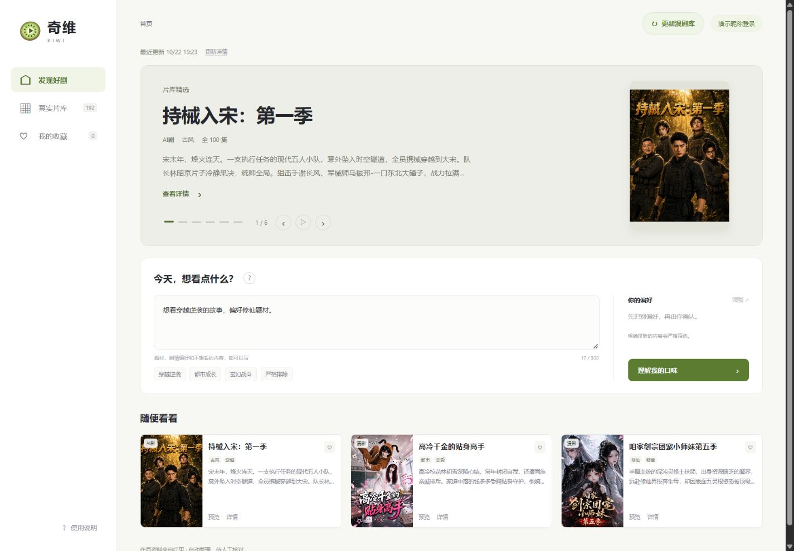
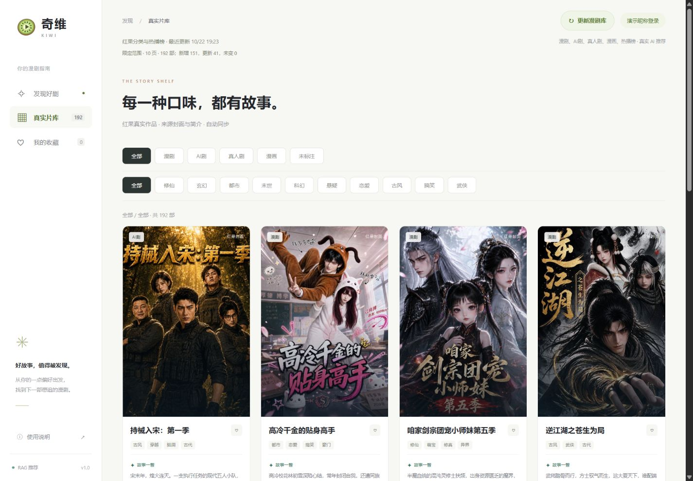
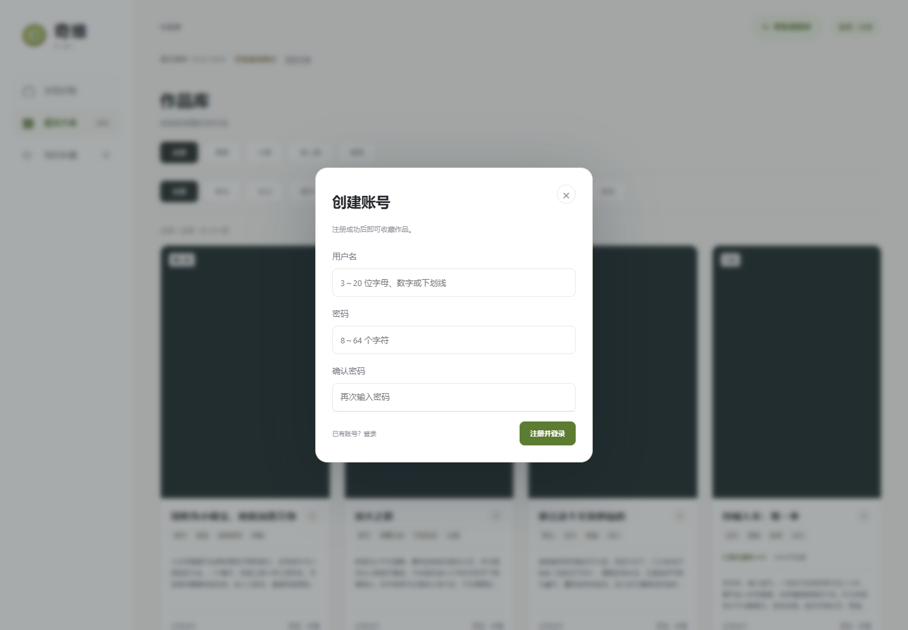
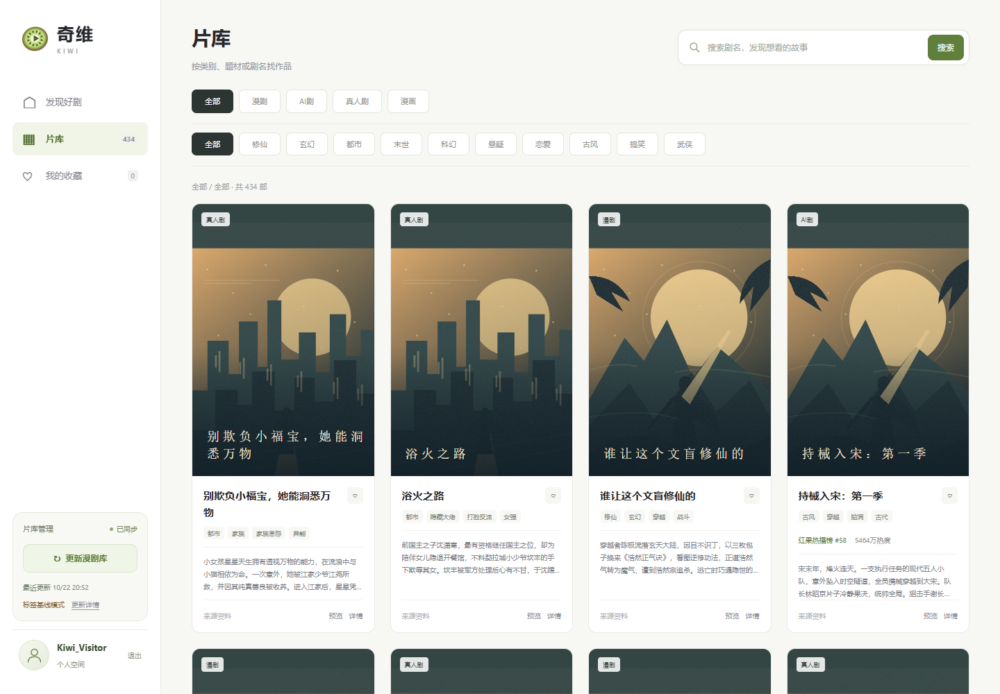

# 奇维 MVP 实现与验收

更新日期：2026-10-24。产品设计 v1.4，技术方案 v1.5。

## 本轮：基础账号技术设计，未实施

核对最新版简历、现有 FastAPI/SQLAlchemy/Vue 代码和产品设计 3.5 后，补充技术方案第 10 节：数据库 Session 与 HttpOnly Cookie、Argon2id 密码哈希、三张表及新旧数据库升级、账号及收藏接口、浏览器请求保护、限流、前端登录恢复与账号隔离、本地演示收藏的主动分批导入，以及后续实施和测试门槛。

本轮仅修改文档和文档检查，不安装依赖、不创建账号、不修改业务数据库或前后端功能，不修改简历。文档中的账号接口、跨设备同步和账号测试均为待实现要求；以下 176 项是上一次页面改动的验证记录，不能当作账号功能已通过验证。

本轮文档链接、代码块/JSON 示例和新增表格列数检查共 3 项通过。已有工程回归共 **177 项通过**：后端 98、Vue 50、Node/启动/文档 28（含上述 3 项）、独立 PostgreSQL 1；普通 pytest 的 PostgreSQL 用例跳过，由独立入口通过。TypeScript、生产构建及 Node 语法检查通过。新增用例只校验文档表格，以上结果不包含尚未开发的账号能力。

## v1.4 账号产品设计与首页内嵌指引验收历史

- 产品设计新增 3.5：用户名密码注册、登录、退出、状态保持、游客范围、账号收藏隔离与跨设备恢复，以及用户确认后导入演示收藏。明确先账号、再账号收藏、最后为轮播接入收藏偏好；账号技术方案与实现待后续开展，本轮未新增认证接口、账号存储或个性化算法。
- 首页移除“随便看看”默认卡片、标题问号、使用指引弹窗和重复入口。尚未生成片单时，虚线框直接展示原三步指引；解析后保留指引，单独确认生成才展示结果卡片。修改输入或保存调整后恢复指引。
- 加载骨架、无匹配与条件待确认仍使用各自状态，不被通用指引覆盖。轮播保留六部作品与独立加载失败重试；作品库和收藏仍使用原卡片，不受移除默认首页卡片影响。

自动验证共 **176 项通过**：后端 **98**、Vue **50**、Node/启动/文档 **27**、独立 PostgreSQL **1**。普通 pytest 中 PostgreSQL 一项跳过，由独立入口实际通过；TypeScript、生产构建与 Node 语法检查通过。新增覆盖有片库时默认卡片不出现、轮播保留六部、三步指引不触发请求、解析/生成/修改输入的显示切换、无匹配及待确认不被覆盖、轮播加载失败重试；更新详情测试入口及采集刷新断言。

浏览器检查 1440px 桌面三列步骤、390px 与 320px 手机单列，无横向溢出；默认作品卡片和问号按钮均为 0，步骤为 3，轮播选择为 6。实际切到作品库仍显示 12 张卡片，返回首页恢复指引。未发起模型调用或更新作品库。

手机效果见 [手机内嵌指引](screenshots/inline-guide-mobile.png)。

## v1.3 页面精简与类型清洗验收历史

以下 172 项及当时的作品数量是上一轮记录；本轮完整回归数量以以上 176 项为准。旧问号弹窗与默认卡片已由本轮内嵌指引替代。

- 删除首页装饰口号、步骤编号与重复标签；更新成功统计默认折叠。详情移除英文装饰、内部证据 ID 和重复引用，依据合并后按需展开，保留完整后端证据与来源。
- 首页使用六部现有剧集封面轮播，采用简介配完整竖版海报；支持每 6 秒自动切换、手动前后、六个选择按钮与暂停，并处理焦点、悬停、后台、弹窗、减少动态效果和组件卸载。封面失败时仍可查看作品详情。
- 标题旁问号可打开三步操作指引，说明描述、确认/调整、生成片单。打开和关闭不修改当前输入，不发起推荐请求。
- 轮播及默认三部片单仍按片库顺序展示；根据收藏偏好推荐是后续规划，本轮未实现个性化，也未额外调用推荐模型。
- 本批来源合并后剔除类型不明记录，来源同步导入器在向量化前再次过滤。类别仅展示四种明确类型；剧情事实的未知三态保持原规则。

自动验证共 **172 项通过**：后端 **98**、Vue **46**、Node/启动/文档 **27**、独立 PostgreSQL **1**。普通 pytest 中 PostgreSQL 一项跳过，由独立入口实际通过。TypeScript 与生产构建通过。新增覆盖六张轮播、自动/手动/键盘操作、暂停条件、异步数据变化、图片失败、定时器清理、指引不触发推荐、证据合并与编号隐藏，以及未知类型过滤和已有明确类别不被覆盖。

真实来源只读取热播榜首屏验证清洗：**20 条 → 保留 3 条明确 AI剧，剔除 17 条类型不明记录**；没有写入业务库或创建向量。现有数据库 **192 部**均有明确类别，无需删除旧数据。见 [清洗统计](type-cleaning-validation.json)。

浏览器验证桌面 1440px、宽屏 2540px、手机 390px 及 320px 无横向溢出；宽屏内容居中。轮播海报保持 2:3，桌面约 180×270px、手机约 110×165px，图片采用 contain。390px 下逐张检查六张轮播，高度均为 276px，避免切换时跳动。实际打开问号卡片、轮播第六部与作品详情，展开依据后不显示内部 ID，空白处关闭详情仍然有效。

补充截图：[手机首页](screenshots/clean-home-mobile.png)、[三步指引](screenshots/usage-guide.png)、[精简详情](screenshots/clean-details.png)。

## v1.2 分类翻页验收历史

以下为上一轮的范围、数据和测试记录，162 项为当时通过数量；本轮完整回归数量以以上 172 项为准。

### 分类翻页交付

- 首页“更新漫剧库”先选择范围：默认漫剧、AI剧，可增加真人剧、漫画及热播榜。后端固定来源，不接受任意 URL。
- 四类内容与榜单自动翻页，串行请求；默认每来源最多 5 页，整个任务最多 25 页、500 部。页面显示实际类别、当前页、读取页数、原始/去重数量与索引阶段，达到上限标明“限定范围”。
- 分别适配分类 JSON、榜单直接 JSON 及两种流式 JSON，不执行来源脚本。验证分页、下一页地址、异常空页、重复页、封面域名及字段；请求超时、大小、重试和全任务时间均有限制。
- 按来源 ID 新增或更新，停止使用快照删除：未选择类别、未遍历页面和榜单外作品保留；同名不同 ID 并存。跨批合并来源，不自动批准人工拒绝项。
- 漫画使用 `hongguo-comic-<id>`、`/comic/<id>` 与章节数；来源分类优先于榜单缺失标签，冲突标记待核对。
- 校验和向量化完成后一次事务发布，失败保留原库；只更改热度、封面、日期等元数据时复用有效向量。无密钥仍可浏览资料，健康状态如实反映索引是否就绪。
- 单 worker 后台任务，启动锁、30 秒冷却、持久化状态、刷新页面恢复轮询；服务重启标记中断。默认采集/索引/总预算分别为 300/600/900 秒。
- 作品按类别和题材筛选，服务端每页 12 部；收藏按保存 ID 独立加载，缺失 ID 提示且保留本机记录。迟到请求不能覆盖新类别。
- 统一 2:3 竖版海报、合理列数和图片失败回退。漫画展示阅读预览；其他作品保留明确标识的模拟视频。修复主动关闭预览后被下方卡片立即重新触发的问题。
- 保留偏好解析、独立确认、严格三态筛选、引用校验及长详情；详情隐藏可见滚动条，标题和关闭按钮保持可见，空白处或 Esc 可关闭。

### 真实来源与索引验收

浏览器实际选择四类内容及热播榜。本次仅在验收进程配置每来源 2 页，项目默认仍为 5 页。更新前 SQLite 已备份至 `.local/kiwi-before-pagination-20261022.db`。

| 来源 | 页数 | 原始条数 | 覆盖程度 |
| --- | --- | --- | --- |
| 漫剧 | 2 | 48 | 限定范围 |
| AI剧 | 2 | 48 | 限定范围 |
| 真人剧 | 2 | 48 | 限定范围 |
| 漫画 | 2 | 48 | 限定范围 |
| 热播榜 | 2 | 40 | 限定范围 |

合计 **10 页、232 条、去重 192 部**；新增 **151**、更新 **41**、未变 **0**、删除 **0**。本次重新生成 **166 条**向量，其余复用；总耗时 **103.3 秒**。原 41 部均保留，最终四类各 48 部，数据库和 `/health/ready` 确认 **192 部资料、192 条有效向量，live / ready**。完整统计见 [真实更新记录](catalog-refresh-validation.json)。这不是全站作品量。

另运行独立采集 CLI，按默认漫剧、AI剧各 5 页导出 **240 条 / 240 部**，确认五页流程可用；导出文件为忽略的本地缓存，未额外写入业务库。

桌面 **1440×1000**：四列，海报约 **264×396px**，首批 12 张图片加载成功，`object-fit: cover`，无横向溢出。手机 **390×844**：单列，卡片约 320px，海报约 318×478px，无横向溢出。

浏览器确认漫画 48 部、4 页，切换第二页显示新的作品；阅读预览不创建视频，详情使用漫画阅读地址与话数。长详情滚动后关闭按钮仍在顶部，空白处关闭生效。剧集模拟视频实际静音循环播放，关闭后不重开，视频节点已卸载。翻页回到列表标题，避免停留在上一页底部。

手机截图见 [手机展示](screenshots/pagination-mobile.png)。

### 自动验证

共 **162 项通过**：后端 **95**、Vue **39**、Demo/Windows 启动及文档 **27**、独立 PostgreSQL 集成 **1**。普通 pytest 中 PostgreSQL 一项明确跳过，由独立入口实际运行通过。TypeScript、前端生产构建、Node 语法检查通过。

本轮覆盖四类及多页解析、末页/异常空页、分页地址、重复页、请求重试/限流、数量上限、跨页及榜单去重、漫画同名不同 ID、人工拒绝保护、元数据向量复用、失败原子性、旧 SQLite 升级、任务锁/恢复/取消，以及范围选择、轮询恢复、旧结果兼容、服务端分页、迟到响应、收藏跨页/失效/重试、封面回退和预览关闭重开问题。

独立一次性 **PostgreSQL 18.6（PGlite/WASM）+ pgvector 0.8.7** 验证迁移、JSONB 类别筛选与分页、严格约束、距离排序及事务回滚；不能替代原生部署或并发测试。受限环境的本机回环测试遭 EACCES 后，已在允许本机连接的执行环境重新完整通过。

### 新库推荐检查

准备 [25 条固定需求](../data/evaluation.json)，覆盖单题材、多偏好、必须条件、题材排除和后宫/感情线/虐心三态排除。参考集合按明确来源标签整理，**仍待独立人工相关性标注**。评测绑定检索内容指纹，拒绝在变化后的片库上沿用旧参考；基线与语义模式读取同一实际数据库，不再使用空种子模拟新库。

| 模式 | 需求数 | 执行错误 | 硬条件违规 | 无效引用 | 中位耗时 |
| --- | --- | --- | --- | --- | --- |
| 标签基线 | 25 | 0 | 0 | 0 | 61.7ms |
| 真实向量与理由模型 | 25 | 0 | 0 | 0 | 10.9s |

真实模式记录 46 次模型调用、62,389 tokens（提供方返回的可获得用量；不包含本轮入库索引费用）。三条严格负向条件因资料未知返回空结果；“人物成长”在当前相似度阈值下也返回空，后续需结合人工标注检查召回。源站标签规则的候选覆盖与相关性参考分数均不能当作人工准确率，也未据此宣称效果提升。

报告：[新库标签基线](evaluation-hongguo-baseline.json)、[新库真实向量](evaluation-hongguo-live.json)。旧 [基线](evaluation-baseline.json) 和 [真实向量](evaluation-live.json) 仅为 2026-10-21 的历史记录。

浏览器另实测“只看末世题材，想看重生的故事”：真实解析后独立确认，返回《末日降临：百倍爆率刀刀爆物资》《空间系老六，末世先囤一万吨猪肉》等 3 部；理由均通过引用校验，第三部未体现重生的软偏好有明确提示。额外加入未支持的“提前囤货”条件时要求调整，不静默移除后直接推荐。

### 数据与未完成范围

原 36 部 Bilibili 种子已停用，原始备份 `.local/kiwi-before-hongguo-20261022.db` 保留。当前自动资料按用户授权用于开发验证，不等同正式审核；未说明的特征保持未知。详见 [审核说明](../data/审核说明.md)。

本轮采用限定范围的分类分页更新；独立人工审核、人工相关性评估、全站采集、任务断点续跑、多实例队列、真实视频、真实账号与服务端收藏尚未完成。Docker 三容器、原生 PostgreSQL、并发负载和备份恢复未实测。

运行方式与复现命令见 [README](../README.md)。

## 2026-10-24 · 基础账号与账号收藏

按产品设计 3.5、技术方案第 10 节完成用户名注册、密码登录、当前设备退出、固定 7 天数据库会话、账号收藏分页和旧收藏确认导入。正式 Vue 页面替换演示昵称入口；离线 Demo.html 保留原演示。游客仍可直接解析偏好和生成片单，收藏触发登录后只继续该次操作。

新增 `users / user_sessions / favorites` 与 Alembic 0003。密码使用 `pwdlib==0.3.1`、`argon2-cffi==25.1.0`，实际算法为 Argon2id，参数 `m=65536,t=3,p=4`。本机单次哈希 **33.97ms**、校验 **33.41ms**，仅为单样本耗时，不代表并发性能。随机会话只存 SHA-256 摘要；Cookie 使用 HttpOnly、SameSite=Lax、Path=/，HTTPS Secure 属性已通过接口测试。

升级前通过 SQLite backup API 保存 `.local/kiwi-before-accounts-20261024-161548.db`，备份及升级后的完整性检查通过；**434 部作品（含向量）和 2 条更新状态记录的整体指纹完全一致**，无重新采集或重新索引。新旧库、迁移约束对齐及一次性库降级已验证。机器可读记录见 [账号验证](account-validation.json)。

自动检查覆盖用户名大小写及并发唯一、密码边界与空白、注册事务失败回滚、未知用户名统一错误、会话轮换/过期/重启恢复、单会话退出、外键级联、账号隔离、收藏幂等和稳定分页、不可用收藏管理、导入去重与统计。所有新增写接口验证完整来源、自定义头、正文类型、大小限制；错误响应与日志不含凭据。可控时钟验证限流，密码同时最多计算 2 个。

前端覆盖启动检查失败重试、表单切换与重复提交、关闭弹窗保留输入和片单、登录后继续收藏、保存失败不假成功、退出失败重试、账号切换和旧请求迟到隔离。旧收藏只按用户确认组导入，超过 100 条分批，部分成功可重试；成功结果按用户 UUID 与组内容标记，本地字典始终保留。

桌面 **1440×1000** 与手机 **390×844** 使用两套独立浏览器上下文完成 8 组实际场景：注册并继续收藏、刷新恢复、不同账号隔离、同账号收藏恢复与取消、仅撤销当前浏览器会话、旧收藏确认及失效跳过；另验证游客推荐可用。无横向溢出和页面脚本错误。浏览器连接独立 SQLite 副本与明确标识的 baseline 模式，未创建个人真实账号或调用付费模型。详情见 [浏览器记录](account-browser-validation.json)。

手机页面：[注册](screenshots/account-register-mobile.png)、[账号收藏](screenshots/account-favorites-mobile.png)、[旧收藏导入](screenshots/account-import-mobile.png)。

本轮通过后端、Vue、Node 和独立 PostgreSQL 检查，具体数量见 [账号验证](account-validation.json)；TypeScript、前端生产构建及 Node 语法检查通过。PGlite 验证 Alembic 0003、用户名冲突、会话、账号收藏、ON CONFLICT、分页及外键。PGlite 的网络层无法完整恢复语句错误后的 psycopg 回滚，因此外键拒绝在 PostgreSQL DO 块中捕获验证；SQLite 另行验证实际数据库异常时注册及导入回滚、双线程唯一与幂等。

仍待真实双设备与 HTTPS 部署、Docker、原生 PostgreSQL 多连接及负载验证。限流当前为单 worker，启动命令关闭代理头解析，Nginx 后的 IP 额度共享；部署时应明确配置可信反代。收藏驱动轮播、找回密码、短信、第三方登录和角色后台留待后续，自动采集资料仍待独立人工复核。本轮未修改简历。

复查旧推荐评测时发现：`data/evaluation.json` 仍绑定 **192 部**的历史指纹，当前库已为 **434 部**，`scripts/evaluate.py` 按设计拒绝运行。账号升级前后作品指纹一致，差异在本轮升级前已经存在；本轮未重写参考标注或覆盖历史评测报告。需针对当前库独立复核参考集后再运行推荐效果评测，此项不计入账号测试通过数量。

## 2026-10-24 · 侧栏个人空间样例、数字分页与剧名搜索

顶部更新操作、最近更新和账号区已移到桌面左侧栏底部。头像仅为 SVG 占位，未增加上传或资料编辑入口。导航和标题统一为“片库”，标题右侧增加搜索框；支持剧名包含匹配整个已审核片库，与类别、题材组合，在 SQL 筛选后计数和分页。输入防抖、回车立即查询、清空与无匹配提示均已联调，旧请求不能覆盖新关键词。

片库与收藏使用可点击的动态数字分页，保留首尾页、邻近页和省略号；当前页绿色高亮，切换带轻微过渡，加载期间禁止重复点击，减少动态效果时不播放动画。

本轮后端 **180**、Vue **78**、Node **28**、独立 PostgreSQL **1** 项通过，合计 **287**；TypeScript、前端构建和 Node 语法检查通过。新增检查覆盖剧名搜索的分页、审核状态、类别题材组合、大小写及 `% / _ / 反斜杠` 字面处理，数字直达、搜索重置页码、防抖/回车/清空/错误重试、迟到响应和首页轮播不继承搜索。

浏览器在 **2160×1150、1440×1000、1366×650、1024×768、768×1024、390×844、320×740** 下检查侧栏、搜索与数字分页。小屏不遮挡正文、无横向溢出，账号位置和更新弹窗仍可使用；4 组联动场景通过，未发现页面脚本错误。使用只复制公共作品资料的独立 SQLite 测试库、baseline 模式及合成账号；业务账号和片库未改动。验证脚本为 `scripts/verify-catalog-layout.mjs`，记录见 [页面验证](catalog-layout-validation.json)。截图通过 `KIWI_BROWSER_BLOCK_COVERS=1` 主动验证已有的封面失败占位，真实封面地址及正常加载逻辑保持原样。

其他效果：[侧栏账号样例](screenshots/sidebar-account-example.png)、[数字分页](screenshots/catalog-numbered-pages.png)、[剧名搜索](screenshots/catalog-title-search.png)、[手机适配](screenshots/catalog-sidebar-mobile.png)、[宽屏](screenshots/catalog-sidebar-wide.png)。个人信息完善与真实头像仍留待后续。

## 2026-10-25 · 首页轮播按钮与收藏风格提示词示例

轮播前后按钮改用同尺寸 SVG 箭头，显式取消按钮内边距并居中；中间的手动暂停按钮及对应状态已移除。保留 6 秒自动轮播、前后翻页、六个选择按钮和键盘操作；悬停、焦点、后台、弹窗及减少动态效果保护继续生效。

需求框下方改为“根据您的收藏，猜您喜欢：”，带“示例”标识和修仙逆袭、穿越重生、末世系统、都市成长四个风格按钮。当前是固定前端样例，不读取收藏、不调用个性化接口。点击仅填入可编辑需求并重置旧偏好和片单，仍需用户识别并确认后生成。

[产品设计](../产品设计文档.md) v1.7 新增 3.7，明确后续收藏偏好来源、最多 6 部轮播和 4 条提示词、公开内容回退、收藏变化后更新、账号隔离及输入保护。真实推荐排序、接口、画像存储均待后续实施，本次没有修改后端业务逻辑或数据库。

自动检查后端 **180**、Vue **81**、Node **28**、独立 PostgreSQL **1** 项通过，合计 **290**；TypeScript、前端生产构建、Node 语法检查通过。Vue 新增或更新按钮数量、翻页回环、减少动态效果变化、示例文案、点击填入而不发请求、旧片单重置和重新确认检查。

浏览器在 **1440×1000、2160×1150、768×1024、390×844、320×740** 下运行 4 组验收。前后按钮的 SVG 中心与按钮中心在 X、Y 方向偏差均为 **0 CSS px**，无横向溢出和脚本错误；手动翻页、键盘、自动切换均可用，点击示例后没有解析、推荐或个人数据请求。记录见 [首页示例验证](home-examples-validation.json)，脚本为 `scripts/verify-home-examples.mjs`。

截图：[居中箭头](screenshots/carousel-controls-centered.png)、[提示词示例](screenshots/favorite-prompt-examples.png)、[桌面首页](screenshots/home-favorite-examples-desktop.png)、[手机首页](screenshots/home-favorite-examples-mobile.png)。截图使用独立公开资料副本和 baseline 模式，并阻止外部封面加载以验证已有占位；正常封面路径未改动，没有操作业务账号或调用付费模型。

## 2026-10-25 · 收藏风格推荐技术方案（文档交付）

[技术方案](技术方案.md) 更新至 v1.9，新增第 11 节，对应产品设计 3.7。确定沿用 Vue 3/TypeScript、FastAPI/Pydantic、SQLAlchemy、本地 SQLite 和部署 PostgreSQL 路径；新增推荐逻辑计划使用纯 Python 标签加权匹配与固定提示词模板，不增加模型调用、依赖或画像表。

设计明确全部有效收藏读取、去重与归一化、初始权重和稳定排序、同部作品共现提示词、公私接口与响应来源、公开回退、账号隔离、前端刷新和后续验收。接口响应示例使用明确标注的非真实作品，不能作为业务数据导入。

本次 **29 项 Node 测试通过**，包括链接、表格、JSON 及新增响应示例的数量、来源和隐私字段校验；`git diff --check` 通过。这些仅是文档交付与现有 Node 回归结果，不能算作收藏推荐后端验收。本次未实现接口或排序服务，未改业务代码、数据库、依赖或简历，后续仍须按第 11.7 节完成实施与真实联调。

## 2026-10-25 · 收藏驱动的轮播与提示词推荐

按产品设计 3.7、技术方案第 11 节实现正式首页的收藏推荐。后端使用当前账号全部有效剧集收藏，按去重标签频次归一化，以类别 0.2、题材 0.4、剧情 0.4 的初始权重排序，优先返回未收藏的相近作品；不足时按稳定顺序补充公开候选，最多 6 部。漫画、类型不明、未批准及无封面候选不进入轮播；无封面的有效收藏仍可贡献风格。只命中内容类别时不能标为收藏匹配。

提示词取同一收藏实际共现的题材与剧情标签，不足时以已有单标签补充，最多 4 条。固定模板只表达软偏好，不推断否定事实。游客或画像不足时使用公开轮播与通用提示词，文案为“换个口味试试：”；真实收藏风格使用“根据您的收藏，猜您喜欢：”，已移除“示例”标识。公开补充与收藏匹配分别标明来源和理由。

新增公开与私人只读接口，共用有数量、枚举与文本限制的 Pydantic 响应模型，两者均禁止缓存；公开接口即使带 Cookie 也不读收藏，私人接口使用现有服务端会话。拒绝额外查询参数，支持 401/422/503；响应不含画像频次、收藏全集、用户归属或向量。查询仅投影公共作品字段与审核状态，以批量关联避免 N+1，关闭会话后计算画像与排序。无需依赖、数据库迁移、画像表或额外模型调用。

Vue 的独立首页状态按账号代次和请求序号双重隔离。收藏、取消、成功导入批次及片库更新后标记刷新，离开首页时延迟至返回；失败写入不触发推荐刷新。退出即清除个人内容；401 提示重新登录并加载公开内容，503 保留账号、明确公开回退并提供重试。包括忽略 AbortSignal 的同账号旧请求、上一账号迟到响应和卸载后响应的保护。后台刷新保留需求、已确认偏好和主动生成的片单；用户主动点击提示词才清空旧偏好与片单，重新识别及确认。

自动检查共 **321 项通过**：后端 **199**、Vue **92**、Node **29**、独立 PostgreSQL **1**；普通 pytest 的 PostgreSQL 一项跳过，由独立入口实际执行通过。TypeScript、前端生产构建和 Node 语法检查通过。规则测试涵盖频次去重、归一化、标签分母、稳定排序、同部共现、仅类别命中、默认和混合模式、无收藏、候选不足、漫画/未知/失效/无封面、全部收藏读取、会话过期、额外参数、错误脱敏、只读批量查询、输出边界与账号隔离。这些验证规则正确性，不是人工推荐准确率。

独立 **PostgreSQL 18.6（PGlite/WASM）+ pgvector 0.8.7** 使用与 SQLite 相同作品和收藏，完整响应逐字段相同，覆盖 JSONB 筛选、未收藏排除、匹配/公开补充和提示词；不代表原生 PostgreSQL 多连接或生产部署验收。

浏览器基于业务库 **434 部公共作品**的独立副本，在两套 Cookie 存储内创建合成账号，不复制业务账号和收藏，不调用付费模型。**7 组场景通过**：游客公开提示词与不自动提交、收藏后个性化、不同账号与不同风格隔离、取消恢复默认与旧收藏确认导入、503 公开回退及重试、退出/切换时保留输入与片单、响应式布局。两账号分别收藏修仙和末世作品，实际首项与提示词不同，已收藏作品不重新入选。**1440×1000、2160×1150、768×1024、390×844、320×740** 均无横向溢出、无页面脚本错误。脚本自动关闭测试服务；公共作品库和业务账号未改动。

复现命令和隔离方式见 [README](../README.md)，浏览器记录见 [机器可读报告](home-recommendations-browser-validation.json)。截图主动阻止外部封面加载以验证已有占位，并不代表来源封面不可用：[桌面个性化](screenshots/home-personalized-desktop.png)、[手机个性化](screenshots/home-personalized-mobile.png)、[公开回退](screenshots/home-public-fallback.png)。

标签权重仍为工程初值，独立人工资料复核与相关性评估、真实双设备/HTTPS、Docker 和原生 PostgreSQL 并发部署仍待完成。旧评测参考集的片库指纹问题沿用此前记录，未以本轮规则测试替代人工评测。本轮未修改简历或已有未跟踪文稿。
