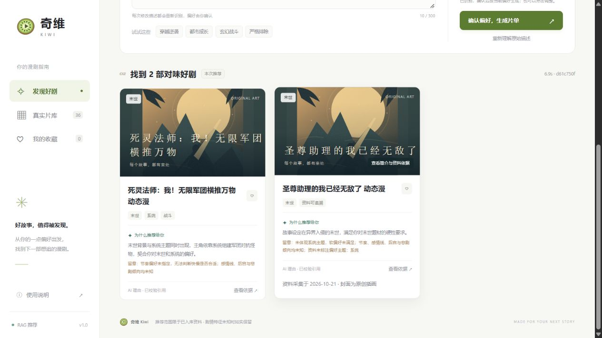

# 本地 MVP 实现与验收

日期：2026-10-21。此记录区分已实现、已验证与尚未验证的内容。

## 已实现

| 范围 | 当前交付 |
| --- | --- |
| 工程 | FastAPI / Pydantic API、SQLAlchemy 数据层、Alembic 迁移、固定 Python 依赖与前端锁文件 |
| 页面 | Vue 3 / TypeScript；输入、解析、编辑确认、最多 3 张推荐卡、片库筛选、详情与来源；加载、失败重试、无结果、迟到响应隔离 |
| 真实模型 | LangChain Prompt / Pydantic 结构化输出；DeepSeek 偏好解析和理由生成；百炼 text-embedding-v4、1024 维向量 |
| 数据 | 36 部真实动态漫官方资料快照、摘要、题材与主题、三态特征、逐字段证据和采集日期 |
| 入库 | 全批校验、重复 ID 跳过、冲突与疑似同名报错、显式更新、向量成功后原子提交、全库重建限制 |
| 推荐 | SQL 必须条件和硬排除；排除时未知不放行；精确余弦检索最多 10 候选、软偏好排序、稳定去重、相关性门槛和最终复核 |
| 依据 | 数据库提供名称、简介和来源；模型只能解释选定作品；校验作品 ID、证据 ID、原文引用；失败时标识证据模板 |
| 配置 | 后端环境变量、输入与输出上限、超时与有上限重试、单次推荐 45 秒预算、请求 ID 和结构化阶段日志 |
| 部署资料 | 三服务 Docker Compose、Nginx 同源代理、健康检查、持久卷和备份恢复说明 |
| 保留原型 | 原有虚构作品 Demo、原创模拟片段、昵称和本机收藏；正式页面不混入虚构作品 |

存储差异：本机 SQLite 便于直接运行，硬条件在 SQL 中执行，真实向量在 Python 中精确计算；PostgreSQL 使用 JSONB 保存标签数组和证据、pgvector 在 SQL 中计算余弦距离。固定维度为 1024，改变维度需另行迁移，不能直接修改环境变量。

## 数据审核授权

用户明确允许先启用 AI 逐条核对来源的资料进行开发验证。所有作品的 `review_note` 和详情页均标识“AI 核对，待独立人工复核”。当前 `approved` 表示这项开发授权，不代表独立人工审核完成。

原始资料缺少的后宫、节奏信息全部保留未知。首批数据在“不要后宫”“不要感情线”“必须快节奏”等条件下可能或必然返回空结果；没有用推断值填满资料。

## 验证证据

自动检查共 **93 项通过**：后端 54、Vue 11、Demo 与启动入口 27、独立 PostgreSQL 集成 1；pytest 普通运行中跳过的数据库测试另由 PostgreSQL 测试入口实际执行通过。

- Python 单元与 API 测试覆盖入库、三态、编辑生效、冲突、无关候选、库外 ID、伪造引用、模型失败、超时和请求体大小。
- Vue 测试覆盖独立确认、手动偏好生效、旧解析结果丢弃、失败保留与重试；本机收藏测试覆盖账号隔离、恢复和损坏存储。
- 原有 25 项 Node Demo 测试继续通过，原型可重新打包。
- `scripts/test-postgres.mjs` 已通过 psycopg 对 **PostgreSQL 18.6（PGlite 0.5.10 / WASM）+ pgvector 0.8.7** 执行真实迁移、JSONB 约束、三态筛选、向量距离和更新失败回滚测试。它是一次性测试环境，不能替代原生 PostgreSQL 部署和并发验证。
- 本机健康检查确认 `live` 模式、36 条已启用资料和 36 条相同模型的 1024 维真实向量；页面 HTTP 200，真实推荐已返回库内作品及通过校验的模型引用。
- 浏览器完成“只看末世，想看系统”的解析、独立确认、2 部真实作品推荐和详情来源核对。系统偏好未匹配的作品明确展示差异，详情展示未知特征与待人工复核标记。
- 依赖检查 `pip check` 通过，TypeScript 检查和生产构建通过。
- Windows PowerShell 设置为 `Restricted` 时，`npm.cmd start` 仍能调用产品入口；新增 `启动产品.cmd` 可从其他目录调用并传递端口等参数，不需要修改系统执行策略。启动文档已统一使用 `npm.cmd`。

## 固定需求评测

24 条需求分别运行 [标签基线](evaluation-baseline.json) 和 [真实向量推荐](evaluation-live.json)。二者使用相同的确认后偏好结构，便于比较检索效果；完整自然语言解析另由真实链路和页面验收检查。

当前参考标签由 AI 基于资料整理，尚未完成独立人工相关性分级。报告中的 reference recall / precision 只是本批开发参考，不能宣传为人工准确率、生产召回率或用户满意度。每条需求保留实际候选、返回数量、阶段时延、调用量及错误。

两组固定评测的硬条件违规和无效引用均为 0。向量检索在本批小样本上未超过标签基线；存在相关作品漏召回，尤其“温暖治愈的奶爸故事”仍未召回对应参考作品。产品保留空结果，不据此编造“向量效果更好”的结论。扩大标注集、保留更细的语义偏好和引入混合检索应在下一轮比较验证。

| 24 条开发参考需求 | 标签基线 | 真实向量 |
| --- | --- | --- |
| 调用错误 | 0 | 0 |
| 硬条件违规 / 无效引用 | 0 / 0 | 0 / 0 |
| 参考 Recall@10 | 1.000 | 0.743 |
| 参考最终相关比例 | 0.958 | 0.822 |
| 耗时 P50 / P95 | 1.38 / 1.76 ms | 7.71 / 13.55 s |

耗时从确认后的推荐阶段计算，不包括偏好解析；本机 SQLite、小型资料库和模型网络条件下的结果不代表生产性能。两组使用相同参考标签，人工质量判断尚未完成。

## 尚未验收

- 独立人工数据审核、推荐相关性分级、理由支持度和剧透检查。
- Docker 三容器实际构建启动、原生 PostgreSQL 运行、并发负载和备份恢复；本机没有 Docker。
- 真实账号、服务端收藏、跨设备同步、真实片段、多轮推荐和重排序。这些原本属于后续范围。

启动与复现命令见 [README](../README.md)。
