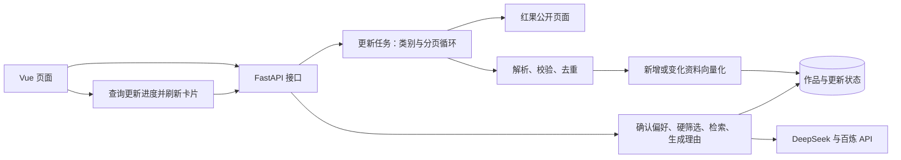

# 奇维 Kiwi · AI 漫剧智能推荐系统技术方案

版本：v2.2 ｜ 日期：2026-10-25 ｜ 对应：[产品设计文档 v2.0](../产品设计文档.md)

第 1～9 节记录采集、推荐和页面方案；第 10 节基础账号、第 11 节收藏驱动轮播与提示词均已实施并验证。第 12 节补充真实片段接入技术设计，素材、接口、迁移和媒体部署仍待实现。首页收藏标签推荐不增加模型调用、依赖、画像表或迁移，权重尚未经人工效果评测；真实片段设计另规划媒体表及外部工具。实际验证见 [实现与验收记录](实现与验收.md)。

## 1. 项目定位与简历能力衔接

已核对当前最新版简历 `00_尹恒-实习简历-Python_Agent项目版_20260920.docx` 及简历连续性记录。求职方向为 Python 开发、大模型应用和 Agent 开发实习，当前有 Python、HTTP/JSON、FastAPI、DeepSeek API、LangChain、Embedding/RAG、Chroma 及 Vue/MySQL 项目基础。

本项目定位为**以真实作品资料为数据来源的 RAG 推荐应用**。采集模块负责持续补充数据，主要展示偏好结构化、硬条件筛选、向量检索、证据校验及接口联调能力。

| 简历中的基础 | 在本项目中的应用 | 本轮需要补充的学习 |
| --- | --- | --- |
| Python、JSON、异常处理和日志 | 请求页面、解析资料、遍历分页、去重与记录错误 | HTTPX 异步请求、HTMLParser、基础 asyncio 任务管理 |
| FastAPI、HTTP/JSON | 启动更新、查询进度、浏览作品、调用推荐接口 | Pydantic 白名单校验、任务状态和失败处理 |
| LangChain、DeepSeek、Embedding/RAG | 解析偏好、作品向量化、检索候选、生成有依据的理由 | 增量索引、三态硬条件、引用校验与评测 |
| Vue 与前后端分离经验 | 更新入口、类别选择、进度轮询、卡片和详情 | TypeScript 类型、响应式海报布局和交互测试 |
| MySQL 项目经验 | 理解作品主键、事务、条件查询与数据更新 | 现有 SQLAlchemy/SQLite；PostgreSQL/pgvector 作为额外实践 |

复用当前单个 FastAPI 服务、Vue 页面和数据库。SQLite 用于本地运行；保留已经建立的 PostgreSQL/pgvector 路径，不再增加一套 Chroma 存储。PostgreSQL 的 SQL 已有独立测试，Docker 与原生部署仍待验收，不能写成已有熟练经验。

本轮采用确定的 Python 流程，不引入分布式爬虫、Redis/Celery、多 Agent 编排或浏览器自动化框架。采集任务不会交给大模型自主决定 URL、翻页或删除数据。

## 2. 现状、目标与系统结构

| 范围 | 扩展前 | 本轮已实现 |
| --- | --- | --- |
| 采集 | 真人剧分类首页、红果热播榜首页 | 四类内容可选，自动翻页，榜单可作为补充 |
| 更新 | 双页面成功后替换本次红果片单 | 按作品标识新增或更新，不因未抓到而删除 |
| 来源类型 | 真人剧、AI剧、漫剧、未标注 | 增加漫画及其独立标识、阅读链接和章节信息 |
| 任务 | 单进程后台任务、持久化状态、前端轮询 | 补充类别、页数、数量及覆盖范围统计 |
| 页面 | 真实竖版封面放入横版容器 | 竖版海报比例、合理卡片宽度和响应式列数 |
| 推荐 | 偏好确认、硬筛选、向量检索、引用校验 | 保留现有链路，验证扩大后的作品库 |



沿用现有技术栈：Python/FastAPI/Pydantic、HTTPX、SQLAlchemy/Alembic、Vue 3/Vite/TypeScript、LangChain、DeepSeek、百炼 text-embedding-v4（1024 维）。数据库访问沿用同步 SQLAlchemy 的短事务，不为本轮扩展重写整套异步数据库层。

## 3. 分类与翻页采集

### 3.1 固定来源及类别

| 请求中的类别值 | 内容类型 | 后端固定入口 |
| --- | --- | --- |
| `real-drama` | 真人剧 | `https://hongguoduanju.com/category/real-drama` |
| `comic-drama` | 漫剧 | `https://hongguoduanju.com/category/comic-drama` |
| `ai-drama` | AI剧 | `https://hongguoduanju.com/category/ai-drama` |
| `comic` | 漫画 | `https://hongguoduanju.com/category/comic` |
| 榜单补充开关 | 红果热播榜 | `https://hongguoduanju.com/rank/hot-drama` |

建议默认勾选漫剧、AI剧，真人剧和漫画由用户选择；热播榜提供独立开关。前端只提交类别值和开关，由后端查表构建 URL，不接收任意目标网址。

“切换类别”是依次请求不同分类入口；“翻页”是根据页面提供的分页信息请求 `?page=2` 等后续页面，无需模拟鼠标点击。公开入口可从 [红果分类页](https://hongguoduanju.com/category/comic-drama) 核对。

### 3.2 页面读取与停止条件

1. 使用同一个 HTTPX `AsyncClient`，按“类别 → 页码”顺序请求，先采用串行采集，便于控制频率和定位错误。
2. 复用现有 HTMLParser，提取页面中的 JSON 和流式数据参数；仅解析数据，不执行网页脚本。将解析结果统一为“作品列表 + 当前页 + 总页数或下一页”。
3. 分类页和榜单分别进行字段适配，漫画单独核对标识和阅读链接，最后统一通过 `WorkInput` 校验。
4. 到达明确末页、页面明确表示没有后续数据，或达到本次采集上限时停止；然后处理下一个所选类别。
5. 无法识别结构、分页重复或后续页反复返回相同数据时标为异常，不能把解析失败当成正常末页。任何下一页地址均须校验同域名、允许路径及合法页码。

以下配置已落地于 `Settings` 和 `.env.example`，不代表实测吞吐量：

| 限制 | 初始值 |
| --- | --- |
| 每来源页数 | 默认最多 5 页，配置范围 1～20 页 |
| 全任务上限 | 最多 25 页、500 部去重作品，任一上限达到即停止扩充 |
| 请求频率 | 串行请求，页面之间至少间隔 0.5 秒 |
| 页面请求 | 单次 25 秒超时；临时网络或 5xx 故障最多重试 1 次；每页最多接收 8 MB |
| 时间预算 | 采集最多 300 秒、索引最多 600 秒，整个更新最多 900 秒；各阶段同时受剩余总预算限制 |

遇到访问拒绝或需要登录的页面时停止并返回原因；源站限流按响应提示处理，超过重试或总预算即失败。每次从第一页更新限定范围；本轮不设计断点续采，扩充更深页面通过调整采集范围和上限完成。

## 4. 资料、去重与增量入库

### 4.1 数据结构

沿用 `works` 主表，一部作品对应一条检索记录。保留名称、原始简介、摘要、标签、封面、来源、采集日期、证据、审核状态及向量元数据。

- `source_meta.content_type` 增加“漫画”；内容类别与题材 `genres` 分开保存。
- `source_meta` 保存来源类别、页面集合、排名/热度，以及来源实际提供的集数或章节数。单批最多 25 页；跨批合并的历史来源集合最多保留 100 个页面地址，避免元数据无限增长。
- 剧集沿用 `hongguo-<series_id>`；漫画采用 `hongguo-comic-<源站标识>`，避免不同标识体系碰撞。例如源站漫画使用 `/comic/<id>` 阅读地址，不能拼成剧集详情链接，见 [来源示例](https://hongguoduanju.com/comic/7111943588446997534)。
- 分类入口提供明确类型时优先于榜单的缺失标签；来源分类冲突时保留来源记录并提示待核对，不靠标题或封面猜测。
- 本批来源合并后只保留四种明确内容类型，未分类记录在 `collect_hongguo` 清洗结束时剔除；来源同步导入器再次校验类型，避免未分类记录参与向量化。统计 `discovered_count`（去重发现数）、`unique_count`（清洗后数）和 `filtered_unclassified`（剔除数）。同批明确分类可补全榜单类型，只有题材标签不能推断内容类型。
- 同一作品出现在不同页或榜单时按来源标识合并来源信息；名称相同但标识不同不自动合并，保留记录并提示待核对。调整现有导入器“不同 ID 同名即拒绝整批”的规则，允许漫画与剧集等同名条目并存。

优先扩展现有 JSON、Pydantic 和 TypeScript 定义。若后续新增实体列，用新的 Alembic 版本升级，并验证已有 SQLite 数据；不改写已执行的历史迁移。

### 4.2 更新与向量复用

流程为：`采集本批资料 → 字段及证据校验 → 按标识合并 → 比较已有记录 → 必要时生成向量 → 一次事务提交`。

| 记录情况 | 处理方式 |
| --- | --- |
| 新作品 | 新增资料；配置向量服务时创建向量 |
| 标题、简介、摘要或检索标签改变 | 重新形成检索文本并生成向量 |
| 仅封面、热度、排名、日期或来源页面改变 | 更新元数据，复用有效向量 |
| 记录及有效向量均未变化 | 跳过并计入未变化数量 |
| 模型版本不匹配或缺少向量 | 补齐对应模型、维度的向量 |

沿用 `content_hash` 判断记录变化，并比较 `search_text`、模型和维度决定是否重建向量，不因采集日期变化重复调用模型。Embedding 沿用每批 8 条；调用前关闭资料读取会话，网络请求期间不持有写事务。向量数量、维度及数值均通过校验后，使用 SQLAlchemy 事务统一写入，异常时回滚本批更新。

**已移除快照删除逻辑**：`source_sync=True` 只按 ID 新增或更新，未选择的类别、未遍历的页面及榜单外作品保持原状。本轮不自动判定下架；需要移除时另行核对来源。

单页失败、字段校验或向量化失败时，本批不发布，原库仍可浏览。正常达到数量或页数上限的批次可以发布，但必须标记“限定范围更新”，不能显示已同步全部作品。

摘要取来源简介的有限长度，标签优先进行可追溯的规则映射。后宫、虐心、节奏等未说明的特征保持 `null`，不在每次采集时额外调用大模型猜测。保留原文和标签证据。

当前 `approved` 包含用户允许用于开发验证的资料，详情须保留“待人工复核”说明，不等于正式人工审核。采集不能把人工拒绝记录自动改为通过；正式审核界面不在本轮范围。缺少模型密钥时仍可采集浏览，但未索引数据不得冒充具备语义检索能力。

## 5. 更新任务与接口

### 5.1 单进程后台任务

复用 `CatalogManager`：启动接口先登记运行状态，再使用 `asyncio.create_task()` 执行采集；管理器保留任务引用并在应用关闭时处理取消。单进程内用一把锁保护启动检查，运行中请求复用当前任务，结束后保留 30 秒冷却。当前阶段明确使用一个 Uvicorn worker。

更新状态继续保存在 `catalog_refresh.payload`，增加 `run_id`、本次范围、阶段、类别、当前页、完成页数、原始条数、去重条数及结果统计。前端每 2 秒查询一次，终态停止；刷新页面时先读取状态。服务重启将遗留运行状态标为中断，保留最近成功时间；不会自动恢复未完成采集。

主状态沿用 `idle / running / succeeded / failed`；成功结果另设 `coverage=complete|limited`，分别表示所选来源已到末页、或正常达到上限。失败返回明确原因，新增/更新发布数量为 0。统计区分“已读取”“已入库”和“可参与推荐”，不以抓取条数替代成功数量。

### 5.2 接口约定

| 接口 | 本轮变化 |
| --- | --- |
| `POST /api/v1/catalog/refresh` | 增加类别和榜单开关，Pydantic 白名单校验；有效启动返回 202；运行中复用任务并返回其真实范围 |
| `GET /api/v1/catalog/refresh` | 返回阶段、范围、计数、覆盖程度、最近成功时间和错误 |
| `GET /api/v1/works` | 分页、题材、`content_type` 类别与 `q` 剧名包含匹配；`q` 最长 100 字符，每页最多 50 条 |
| `GET /api/v1/works/{id}` | 展示现有资料及扩充的来源元数据 |
| 偏好解析、推荐与健康检查 | 保留现有接口；健康检查继续核对配置、资料和有效向量 |

更新接口已支持以下请求，类别由 Pydantic 白名单校验：

```json
{
  "categories": ["comic-drama", "ai-drama"],
  "include_hot_rank": false
}
```

类别必须至少选择一项，或明确启用榜单；不传任意 URL、数据库语句或无限页数。页数、频率、数量和时间上限由后端配置控制。前端收到复用任务或冷却结果时显示该任务实际范围，不能显示成刚提交的新范围。

## 6. Vue 页面与海报适配

- “更新漫剧库”、最近更新、详细统计及账号区移到桌面左侧栏底部；删除主内容区重复的顶部工具栏。头像使用纯 SVG 占位，个人资料功能尚未开放；手机将工具区排在导航下方，避免遮挡正文。点击更新后用简单弹窗选择类别及榜单补充，确认后启动；更新期间禁用重复提交，显示当前类别、页数和阶段。
- 成功后重新请求作品和健康状态，清除依赖旧作品版本的推荐结果、预览和详情；失败保留现有卡片与用户偏好。进度网络请求失败时保留任务信息，允许重试查询，而非重复启动任务。
- 片库提供“全部 / 真人剧 / 漫剧 / AI剧 / 漫画”筛选，不再展示未标注项；与题材分别处理，选择或切页取消旧请求，防止迟到结果覆盖。片库使用服务端分页，不一次加载全部作品。
- 收藏页按第 10 节的服务端账号接口分页，失效 ID 单独提示，收藏计数不随片库翻页变化。
- 片库标题旁的搜索框由 `useCatalog.ts` 管理输入与已提交关键词；300ms 防抖、回车立即提交、查询变化重置页码。输入变化立即取消旧请求并拒绝迟到响应；首页轮播不带搜索条件。`q` 与类别、题材条件共同在 SQL 内执行，使用参数化 `icontains(..., autoescape=True)`，百分号和下划线按字面处理，大小写统一匹配；过滤后再计数和分页。
- `CatalogPagination.vue` 复用片库与收藏页，显示首尾页和当前页邻域，空缺用无操作的省略号表示；`TransitionGroup` 提供数字移动过渡，当前页带 `aria-current`，请求中禁止重复翻页。窄屏保留紧凑数字，减少动态效果设置遵循现有全局规则。
- `WorkCard.vue` 的封面区改为 `aspect-ratio: 2 / 3`，图片铺满容器并用 `object-fit: cover` 保持比例，必要时小幅裁切；移除当前横版区域配合 `contain` 产生的大面积侧边色块。图片失败时使用同尺寸占位图。
- 片库与收藏保持每页 12 部，`.catalog-section` 使用容器查询，根据可用内容宽度选择 1、2、3、4、6 列，完整页的各行排满，避免宽屏 7 列加第二行 5 张的留白。真实末页和少量搜索结果按实际数量显示，不拉伸末行卡片或补虚构数据。标题最多两行、摘要约三行，完整资料放入详情；主动生成的片单保留独立网格。
- 发现页、片库和收藏页复用 `WorkPreview.vue`，浮层只展示媒体与播放／关闭控件，收藏和详情留在原卡片。`previewPosition.ts` 优先右侧、其次左侧，空间有限时收窄，两侧都不足 240px 时通过 Teleport 在原卡片末尾内嵌展开；内嵌模式不用 Popover，避免脱离文档流后覆盖资料。左右浮层与原卡片保持 12px 间距，竖向约束在视口内；布局模式因窗口变化改变时关闭旧预览，等待重新触发。
- 保留 260ms 悬停与 180ms 离开保护，进入浮层不关闭；关闭后抑制指针下方刚露出的卡片自动重开。原卡片被移除时停止并卸载媒体；切卡后的旧播放拒绝与媒体事件不能改写新预览。手动播放按钮消失后将焦点转到稳定的播放／暂停控件，避免焦点变化误触发关闭。现有视频仍明确标为模拟；漫画仅展示封面及章节提示。真实片段的数据接入尚未实施，需求见产品设计 3.8。

首页 `FeaturedCarousel.vue` 复用发现页一次请求的前六条资料，不再将其中前三条展示成默认卡片。轮播从有封面且明确为剧集的条目选择最多六部，使用 Vue 状态及定时器，不引入轮播框架或模型调用。海报容器为 2:3，图片采用 `contain`；手机缩小海报并限制标题行数、保持轮播高度稳定。保留定时切换、前后翻页与键盘操作，移除手动暂停按钮；悬停、焦点、后台、弹窗及减少动态效果保护继续有效，卸载时清理定时器和监听。

片单区域以 `result` 和 `busy` 分支呈现：未生成结果时在虚线框内直接展示三步指引；进行中显示骨架；有结果时只渲染 `result.items`，不回退到片库卡片；空结果和待确认继续展示原因及调整入口。移除问号、原使用说明入口和指引 `dialog`，桌面三列步骤、窄屏单列；轮播加载错误保留独立重试。偏好解析和确认协议不变，修改输入或保存偏好调整后恢复指引。详情按原文引用合并重复依据，默认使用 `details/summary` 折叠；只隐藏内部 ID，数据库和推荐引用校验保留。更新成功统计默认折叠，运行和失败信息保持直接可见。轮播暂按片库顺序展示，后续仅为轮播接入收藏个性化，不恢复默认卡片区。

## 7. 保留的 RAG 流程与工程约束

`用户描述 → DeepSeek 解析 → Pydantic 校验 → 用户确认/修改 → SQL 硬筛选 → 语义检索 → 排序与去重 → 生成并校验引用 → 最多 3 部`。

偏好结构继续区分软偏好、必须条件和明确排除项，例如：

```json
{
  "schema_version": 1,
  "soft_preferences": {"genres": ["修仙"], "themes": ["逆袭"], "pace": null},
  "required": [],
  "excluded_features": ["harem"],
  "excluded_genres": [],
  "unresolved_constraints": [],
  "conflicts": []
}
```

- 编辑后的偏好直接执行；新输入不继承旧偏好。冲突和未支持的硬条件要求用户调整。
- “不要后宫”使用 `harem IS FALSE`，同时排除 `true` 和 `null`。模型不生成 SQL；程序用字段白名单和参数绑定构建查询。
- SQLite 在 SQL 硬筛选后以 Python 计算余弦相似度；PostgreSQL 使用 pgvector。沿用最多 10 候选、软偏好排序和稳定去重，最终不足 3 部时按实际返回。
- 内容类别筛选先用于作品浏览，不静默改写推荐偏好协议。未来若允许限定推荐类别，应另加明确的界面选项与服务端校验。
- 模型只解释已选作品，名称和链接由数据库填充；校验作品 ID、证据 ID 和逐字引用。理由失败时可返回明确标识的证据模板，解析或向量失败不切换虚构作品。
- 推荐请求沿用 45 秒总预算，与后台更新预算分开。API Key 仅由后端读取；日志记录请求/任务标识、阶段耗时、数量和错误类型，不记录密钥。
- 本地依旧采用 SQLite；PostgreSQL/pgvector 和 Docker Compose 沿用现有工程配置，部署验收不作为本轮采集扩展的前提。LangSmith 保留为按需学习项，当前以已有结构化日志为验收证据。

## 8. 实施顺序与验收

| 顺序 | 主要修改位置 | 完成依据 |
| --- | --- | --- |
| 1. 分类和页面解析 | `crawler.py`、`schemas.py`、采集测试 | 四种类别样例、至少两页、末页和异常可区分；漫画标识及链接正确 |
| 2. 安全增量更新 | `importer.py`、数据层与入库测试 | 停用未出现即删除的逻辑；重复采集无重复记录，变化资料更新，元数据变化复用向量 |
| 3. 任务和接口 | `catalog.py`、`main.py`、配置及 API 测试 | 类别选择、计数、上限、中断和失败保留；运行中无重复任务 |
| 4. 页面和卡片 | `App.vue`、`WorkCard.vue`、`style.css`、TypeScript 类型 | 选择范围、服务端分页、2:3 海报和统一详情交互可用 |
| 5. 新库推荐验证 | 现有推荐测试、评测数据与验收记录 | 新作品可检索，硬条件不放宽，引用有效；数量和效果以实测为准 |

自动测试使用固定页面样例与 HTTPX 模拟响应，不依赖实时网页和付费模型。覆盖跨类别/分页/榜单去重、漫画与剧集同名不同 ID 并存、重复页、缺字段、超时、限流、非法来源、数量上限、任务复用、批次失败回滚，以及未抓到的旧作品仍保留。Vue 测试覆盖轮询恢复、类别和分页切换、收藏跨页保留、迟到响应、失败重试与封面回退。

随后小范围执行真实来源采集和模型入库验收，记录所选类别、页数、原始数、去重数、新增/更新/跳过数、索引数量、覆盖程度、耗时及可获得的调用量。桌面约 1440px 和手机约 390px 检查无封面侧边空白、拉伸、内容溢出或横向滚动。

旧 36 部对应的评测不能套用到新库。本轮已准备 25 条固定需求，使用源站标签规则建立待复核参考，并比较标签基线与语义检索，记录硬条件违规、无效引用、参考匹配与耗时。评测读取同一当前库并核对检索内容指纹，变化后须复核参考。人工相关性标注完成前，不对外宣称准确率提升。

每次实施补充对应测试，运行现有 Node、pytest、Vue 和独立 PostgreSQL 检查，更新 [README](../README.md) 与验收记录并创建 Git commit。测试通过与真实部署验收分别表述。

## 9. 简历表述与参考

完成对应实现和验证后，可围绕以下内容组织简历：Python/FastAPI 实现作品采集更新接口；按类别分页采集、标识去重和增量索引；结合 LangChain、结构化硬条件与向量检索完成可追溯推荐；通过接口、事务和页面测试验证异常处理。

四类自动翻页已实现并验证限定范围，可在掌握实现后如实表述；不能写“全量抓取红果作品库”“分布式高并发采集”或未经评测的效果提升。先能解释分页停止、去重主键、更新事务、向量复用、未知条件处理和失败恢复，再把实测数据写入简历。本轮不修改简历文件。

实现时按项目锁定版本查阅官方资料：

- [HTTPX 异步客户端](https://www.python-httpx.org/async/)、[Python 3.13 asyncio 任务与取消](https://docs.python.org/3.13/library/asyncio-task.html)
- [Pydantic 数据模型校验](https://docs.pydantic.dev/latest/concepts/models/)、[SQLAlchemy 2.0 事务管理](https://docs.sqlalchemy.org/en/20/orm/session_transaction.html)
- [CSS 海报比例](https://developer.mozilla.org/en-US/docs/Web/CSS/aspect-ratio)、[图片适配方式](https://developer.mozilla.org/en-US/docs/Web/CSS/object-fit)
- [LangChain 模型与结构化输出](https://docs.langchain.com/oss/python/langchain/models#structured-output)、[pgvector](https://github.com/pgvector/pgvector)、[百炼 text-embedding-v4](https://help.aliyun.com/zh/model-studio/text-embedding-v4)

## 10. 基础账号与账号收藏技术方案（已实施）

### 10.1 范围与技术选择

对应产品设计 3.5，按“基础账号 → 账号收藏 → 本地收藏导入”实施；收藏风格推荐实现见第 11 节。游客继续浏览作品和主动生成片单；本轮不改变 RAG 的偏好确认、硬筛选和引用校验，不恢复已移除的首页默认卡片。

账号功能围绕本项目已有的接口、数据库和页面能力扩展；原设计阶段对齐的能力如下，本轮不修改简历：

| 已有基础 | 本阶段复用 | 需要补充掌握的内容 |
| --- | --- | --- |
| Python、FastAPI、HTTP/JSON | 请求校验、错误响应、依赖函数、模块拆分 | Cookie、服务端 Session、密码哈希和鉴权依赖 |
| Vue、前后端分离项目 | 登录弹窗、表单状态、fetch、收藏展示 | 登录恢复、账号切换隔离、迟到请求取消 |
| MySQL 项目与当前 SQLAlchemy 实践 | 用户与收藏关系、唯一约束、外键、短事务 | 账号归属校验、重复写入幂等、旧库升级验证 |

确定采用 **FastAPI + SQLAlchemy + 数据库 Session + HttpOnly Cookie**。浏览器只持有随机会话凭据，服务端按数据库会话查用户；退出时可直接删除该会话。复用 SQLite 本地运行及现有 PostgreSQL 路径，不迁回 MySQL，也不增加独立认证服务、Redis、OAuth2、JWT 双令牌或角色权限系统。账号是推荐应用的辅助模块，不让认证工程盖过 RAG 主线。

跨设备收藏恢复要求两台设备访问同一后端和数据库。当前 `127.0.0.1` 启动只用于本机验证，开发阶段用两套独立 Cookie 存储检查身份隔离；实际双设备及 HTTPS 验收随部署另行完成，本期不改变监听地址或发布服务。

已新增 Python 依赖 `pwdlib[argon2]`，在本项目 Python 3.13 环境安装并验证；`pwdlib==0.3.1`、`argon2-cffi==25.1.0` 及间接依赖已同步到 `backend/pyproject.toml` 与 `backend/requirements.lock`。密码哈希的选型参考 [FastAPI 密码哈希说明](https://fastapi.tiangolo.com/tutorial/security/oauth2-jwt/#password-hashing) 和 [pwdlib 官方指南](https://frankie567.github.io/pwdlib/guide/)，不照搬该教程中的 JWT 登录流程。

### 10.2 数据模型与升级

沿用一个业务数据库，增加三张表；不把账号、密码或收藏写入向量库。

以下字段均非空，字符串长度为最大长度，主键、唯一约束和外键由数据库实际执行。

| 表 | 字段与约束 | 用途 |
| --- | --- | --- |
| `users` | `id`：UUID 字符串主键；`username`：20 位显示名称；`username_key`：20 位、非空且唯一；`password_hash`：255 位字符串；`created_at`：UTC 时间 | 稳定用户身份及凭据 |
| `user_sessions` | `token_hash`：64 位字符串主键；`user_id`：用户外键及索引；`created_at`、`expires_at`：UTC 时间，过期时间索引 | 保存会话凭据的摘要，不存原始 Cookie 值 |
| `favorites` | `(user_id, work_id)`：联合主键，分别关联用户和作品；`created_at`：UTC 时间；增加 `(user_id, created_at, work_id)` 索引 | 同账号同作品只能收藏一次，支持稳定分页 |

- 用户名先去首尾空白，校验 `^[A-Za-z0-9_]{3,20}$`，再用小写得到 `username_key`；显示名称保留用户输入的大小写。注册与登录使用同一归一化函数。使用数据库唯一约束与 `INSERT ... ON CONFLICT (username_key) DO NOTHING RETURNING id`；未插入转换为 409，并发时仍只有一个账号。
- 密码按产品约定为 8～64 个字符，区分大小写、不 trim；Pydantic 是最终校验方，前端用 Unicode 字符计数保持一致。确认密码只用于注册一致性校验，不持久化。
- 外键采用删除级联；SQLite 的每个连接显式开启 `PRAGMA foreign_keys=ON`，并验证孤儿收藏无法写入。账号删除不在本期提供入口；真实下架判断仍不交给爬虫。
- 已新增 `backend/migrations/versions/0003_accounts.py`，不修改 0001/0002。PostgreSQL 启动前执行 Alembic 升级；本地 SQLite 沿用 `initialize()` 创建新增表，已有表不重建，检查与迁移脚本生成的约束一致。不对已有 SQLite 盲目 stamp 或重跑建库。
- SQLite 对时区的处理与 PostgreSQL 不同，统一经 UTC 读写辅助函数比较到期时间，覆盖从 SQLite 读取无时区时间的情况。
- 实施升级前备份本地数据库；测试新库和含旧作品、向量及更新状态的数据库。账号模块升级不触发重新采集、重新向量化或旧资料清理。回滚代码前先恢复匹配备份，降级只在一次性测试库验证，不用删除业务账号表作为日常回退方式。

### 10.3 密码与登录会话

注册流程：`校验输入 → 在事务外计算密码哈希 → 事务写入用户及新会话 → 提交成功后设置 Cookie`。用户与首个会话一起提交，失败不返回半成功登录状态。若提交成功后响应丢失，用户可直接登录，不把网络失败解释为账号必定未创建。

密码使用 `pwdlib` 的 Argon2id 实现，库负责随机盐和校验；采用 `PasswordHash.recommended()`，实测 Argon2id 参数为 `m=65536,t=3,p=4`，测量记录见验收文档。保存完整编码哈希，禁止以普通 SHA-256、可逆加密或明文保存密码；参数不能低于所选 [OWASP Argon2id 配置](https://cheatsheetseries.owasp.org/cheatsheets/Password_Storage_Cheat_Sheet.html#argon2id) 的要求。

登录流程：`归一化用户名 → 查用户 → 释放读会话 → 校验哈希 → 事务创建新会话 → 设置 Cookie`。未知用户名也校验预先准备的虚拟密码哈希，登录失败统一返回“用户名或密码不正确”，不在异常响应中回传输入值。耗时哈希在同步路由的工作线程执行，不阻塞 async 事件循环；并发限制见 10.5。

会话采用以下确定规则：

1. 使用 Python `secrets.token_urlsafe(32)` 生成会话凭据，数据库保存原始凭据的 SHA-256 摘要。这里 SHA-256 只处理高熵随机凭据，不处理用户密码。每次登录生成新凭据，不接收客户端指定的会话 ID。随机值生成使用 [Python secrets](https://docs.python.org/3.13/library/secrets.html#generating-tokens)。
2. 初始有效期设为 **7 天固定期限**，Cookie 的 `Max-Age` 与服务端到期时间一致；访问不会续期，不增加刷新令牌。浏览器刷新或服务重启后可恢复数据库中尚未到期的会话。
3. Cookie 名为 `kiwi_session`，设置 `HttpOnly`、`SameSite=Lax`、`Path=/`，省略 `Domain`；正式 HTTPS 环境必须 `Secure=true`。仅本机回环 HTTP 开发配置允许 `Secure=false`，两者由环境配置明确区分。使用 [FastAPI Response Cookie](https://fastapi.tiangolo.com/advanced/response-cookies/) 设置，属性含义见 [MDN Set-Cookie](https://developer.mozilla.org/en-US/docs/Web/HTTP/Reference/Headers/Set-Cookie)。
4. `get_current_user` 从 Cookie 摘要查会话并检查到期时间，再取用户；受保护接口只能使用该依赖得到的 `user.id`。随机伪造、已删除、已过期会话均不能访问收藏；数据库不可用返回 503，不能误判为正常退出。
5. 同账号不同设备各有独立会话；退出删除当前会话，再以相同 Cookie 名和路径清除浏览器凭据。重复退出仍成功。登录时撤销当前浏览器原有会话并换发，不影响其他设备；不提供“退出所有设备”。
6. 启动和登录时限频清理已过期会话，不在每次读请求写表；即使尚未物理清理，鉴权也必须拒绝过期记录。会话设计参考 [OWASP Session 管理](https://cheatsheetseries.owasp.org/cheatsheets/Session_Management_Cheat_Sheet.html)，7 天是本项目选定的初始产品参数，不是通用安全标准。

### 10.4 接口契约（已实现）

统一沿用 `/api/v1` 与已有 `error / request_id` 错误结构。以下接口均已实现；请求不接受 `user_id`、`password_hash` 等额外字段，Pydantic 设置 `extra='forbid'`。

| 方法与路径 | 输入及鉴权 | 成功结果 |
| --- | --- | --- |
| `POST /api/v1/auth/register` | 用户名、密码、确认密码；校验写请求来源 | 201，公开用户字段及 Set-Cookie |
| `POST /api/v1/auth/login` | 用户名、密码；校验写请求来源 | 200，公开用户字段及 Set-Cookie |
| `GET /api/v1/auth/me` | 当前 Cookie，可为游客 | 200，`user: null` 或 `{id, username}`；不返回会话凭据 |
| `POST /api/v1/auth/logout` | 校验写请求来源；允许无有效会话 | 204，撤销当前会话并清 Cookie |
| `GET /api/v1/me/favorites` | 登录；`page>=1`，`page_size` 默认 12、最多 50 | 200，已可展示作品 `items`、有效总数 `total`、页码、`unavailable_count` 及最多 50 个 `unavailable_ids`（供用户取消不可用收藏） |
| `GET /api/v1/me/favorites/ids` | 登录；分页每页默认 200、最多 200 | 200，收藏关系中的作品 ID、关系总数及页码；供卡片收藏状态使用 |
| `PUT /api/v1/me/favorites/{work_id}` | 登录及写请求校验；作品存在且审核通过 | 200，`saved: true`；已存在也成功 |
| `DELETE /api/v1/me/favorites/{work_id}` | 登录及写请求校验 | 204；关系不存在也成功，不影响别的账号 |
| `POST /api/v1/me/favorites/import` | 登录及写请求校验；仅 `work_ids`，每批 1～100 条、单个 ID 最长 80 字符 | 200，本批去重、已存在、新增及不可用统计 |

收藏查询只按当前账号过滤，按 `created_at DESC, work_id ASC` 排序后分页。`total` 是当前可展示的已审核收藏数；`unavailable_count` 是收藏关系仍在但作品不可展示的数量。前端数量使用服务端统计，不把当前页长度当总数；ID 接口的关系总数与作品列表的有效总数分别命名，不混用。硬删除作品通过外键清理对应关系；未审核等不可展示记录仍可由用户取消收藏。

PUT 和导入采用 SQLite/PostgreSQL 各自的 `INSERT ... ON CONFLICT DO NOTHING`，由联合主键处理并发重复；DELETE 始终带上会话用户条件。禁止“查不到就无条件插入”或接收前端账号 ID。会话及收藏响应均设置 `Cache-Control: no-store`，公共作品响应不混入个人收藏字段。

错误约定：422 为格式或字段校验失败，409 为用户名冲突，401 为凭据不正确或未登录，403 为来源校验失败，404 为不可收藏的作品，429 为请求受限，503 为存储或服务异常。字段错误只返回字段名称及安全提示，日志不记录请求正文、密码、Cookie、原始会话凭据或完整哈希。注册查重提示按已确认产品要求提供，登录不另给“用户名不存在”的提示。

### 10.5 浏览器请求保护与运行限制

本期面向同源 Vue 浏览器页面，采用 **自定义请求头 + 严格来源校验** 防护新增账号和收藏写接口，不额外维护一套 CSRF Token。不能只设置 SameSite 就认为已完成 CSRF 防护。该组合适用于当前 JSON API，依据 [OWASP 自定义请求头防护模式](https://cheatsheetseries.owasp.org/cheatsheets/Cross-Site_Request_Forgery_Prevention_Cheat_Sheet.html#employing-custom-request-headers-for-ajaxapi)。

- 新增写接口统一要求 `X-Kiwi-Request: 1`；有正文时只接受 `application/json`。浏览器表单、缺少请求头或错误内容类型在进入业务逻辑前拒绝。GET 只读，不用 GET 完成退出、收藏或导入。
- 优先校验 `Origin`，缺失时检查 `Referer` 的完整来源；按“协议、主机、有效端口”与配置的允许来源精确比较。两者均缺失、`Origin: null`、不同端口或相似域名一律 403，不能沿用当前采集接口只比较 hostname 的规则。
- 生产只允许部署域名；本地允许来源显式列出 8000、Compose 8080 和 Vite 5173 所需地址，临时端口需另外配置。保持相对 URL 经 Vite 代理，浏览器到 API 仍同源，不开放通配 CORS 或跨源携带凭据。来源值不由不可信 Host 或任意代理头推导。
- 注册、登录也应用以上检查，避免跨站登录。自定义头是浏览器请求标记，不是密码或访问令牌；后端身份仍来自会话。以后若改为跨站前后端或开放外部客户端，须重新评估该约束，不能直接放宽来源白名单。
- 单 worker 内用带锁、定期清理且有容量上限的计数器：登录同一 IP+归一化用户名 5 分钟最多 5 次失败；单 IP 登录 5 分钟最多 30 次尝试，注册 10 分钟最多 10 次。超限返回 429 与 `Retry-After`，不永久锁定账号；IP 仅信任直连地址；本地启动和 Docker 命令关闭 Uvicorn 代理头解析，当前 Nginx 后的请求共享代理 IP 额度。可信反代及真实客户端 IP 须部署时单独配置，不能接受任意转发头。
- 密码计算同时最多 2 个，其余立即返回可重试的 429，避免无界排队占满内存；实际哈希延迟已记录于本轮验收；单次测量不代表负载性能。进程重启会清空这些内存限流状态，这是当前单进程方案的范围；不宣称分布式防暴力破解能力。
- 新配置限定为 Cookie 安全开关、Session 有效期、允许来源及上述受限参数；不把数据库和模型密钥加入前端配置。现有全局 24 KB 请求上限继续适用，100 条 ID 的导入批次须在该上限内。

### 10.6 Vue 登录状态与账号收藏

复用 `App.vue` 的账号入口和弹窗，拆出 `AuthDialog.vue`、`useAuth.ts`；将 `library.ts` 从昵称字典调整为账号收藏状态，`useCatalog.ts` 的收藏页改为服务端分页。无需引入 Pinia 或新的 UI 框架。

- 登录状态为 `checking / guest / authenticated / error`。启动先调用 `/auth/me`；明确返回游客才展示登录入口，数据库或网络失败显示重试，不能自动把账号收藏降为本地演示收藏。
- 登录凭据只在 HttpOnly Cookie 中，前端不读取也不写入 localStorage。请求辅助函数增加 PUT/DELETE 和认证写请求头支持，保留现有偏好解析与推荐调用方式；相对路径使用 `credentials: 'same-origin'`。
- 登录或注册成功后读取收藏摘要和分页 ID 集合，内存使用 Set 管理当前账号收藏状态。ID 尚未加载完或加载失败时，相关按钮显示状态未就绪/重试，不先显示错误的“未收藏”；列表本身通过收藏分页接口读取，不逐条请求详情。数量按作品接口的有效总数展示。
- 收藏采用“服务端成功后更新页面”，每部作品提交中禁用重复点击。PUT 网络失败时可再次 PUT，结果仍幂等；不能用不确定的 toggle 请求重试，避免把已经收藏的作品反向取消。
- 复用 `latestRequest`，为所有账号私有请求增加用户代次标记；退出、收到 401 或账号变化时取消在途请求、清空私有收藏缓存及导入提示。上一账号的迟到响应不得写入下一账号界面；进行中的服务端事务可能已经提交，重进该账号时以服务端为准。
- 游客点击收藏时记录单个待收藏作品，成功登录后仅执行这次操作；主动打开账号入口不产生收藏。关闭弹窗清除待操作和密码，不清空观剧输入、偏好或已生成片单。受保护写请求遇到会话失效后不跨账号自动重放，由用户重新确认操作。
- 退出需先请求撤销服务端会话，成功后再显示已退出并返回公开首页；失败时提示重试，不能只清前端状态而声称会话已撤销。保留观剧输入和当次偏好，不将收藏画像混入显式生成片单。

### 10.7 本地演示收藏导入

旧 `kiwi-real-library-v1` 仅是浏览器中按演示昵称组织的作品 ID，不是账号凭证。新账号不能因为用户名相同就获得这些数据；认证成功后单独展示昵称、数量和目标账号，由用户确认选中哪一组。

1. 前端读取旧字典，校验字符串列表并去重，只对明确选择的一组提交 ID；后端既不接收演示昵称作为身份依据，也不信任 localStorage 内的账号声明。
2. 超过 100 条时串行分批。每批先校验输入并查询可用作品，在一个短事务内合并收藏；不可用 ID 跳过并报告，数据库异常回滚该批。多批允许部分成功，页面说明已完成批次和剩余数量；保留全部本地数据，以便重试未完成部分。
3. 响应定义 `requested`（原条数）、`unique`（去重数）、`added`、`already_saved`、`skipped_unavailable`，并满足 `unique = added + already_saved + skipped_unavailable`。重试可能得到 `added=0`，应解释为已经在账号中保存，不能当作失败。
4. 全部批次成功后才标记完成：在单独本地记录中以“服务端用户 UUID + 演示组规范化 JSON 指纹”记导入结果，避免重复提示；该标记只用于界面，不用于鉴权。localStorage 不可写时保留本次内存结果，不阻断登录或正常收藏。
5. “暂不导入”关闭本次提示，后续可在“我的收藏”的旧数据入口主动导入。未确认、跳过、失败或成功均不自动删除旧字典；成功账号数据存于服务器，另一设备登录同一账号即可读取，但不能访问原浏览器未提交的本地数据。

统计示例对应已实现的接口结构：

```json
{
  "requested": 5,
  "unique": 4,
  "added": 2,
  "already_saved": 1,
  "skipped_unavailable": 1
}
```

### 10.8 实施顺序与验收门槛

| 阶段 | 实现位置 | 必须验证 |
| --- | --- | --- |
| 1. 账号存储与密码 | `database.py`、新增 0003 迁移、`auth.py`、配置与依赖锁 | 新旧 SQLite 和 PostgreSQL 升级；用户名并发唯一；密码正确/错误与边界；摘要无明文 |
| 2. 会话和账号接口 | 认证路由、`get_current_user`、`main.py` | 注册即登录、刷新及重启恢复、7 天到期、伪造凭据拒绝、换发、当前设备退出、另一设备不受影响 |
| 3. 收藏接口 | `favorites.py`、Pydantic 请求模型、数据库测试 | 401、账号间隔离、幂等及并发重复、稳定分页、不可用作品统计、数据库失败回滚 |
| 4. Vue 账号联调 | `AuthDialog.vue`、`useAuth.ts`、`api.ts`、`library.ts`、`useCatalog.ts` | 游客使用推荐、表单切换、登录后继续收藏、状态恢复、退出及账号切换、错误重试和迟到响应隔离 |
| 5. 旧收藏导入 | 独立导入函数、收藏页提示和测试 | 显式确认、按组导入、100 条分批、重复导入、失效跳过、部分失败重试、本地记录不丢失 |

每个账号写接口都测试跨来源、相似域名、错误端口、缺失来源、缺自定义头、表单正文及超限请求被拒绝；验证 Cookie 的 HttpOnly/SameSite/Secure/清除属性，错误响应与日志不含凭据。用户 A 的 Cookie 不能读写 B 的收藏，任何额外 `user_id` 字段均拒绝。使用可控时间测试会话过期和限流，不让测试真实等待 7 天。

pytest 使用临时 SQLite 和独立 PostgreSQL 测试库；Vue 模拟网络响应并覆盖状态竞态，不使用个人账号、真实密码或付费模型。至少保留一项真实 Argon2id 哈希/校验测试，其余限流和流程测试可替换哈希组件以控制耗时。浏览器以两套独立 Cookie 存储验证账号隔离，再以同一账号登录验证收藏恢复，覆盖桌面和手机。

本轮已运行 Node、pytest、Vue、独立 PostgreSQL 检查、前端构建及双浏览器上下文验收。新旧 SQLite 升级、实际业务库备份及公有数据不变、Cookie 属性、会话重启恢复与账号隔离均有本轮记录，见 [实现与验收](实现与验收.md)。HTTPS 的 Secure 属性有接口测试，真实 HTTPS、真实双设备、Docker、原生 PostgreSQL 多连接部署仍待验收。

### 10.9 简历表达与阶段边界

这部分用于补足已有 FastAPI 和数据库项目的完整性，需要能讲清“用户名归一化与唯一约束、密码哈希与会话摘要的区别、Cookie 如何恢复登录、服务端如何限制收藏归属、重复收藏为何安全、旧数据为何需要确认导入”。实现并验证后，可表述为“基于 FastAPI 和 SQLAlchemy 实现账号注册登录、服务端 Session 及账号收藏，完成身份隔离、幂等写入和旧收藏导入验证”。

本次完成基础账号实现与本地验证，未修改简历，也不声称掌握生产级身份平台、分布式会话或高并发认证。收藏驱动轮播已按第 11 节实现；密码找回、第三方登录、短信、角色后台及对外部署继续保留为后续范围。

## 11. 收藏风格推荐实现

### 11.1 范围与技术选择

对应产品设计 3.7，实现“账号收藏 → 风格统计 → 作品排序与提示词 → 首页展示”。以下接口、模块和标签算法已接入正式 Vue 页面，替换固定示例；独立离线 Demo 保持演示数据。

| 部分 | 确定采用 | 与简历及现有项目的衔接 |
| --- | --- | --- |
| 前端 | Vue 3、TypeScript、现有 fetch 与请求取消工具 | 复用 Vue 项目经验、首页轮播和账号状态 |
| 后端 | FastAPI、Pydantic | 复用已有 HTTP/JSON 接口与结构校验能力 |
| 推荐算法 | Python `Counter`、集合、标签加权匹配 | 用容器、函数及排序实现可解释的内容推荐 |
| 数据访问 | 同步 SQLAlchemy 短只读会话 | 在现有用户、收藏和作品关系上查询，补充关联查询实践 |
| 数据库 | 本地 SQLite；部署沿用 PostgreSQL/pgvector 路径 | 复用 MySQL 项目中的表关系与 SQL 思路，不为此功能单独迁库 |

不新增 Python/npm 依赖、用户画像表或数据库迁移，画像按请求计算；当前小片库由服务端读取合格候选后在 Python 排序。候选量扩大后根据实测耗时调整预筛，不预先承诺吞吐量。既有 LangChain、DeepSeek 和 Embedding 继续服务用户主动确认的 RAG 片单，本模块不调用模型或向量服务，也不把收藏偏好写入该片单的硬条件。

### 11.2 数据读取与收藏画像

身份只来自服务端 Session。使用 `favorites JOIN works` 读取当前 `user.id` 的**全部收藏**，不能只用收藏第 1 页、浏览器昵称字典或其他账号的数据。另取当前账号全部已收藏 ID，用于去重和排除；用批量查询避免逐个请求详情或 N+1 查询。

- 有效画像来源：`review_status='approved'`，且 `source_meta.content_type` 明确为真人剧、漫剧、AI剧的收藏；漫画、未标注和不可用记录不参与。本条件沿用当前开发资料可用状态，保留待人工复核边界。
- 类型取 `source_meta.content_type`，题材取 `genres`，剧情特色取 `themes`。后两者沿用 `schemas.py` 的 `GENRES / THEMES` 白名单；每部收藏内部先去重，每个特征对该收藏最多计数一次，不重复累计原始 `source_meta.tags`。
- 设有效收藏数为 N；分别以 `Counter` 保存类别 C、题材 G、剧情 T 的频次，归一化为 `p_f(tag)=count_f(tag)/N`。N 为 0 或没有任何有效题材、剧情标签时，判为画像不足，使用默认内容。
- 画像不使用简介猜测属性，不把收藏题材推断为“不要后宫”等排除项，不因来源未知就补成否定事实。图片是否可用不影响收藏贡献风格，但候选轮播必须有封面。

读取必要字段后关闭数据库会话，再交给纯函数打分与生成提示词；不在读会话内做网络请求或写画像。并发收藏或采集变化通过下一次刷新收敛，不把多个普通查询声称为固定快照。

### 11.3 轮播排序与默认补充

候选来自数据库中已可用、有非空封面、类别明确为剧集的作品；私人请求排除当前账号全部已收藏 ID，按作品 ID 去重。只有命中至少一个题材或剧情标签的候选可称为收藏风格匹配，单独命中内容类别不算风格匹配。

首版使用以下确定规则，权重是可调整的工程初值，不是经过效果评测的最优参数：

1. 类别命中分 `C(w)=p_C(w.content_type)`，不存在时为 0。
2. 题材分 `G(w)` 为候选白名单题材中各标签 `p_G` 的平均值；未命中计 0，候选没有题材时整体为 0。剧情分 `T(w)` 同理。分母使用候选去重后的该组标签总数，避免标签越多越占优。
3. 总分 `score(w)=0.2*C(w)+0.4*G(w)+0.4*T(w)`。按分数降序、作品 ID 的 Python 字符串升序稳定排序，选最多 6 部风格匹配作品。
4. 不足 6 部时从剩余合格的公开候选按作品 ID 升序补充，仍排除已收藏和已选 ID；全部候选不足则按实际返回，允许为空，不重新加入已收藏作品凑数。

例如两部有效收藏均为“漫剧／修仙／逆袭”，同特征候选得分为 1；只匹配漫剧类别、题材为都市且主题为成长的候选得分为 0.2，但不进入风格匹配组，只能作为公开补充。游客使用相同的公开候选资格与稳定顺序，无账号收藏排除项。

每条结果标记 `basis='favorites'` 或 `basis='public'`。前者只返回实际命中的类别、题材、剧情标签，理由由这些标签拼成短句；后者匹配标签为空，说明为“片库精选”，不冒充收藏匹配。`carousel_mode` 根据实际返回来源取 `personalized / mixed / default`，无候选时为 `default`。

### 11.4 风格提示词

从有效收藏中统计**同一部作品里实际共同出现**的“题材＋剧情标签”组合，按出现次数降序、标签字符串升序取不同组合，最多 4 条。不足时使用画像里已有的单题材或单剧情标签补充并去重；不为凑满数量编造标签，也不把两个从未共现的高频标签强行拼接。

提示词采用固定模板：组合为“想看{题材}题材，偏好{剧情特色}主题。”；单标签为“想看{题材}题材的故事。”或“想看带有{剧情特色}元素的故事。”。标签来源必须在白名单和当前画像中，标签标题最多 16 字符、正文最多 300 字符。只表达软偏好，不自动添加“只看”、否定条件或未获证实的剧情事实。

个性化提示词最多 4 条，不足可少于 4 条；无有效风格时返回最多 4 条固定通用提示词，`prompts_mode='default'`，文案为“换个口味试试：”。有真实画像来源时为 `personalized`，文案为“根据您的收藏，猜您喜欢：”。两组模式分别判断，允许轮播全为公开补充而提示词仍有收藏依据。真实接口已接通并验证，已移除“示例”标识。

### 11.5 接口与返回契约

| 接口 | 身份及行为 |
| --- | --- |
| `GET /api/v1/home/recommendations` | 公开默认内容，即使浏览器带 Cookie 也不读取收藏；用于游客、启动检查中及失败回退 |
| `GET /api/v1/me/home-recommendations` | 复用 `get_current_user`；缺失或无效会话返回 401；读取当前账号收藏，画像不足时正常返回默认内容 |

两者复用相同服务与响应模型，固定最多 6 部轮播和 4 条提示词，不接收用户 ID、用户画像或客户端打分。额外查询参数按 422 拒绝，所有筛选使用 SQLAlchemy 参数绑定。均为只读 GET；私人接口归属限制沿用第 10 节，不返回完整收藏列表、画像频次、凭据或数据库内部字段。两类响应均设置 `Cache-Control: no-store`，防止个人内容被共享缓存复用。

Pydantic 使用 `HomeRecommendationResponse`、`HomeWorkItem`、`PromptSuggestion`；输出校验数量、枚举及文本长度。`items` 复用完整 `public_work` 字段，再增加 `basis / matched_features / reason`；完整作品由后端数据库提供，不由客户端补名称和链接。以下仅列作品对象的部分字段，展示新增字段结构；示例 ID 和名称不是已入库作品：

```json
{
  "request_id": "home-example",
  "strategy_version": "favorites-tags-v1",
  "carousel_mode": "mixed",
  "prompts_mode": "personalized",
  "items": [
    {
      "id": "example-similar", "title": "相似作品结构示例（非真实作品）",
      "basis": "favorites",
      "matched_features": {"content_type": ["漫剧"], "genres": ["修仙"], "themes": ["逆袭"]},
      "reason": "根据你收藏的修仙、逆袭风格推荐"
    },
    {
      "id": "example-public", "title": "公开补充结构示例（非真实作品）",
      "basis": "public",
      "matched_features": {"content_type": [], "genres": [], "themes": []},
      "reason": "片库精选"
    }
  ],
  "prompts": [
    {"label": "修仙逆袭", "text": "想看修仙题材，偏好逆袭主题。", "basis": "favorites", "genres": ["修仙"], "themes": ["逆袭"]}
  ],
  "warnings": []
}
```

错误沿用 `error / request_id`：401 表示会话失效，422 表示参数不合法，数据库或推荐服务异常返回 503。私人接口失败不能被后端转换成“正常无收藏”；前端可独立请求公开接口并说明回退，公开接口也失败时显示可重试错误，不补虚构内容。首版不增加限流参数或写接口，性能与限流需求在实际运行后评估。

### 11.6 Vue 状态与刷新

`useHomeRecommendations.ts` 管理轮播、提示词、模式和错误；`useCatalog.ts` 继续负责片库分页与搜索，首页不继承其搜索条件。`FeaturedCarousel.vue` 按服务端顺序展示，不再从片库请求前 6 条取个性化候选；原有自动切换、手动翻页和减少动态效果行为保留，不恢复暂停按钮。

- `checking / guest / error` 使用公开接口；只有明确 `authenticated` 才用私人接口。认证检查异常不自动修改账号状态，也不读取本地演示收藏充当真实画像。
- 复用 `auth.scope()` 的账号代次及 `latestRequest` 的请求序号。账号变化或收藏变化立即使旧请求失效；只有当前账号代次和当前请求都匹配的响应可写入，防止同账号旧收藏结果或上一账号内容覆盖新结果。
- 收藏、取消、导入成功及片库更新成功后标记首页数据需刷新；首页可见时刷新，其他页面回到首页再取新数据。同一轮变更合并触发，失败的收藏请求不更新依据；定时翻页本身不重新请求或重排候选。
- 退出成功或账号切换确认后立即清除旧的私人轮播、提示词和理由，再取对应结果；退出失败保留当前账号并提示重试。私人接口 401 复用 `auth.expire()`，提示重新登录后加载公开内容；503 保留账号状态，公开请求成功后显示“个性化推荐暂不可用，已显示片库精选”并提供重试，公开请求也失败则显示加载错误。不得继续展示上一账号的内容。
- 任何后台刷新都不改 `query`、已确认偏好或当次片单。只有用户主动点击提示词才填入正文、清空旧偏好及片单；随后仍需用户识别并确认，不能自动调用解析或片单生成接口。

### 11.7 修改位置与实施验收

| 阶段 | 实现位置 | 必须验证 |
| --- | --- | --- |
| 画像、打分与提示词 | 新增 `backend/kiwi/home_recommendations.py`，纯函数配合现有查询层 | 全部有效收藏、去重频次、归一化、稳定排序、同收藏共现、无否定推断、最多 6/4 条 |
| 接口与模型 | `schemas.py`、`main.py`、复用 `auth.py` | 公私接口分离、Cookie 归属、401/422/503、no-store、公开补充标识及来源字段，不新增迁移 |
| 首页联调 | 新增 `useHomeRecommendations.ts`，调整 `App.vue`、`types.ts`、`FeaturedCarousel.vue` | 首次加载、收藏/导入/取消后刷新、输入保护、退出/切换、同账号与跨账号迟到响应、失败回退及重试 |
| 完整验收 | 后端、Vue、Node、独立 PostgreSQL 和浏览器 | 相同数据 SQLite/PostgreSQL 结果一致；两个账号收藏不同且不串用；有收藏、无收藏、失效、漫画、无封面及候选不足场景 |

纯函数使用人工构造的小样例验证：给定收藏应命中哪些标签和作品、哪些必须排除，以及并列时的顺序；这些是规则正确性测试，不是推荐准确率。另记录有效收藏数、候选数、耗时、策略版本及错误类型，不记录密码、Cookie、完整画像或用户输入；效果评价仍需独立人工复核。

已运行 pytest、Vue、Node、独立 PostgreSQL、TypeScript/前端构建及双账号浏览器验收，实际数量和场景见 [实现与验收](实现与验收.md)。规则正确性、浏览器联调与人工相关性评估分别记录，当前检查不代表人工推荐准确率。参考：[基于内容的推荐](https://developers.google.com/machine-learning/recommendation/content-based/basics)、[Python Counter](https://docs.python.org/3.13/library/collections.html#collections.Counter)、[SQLAlchemy 关联查询](https://docs.sqlalchemy.org/en/20/orm/queryguide/select.html#joins)。

## 12. 真实片段接入与预览（技术设计，待实现）

### 12.1 范围与技术栈

对应产品设计 3.8。侧边纯媒体浮层、左右定位、窄屏下方展开和原卡片操作已实现；本节规划将真实片段接入该交互。当前页面仍播放有明确标识的原创模拟动画，以下媒体表、接口、处理命令和部署配置均未实现。

首轮选取 **3～5 部作品、每部约 10～20 秒**的已核实片段，先完成作品对应、处理、发布及播放验证，再扩充覆盖。采用人工选段和离线处理；RAG 继续负责作品推荐，本模块不调用模型识别或剪辑精彩片段，不自动采集整剧。

| 部分 | 采用技术 | 与现有基础的衔接 |
| --- | --- | --- |
| 页面 | Vue 3、TypeScript、原生 `<video>` | 复用已有 Vue 页面与侧边媒体组件，处理加载、播放、关闭及状态隔离 |
| 接口 | Python、FastAPI、Pydantic | 复用 HTTP/JSON、类型校验、异常与日志；提供片段元数据和媒体读取接口 |
| 数据 | SQLAlchemy、Alembic；本地 SQLite，部署 PostgreSQL | 复用已有关系查询与迁移，作品通过唯一 ID 关联媒体；沿用 SQL 项目基础 |
| 处理 | FFmpeg、ffprobe 外部命令行工具 | 新增学习内容；Python 读取 ffprobe JSON，并组织裁切、转码和封面生成 |
| 文件服务 | 本地媒体目录、开发期 FileResponse、部署期 Nginx | 初期保存少量文件；HTTP Range 支持按字节读取，部署时分离接口校验与文件传输 |
| 验证 | pytest、Vitest、Playwright | 延续既有接口、状态竞态、独立数据库与触屏浏览器检查 |

不新增播放器 SDK、云转码、对象存储、Redis 或任务队列。FFmpeg/ffprobe 是需要单独安装和记录版本的系统工具，Python 通过 `subprocess` 调用，不新增仅用于包装命令的 Python 库。当前工程具备 Vue、FastAPI、SQLAlchemy 等基础，不据此把尚未实践的视频处理或媒体部署写成已有熟练经验。

### 12.2 素材准备与离线处理

流程：`人工核实作品及使用依据 → 准备本地源文件与导入清单 → ffprobe 检查 → FFmpeg 生成短片段和封面 → 校验输出 → 发布文件 → 事务登记媒体 → 浏览器验收`。

- 首版使用已获准展示的本地源文件。官方预告／试看页面及使用依据记入清单；红果页面能否提供稳定可用的视频仍待核实，公开可访问不能代替使用确认。作品对应通过源站作品 ID、页面和内容共同核对，不按同名或题材自动配片；漫画不导入剧集视频。
- 计划新增 CLI `python -m kiwi import-previews --manifest <清单文件>`，提供 `--check-only` 检查与 JSON 统计；检查模式仅校验清单与 ffprobe 结果，不转码、不发布文件、不写库。清单包含 `work_id`、本地源文件、`source_page_url`、`usage_basis`、`clip_kind`、选段起点与目标时长。该命令目前不存在；首版不开放网页上传、远程 URL 下载或转码写接口。
- Pydantic 校验作品 ID、来源页、`clip_kind=trailer|excerpt`、起点非负及目标时长；作品须可用且为明确剧集类型。未确认作品对应与使用依据的素材保持 `pending`，不能发布为真实可播放片段；资料的开发验证状态不自动授予视频展示资格。
- ffprobe 输出 JSON，读取容器、音视频轨、时长、宽高与文件大小。FFmpeg 统一输出 MP4／H.264、`yuv420p`，保留原画幅，最长边不超过 1280、短边不超过 720；有音轨时使用 AAC，无音轨则保持无音轨。使用 `+faststart` 将 MP4 索引移至前部，另生成 JPEG 封面；不将整剧直接放进预览组件。
- 初始处理限制：每次一个任务，源文件不超过 200 MB，输出视频不超过 20 MB；ffprobe 超时 10 秒、单部 FFmpeg 总预算 120 秒。输出目标为 10～20 秒，允许编码时间基引入不超过 200ms 的时长偏差。参数、大小、超时均可配置，作为实现初值而非性能承诺。
- Python 使用参数数组及 `shell=False`，只处理清单中已校验的本地普通媒体文件；调用工具时限制为本地文件协议。失败返回具体阶段、作品 ID 和错误类型，不把原始路径、凭据或完整工具输出直接发给页面。日志保留处理耗时、输出大小和工具版本。

源文件和暂存内容放在不公开的目录。输出先写暂存区，全部校验后以新的 `asset_id` 发布到媒体根目录，再用短事务切换该作品的当前记录；同一作品串行发布，输出文件不原地覆盖。重新导入相同作品及相同源文件指纹、选段参数和处理配置时跳过。失败时旧的可用片段继续可读；事务失败产生的未引用文件登记为待清理，不开放目录访问，不删除作品或旧素材。

### 12.3 数据、文件与迁移

计划新增 `work_previews`，一部作品保留一条当前媒体记录；文件存文件系统，数据库只存元数据。

| 字段 | 含义与约束 |
| --- | --- |
| `work_id` | 主键并外键关联 `works.id`，不能用标题或浏览器昵称归属素材 |
| `asset_id` | 当前媒体版本的随机 32 位小写十六进制 ID，唯一；更换素材时生成新值 |
| `status` | `pending / ready / unavailable`；只有已核实且文件校验通过的 `ready` 可播放 |
| `clip_kind` | `trailer / excerpt`，分别显示真实预告／试看片段 |
| `video_path / poster_path` | 相对媒体根目录的文件路径，仅供服务端使用；封面可空 |
| `duration_ms / width / height / size_bytes` | 输出文件的实测时长、尺寸与大小，不使用清单填写值冒充实测 |
| `source_page_url / usage_basis` | 可展示的来源页面及内部使用依据；带令牌的下载地址不作为公开来源页 |
| `source_hash / processing_hash / video_sha256` | 源文件、选段与转码配置、输出文件的指纹，用于去重、校验和追溯 |
| `checked_at / created_at / updated_at` | 核对及变更时间，统一 UTC |

无记录对应 `missing`；作品为漫画时返回 `not_applicable`。`pending` 允许素材 ID、文件路径及输出测量字段为空；`ready` 要求这些输出字段、核对时间和使用依据齐备，时长及尺寸为正数且文件有效，不能仅凭 URL 存在设为就绪。素材撤回、对应关系存疑或文件不可用时标为 `unavailable`，作品资料仍保留。替换流程中待核对的素材留在暂存清单，不提前覆盖旧的 `ready` 记录。

实施时新增 Alembic `0004`，沿用 SQLite 本地升级与 PostgreSQL 迁移路径，不改写历史迁移。升级前备份并验证作品、收藏、会话和向量指纹不变；媒体字段不进入作品检索文本或向量更新判断。数据库降级不自动删除媒体文件，回滚需保留匹配的数据库与媒体版本。

媒体根目录通过计划配置 `MEDIA_ROOT` 指定，开发期默认 `.local/media/previews/`，文件组织为 `<asset_id>/clip.mp4` 与可选 `poster.jpg`；原文件名不决定公开 URL。计划配置 `MEDIA_DELIVERY_MODE=app|nginx`，开发默认 `app`，完成内部媒体 location 与共享卷配置后才启用 `nginx`。部署时后端与 Nginx 读取相同媒体卷，媒体和数据库均纳入备份，前端构建不内嵌真实视频。

### 12.4 计划接口与返回契约

| 计划接口 | 行为 |
| --- | --- |
| `GET /api/v1/works/{work_id}/preview` | 游客可访问；返回当前作品预览状态及可公开元数据，不执行下载、转码或模型调用 |
| `GET / HEAD /api/v1/media/previews/{asset_id}/video` | 读取当前有效版本的 MP4，支持 Range；HEAD 返回相同文件头而不返回正文 |
| `GET / HEAD /api/v1/media/previews/{asset_id}/poster` | 读取当前有效版本的 JPEG；无生成封面时返回 404，前端可继续使用作品封面 |

元数据状态为 `ready / missing / pending / unavailable / not_applicable`。作品不存在或不可公开时 404；正常无素材仍返回 200 和明确状态；参数不合法为 422，数据库或元数据服务失败为 503。错误沿用 `error / request_id`，不能把服务失败伪装成正常无素材。公开接口不依赖登录账号、不接收任意文件路径或代理 URL，额外查询参数拒绝为 422。

以下仅为未来响应结构示例，作品 ID、素材 ID 和地址均非已接入真实数据。只有 `ready` 时 `preview` 非空，其他状态为 `null`；内部文件路径、使用依据、指纹和凭据不返回。

```json
{
  "request_id": "preview-example-ready",
  "work_id": "example-work",
  "status": "ready",
  "message": "真实预告",
  "preview": {
    "asset_id": "00000000000000000000000000000001",
    "clip_kind": "trailer",
    "video_url": "/api/v1/media/previews/00000000000000000000000000000001/video",
    "poster_url": "/api/v1/media/previews/00000000000000000000000000000001/poster",
    "content_type": "video/mp4",
    "duration_ms": 15000,
    "width": 1280,
    "height": 720,
    "source_page_url": "https://example.org/previews/example-work",
    "checked_at": "2026-10-25T00:00:00Z"
  }
}
```

```json
{"request_id":"preview-example-missing","work_id":"example-work","status":"missing","message":"暂无视频预览","preview":null}
```

文件请求先查询 `asset_id`，确认仍是可公开作品的当前 `ready` 素材，并将数据库相对路径解析、限制在 `MEDIA_ROOT` 内；旧版本、缺失、停用或未核实素材返回 404。初期元数据和媒体统一 `Cache-Control: no-store`，避免沿用已失效的片段。视频使用 `video/mp4` 和 inline 展示；完整读取为 200、有效字节范围为 206、不可满足的范围为 416，支持 `Accept-Ranges`、`Content-Length` 和正确的 `Content-Range`。

开发期复用 FastAPI 底层的 `FileResponse`，不手写整文件加载或 Range 解析。部署期计划由 API 完成上述记录与路径校验，再通过 `X-Accel-Redirect` 交给 Nginx 的 `internal` 媒体 location 传输文件；客户端仍访问同一媒体 API，内部目录不直接公开。应用直出与 Nginx 模式都须验证 Range、HEAD 和失效拦截。现有 Nginx 只有页面及 API 代理，该内部媒体 location 与共享卷配置尚未添加。

### 12.5 Vue 接入与异常状态

复用 `WorkPreview.vue`、`previewPosition.ts` 及原生 `<video>`；真实预览流程取消按题材映射 `workClip()` 的模拟资源回退，独立 Demo 继续明确标为模拟。

- 卡片悬停意图确认或用户主动点击后才请求预览元数据；页面不提前下载全部视频。立即展示作品封面和加载状态，`ready` 才设置媒体 `src`，使用 `preload="metadata"`、`muted`、`playsinline`；预加载只是浏览器提示，实际字节量由浏览器决定。
- `missing / pending` 显示“暂无视频预览”，`unavailable` 或请求／播放异常显示“视频暂不可用”并提供重试；重试重新获取当前作品元数据，不循环请求旧失效地址。视频 404 或链接过期也按失败处理，不补其他作品或模拟片段。漫画直接使用原有阅读资料预览。
- 每次打开绑定作品 ID、请求序号与取消信号。切卡、关闭、切页及原卡片移除时取消旧元数据请求、停止视频并清除 `src`；旧响应和媒体事件即使迟到也不能回写新预览。只保留当前活动片段，首版不做长期元数据缓存。
- 保留左右侧边定位、窄屏下方展开、手动播放、自动播放受限／减少动态效果、Esc、后台停止和关闭后不重开。浮层仍只有媒体与必要控件，素材性质显示为真实预告／试看片段；来源入口在原卡片详情中呈现。预览请求与播放不改变输入、已确认偏好、片单、收藏或收藏推荐依据。

### 12.6 计划实施位置与验收

| 阶段 | 计划位置 | 验收重点 |
| --- | --- | --- |
| 素材准备 | 本地源文件与清单；新增媒体导入模块、CLI 子命令 | 3～5 部逐一核对对应作品与使用依据，记录 FFmpeg/ffprobe 版本和编码器可用性 |
| 数据与服务 | `database.py`、`schemas.py`、迁移 `0004`；新增媒体服务与路由 | SQLite/PostgreSQL 一致，幂等、失败保留旧素材、路径限制、状态和错误契约 |
| 页面联调 | `api.ts`、`types.ts`、`WorkPreview.vue`、详情来源区 | 真实资源播放、缺失与重试、切卡迟到响应、原卡片操作和输入保护 |
| 文件部署 | `Settings`、环境示例、Nginx、Compose 媒体卷 | 200/206/416、HEAD、类型和范围头、失效及旧版本拦截、实际备份恢复 |

pytest 覆盖清单和输出校验、工具缺失／超时／非零退出、重复导入、事务失败、公开状态、文件不存在与路径逃逸、完整读取／Range／HEAD。Vue 检查元数据到媒体的状态转换、缺素材、服务异常、失败重试、切卡与卸载后的迟到响应。Playwright 在 Edge／Chrome 桌面与独立触屏上下文中，实际播放每部 10～20 秒样本，检查静音、画幅、侧边不遮挡、手机展开和关闭卸载；模拟网络响应不能代替真实文件播放。真实手机及 Nginx 媒体部署另行验收。

实施后再运行完整回归、构建、独立 PostgreSQL 和媒体浏览器验收，并记录实际样本数、输出格式、耗时、文件大小、Range 结果及未完成项。本次只更新技术设计和文档校验；未安装 FFmpeg、未导入真实素材、未创建媒体表或接口，也未修改部署配置和简历。既有 336 项检查与模拟视频验收不能当作本功能已实现。

技术依据：[ffprobe 文档](https://ffmpeg.org/ffprobe.html)、[FFmpeg MP4 格式与 faststart](https://ffmpeg.org/ffmpeg-formats.html#mov_002c-mp4_002c-ismv)、[HTML video](https://developer.mozilla.org/en-US/docs/Web/HTML/Reference/Elements/video)、[FileResponse 与 Range](https://starlette.dev/responses/#fileresponse)、[Nginx internal](https://nginx.org/en/docs/http/ngx_http_core_module.html#internal)。
