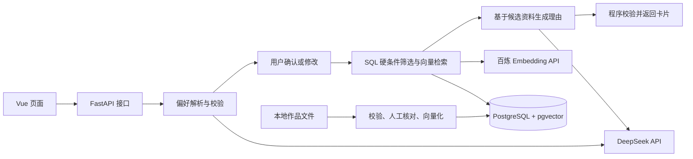

# 奇维 Kiwi · AI 漫剧智能推荐系统技术方案

版本：v0.1 ｜ 日期：2026-10-21 ｜ 状态：待实施

产品依据：[MVP 产品设计文档](../产品设计文档.md)。当前仅有使用虚构作品和规则推荐的前端 Demo；本文描述后续实现方案，接口、数据库、真实模型调用和效果指标均不代表已经完成。

## 1. 实现目标与范围

构建一个可以运行、演示和评测的 RAG 推荐应用：用户输入观剧需求，确认或修改识别出的偏好，系统从已有作品库中检索作品并给出有资料依据的推荐。

- 整理 30～50 部真实作品，每部作品对应一条检索记录。
- 单轮推荐，默认最多返回 3 部；修改输入后重新解析，不自动继承上一轮偏好。
- 支持本地结构化文件导入、偏好编辑、语义检索、硬条件筛选、推荐理由和来源展示。
- 准备 20～30 条固定需求，用于检查相关性、硬条件执行、资料依据和响应耗时。
- 当前 Demo 的昵称登录、本机收藏和模拟视频预览继续作为演示功能；真实账号、服务端收藏和真实片段接入属于后续迭代。

项目主要服务于 Python 后端和大模型应用开发方向的实践。复用已有 Python、FastAPI、LangChain 和 Vue 基础，补充数据库管理、业务约束、测试及部署能力；简历表述以后续实际实现和验证结果为准。

## 2. 技术选型

| 部分 | 选型 | 职责与选择理由 |
| --- | --- | --- |
| 前端 | Vue 3、Vite、TypeScript | 实现输入、偏好编辑、推荐卡片和异常状态，复用已有 Vue 经验；先接通现有 Demo，再逐步组件化 |
| 后端 | Python、FastAPI、Pydantic | 提供 HTTP API，校验入参和模型输出，组织推荐流程；异步调用模型与数据库 |
| 数据访问 | SQLAlchemy、Alembic、psycopg | 实现数据库访问、事务和结构迁移；查询采用参数绑定 |
| AI 链路 | LangChain | 组织 Prompt、模型适配、结构化输出和调用追踪；首版使用固定流程 |
| 生成模型 | DeepSeek API | 负责偏好解析、离线摘要辅助整理和推荐理由生成；具体模型通过配置指定 |
| 向量模型 | 百炼 text-embedding-v4 | 对作品资料和检索需求进行向量化；首版统一使用 1024 维 |
| 数据库 | PostgreSQL、pgvector | 统一存储作品资料、标签、证据和向量，在 SQL 中结合硬条件与相似度检索 |
| 测试 | pytest、HTTPX；Vue 阶段加入 Vitest | 覆盖业务规则、接口、前端交互及异常路径；保留现有 Node.js Demo 测试 |
| 部署与观测 | Docker Compose、结构化日志、可选 LangSmith | 复现应用和数据库环境，记录调用链路、耗时及失败原因 |

PostgreSQL + pgvector 是本方案主要新增学习内容，可将原先需要关系库和独立向量库维护的数据集中管理。MVP 采用精确向量检索，暂不建设 HNSW 等近似索引；数据增长后以评测决定是否调整。

初始化工程时确认依赖兼容性，将实际 Python、Node.js、数据库镜像版本和依赖写入项目配置、锁文件与 README。本文不把未来版本或本机已安装版本当作部署前提。

## 3. 系统结构



后端拆为接口层、推荐服务、数据访问和模型适配四部分。LangChain 用于模型调用和链路组合，业务约束由 Python 与 SQL 执行。首版不启用自主工具规划或多 Agent；后续需要多轮状态管理时再评估 LangGraph。

## 4. 作品数据与入库

### 4.1 数据组织

首版以 UTF-8 JSON 文件整理作品，人工维护稳定的 `id`。核心数据如下：

| 数据组 | 字段与约束 |
| --- | --- |
| 作品身份 | `id`、`title`；`id` 唯一，名称不能为空 |
| 原始资料 | `original_intro`、`source_url`、`collected_at`；保留原文、资料来源与采集日期 |
| 检索内容 | `summary`、`genres`、`themes`、`pace`；摘要及标签必须有原文支持，未知信息保留为空 |
| 排除特征 | `harem`、`romance`、`tragic`；分别表示后宫、感情线、虐心，采用 `true / false / null` 三态 |
| 资料证据 | `evidence`；记录摘要、标签和特征对应的原文片段及证据标识 |
| 审核状态 | `review_status`；仅人工核对通过的作品参与推荐 |
| 向量元数据 | `embedding`、`embedding_model`、`embedding_dimension`、`content_hash`、`embedded_at` |

存储时以 `works` 表作为作品主表，向量与原始资料保持在同一行；题材和主题采用数组，证据采用 JSONB。每部作品的短简介和特色摘要组成检索文本，不进行机械分块。

证据必须区分“明确没有”和“资料未提及”。例如后宫信息采用：

| 原始资料情况 | `harem` | 用户要求“不要后宫”时 |
| --- | --- | --- |
| 明确包含后宫 | `true` | 排除 |
| 明确无后宫 | `false` | 可进入后续检索 |
| 无法确认 | `null` | 排除，不能按无后宫处理 |

### 4.2 导入流程

`读取文件 → Pydantic 校验 → 模型辅助整理 → 人工核对 → 生成向量 → 事务写入`

- 模型辅助整理离线进行，原始简介始终保留。审核未通过或证据不足的条目不进入推荐集。
- 同一 `id` 重复且内容一致时跳过；同一批次出现内容冲突时报告错误；不同 `id` 疑似同名作品需人工确认。
- 内容更新采用显式更新模式，重新核对证据并生成对应向量；调用成功后以事务更新资料和向量，避免新旧版本混用。
- 记录导入成功、跳过和失败条数，失败包含作品标识与原因。
- 更换向量模型或维度时，重建整库向量并同步查询配置，完成后统一切换。

## 5. 推荐流程与关键规则

### 5.1 偏好解析及确认

将自然语言转换为受 Pydantic 约束的结构，区分软偏好、必须满足的条件和明确排除项。例如：

```json
{
  "schema_version": 1,
  "soft_preferences": {
    "genres": ["修仙"],
    "themes": ["逆袭"],
    "pace": "快"
  },
  "required": [],
  "excluded_features": ["harem"],
  "excluded_genres": [],
  "unresolved_constraints": [],
  "conflicts": []
}
```

“想看修仙、节奏快一点”默认为软偏好；“只看修仙”“必须快节奏”进入必须条件。识别到未支持的明确条件时放入 `unresolved_constraints` 并要求用户调整；冲突条件同样先确认，不静默忽略。

页面展示识别结果并允许编辑。推荐请求直接使用编辑后的结构，由服务端再次校验；不重新解析旧文本覆盖用户修改，也不合并上一轮偏好。

### 5.2 检索与筛选

1. 根据确认后的偏好构造检索文本，由与作品库相同的 Embedding 模型生成查询向量。
2. 从审核通过的作品中应用必须条件和排除条件。例如排除后宫使用 `harem IS FALSE`，同时排除 `true` 与 `null`。
3. 在符合硬条件的作品内按余弦距离进行精确检索，获取最多 10 部候选；没有候选时直接返回无结果。
4. 结合软偏好命中情况排序，并按作品 `id` 去重；距离或得分相同时使用 `id` 稳定排序。
5. 通过固定评测集校准相关性门槛，剔除明显无关的候选，最终最多返回 3 部，不用无关作品补齐。

硬条件使用白名单字段和固定操作符映射到 SQL，禁止将模型生成的 SQL 直接执行。软偏好不满足的部分在卡片中说明；所有硬条件在最终返回前再次校验。

### 5.3 推荐理由与资料依据

推荐作品先由程序确定，模型只接收已选作品的 ID、原始资料、审核摘要和证据，生成简短理由、偏好差异及对应的证据标识。

- 作品名称、来源链接和简介由数据库填充，模型不能新增作品或自行生成来源 URL。
- 校验返回的作品 ID、证据标识和原文引用确实属于当前候选；检查完成后才展示。
- 引用存在不等于理由一定被引用支持，评测时仍需人工检查是否夸大、剧透或曲解原文。
- 生成失败或校验未通过时，使用可由已审核标签及证据直接组成的模板理由，标记为模板生成；资料不足以形成理由的作品不输出。

## 6. 接口与页面衔接

以下为拟定接口，开发时以 FastAPI 生成的 OpenAPI 为准。

| 接口 | 用途 |
| --- | --- |
| `POST /api/v1/preferences/parse` | 输入需求文本，返回结构化偏好、冲突和待确认条件 |
| `POST /api/v1/recommendations` | 输入确认后的偏好及数量上限，返回推荐卡片或明确的无结果状态 |
| `GET /api/v1/works` | 分页浏览已审核作品库，支持题材筛选 |
| `GET /api/v1/works/{id}` | 查询作品介绍、资料依据及来源 |
| `GET /health/live`、`GET /health/ready` | 分别检查进程存活、数据库连接和必要配置 |

推荐响应包含 `request_id`、`status`、`preferences`、`items`、`warnings` 和分阶段耗时；卡片包含作品标识、名称、摘要、推荐理由、偏好差异及资料依据。接口校验 `limit` 为 1～3，空结果返回成功响应并明确原因。

页面遵循“输入 → 解析 → 编辑确认 → 推荐”的流程，处理加载、无结果、条件冲突和失败重试。新请求完成前保留用户编辑内容，避免旧请求的迟到响应覆盖新结果。MVP 使用普通 JSON 响应，后续有实际需要再加入流式输出。

现有 Demo 先通过接口适配接入后端，再迁移为 Vue 组件。真实模式与模拟模式需要明确标识，服务失败时不能自动展示虚构作品作为真实结果。昵称登录和收藏保留其本机演示身份，正式认证上线前不作为真实账户使用。

## 7. 异常处理、配置与部署

- 偏好不足、条件冲突或未支持的硬条件：返回需要调整的字段，等待用户确认。
- 解析或向量化失败：返回可重试错误，不继续猜测偏好或随机推荐；理由生成失败按第 5.3 节降级。
- 外部调用设置超时和有上限的重试；网络错误、限流与格式修复分别处理，共享单请求总预算，避免叠加后无限等待。初始总预算设为 45 秒，评测后调整。
- 输入长度、模型输出长度和单次推荐数量设上限；资料作为待引用数据传入模型，不能改变业务规则。
- API Key、数据库地址、模型名、向量维度和超时通过环境变量配置，仅后端读取密钥；`.env.example` 只保留配置名称和示例值。
- 日志记录请求标识、阶段耗时、模型名、候选数量和失败类型；LangSmith 按需开启，API Key 不进入日志和追踪数据。
- 本地开发由 Vite 代理 `/api` 至 FastAPI。部署时使用 Docker Compose 启动前端静态服务、后端和 PostgreSQL，前端服务统一代理 `/api`；数据库使用持久卷并提供导出恢复说明。

## 8. 测试与验收

### 8.1 自动测试

| 层次 | 必测场景 |
| --- | --- |
| 入库 | 缺必填字段、非法三态值、重复 ID、冲突内容、向量失败、重新导入及更新一致性 |
| 偏好 | 否定识别、必须与一般偏好区分、编辑生效、冲突提示、未支持条件及单轮重置 |
| 推荐 | 硬条件筛选、未知信息排除、去重、稳定排序、不足 3 部及无相关候选 |
| 生成 | 库外作品 ID、错误证据标识、伪造引用、超时、格式错误及模板降级 |
| API 与前端 | 参数校验、错误状态、确认修改、重试及迟到响应处理 |

单元测试与 API 测试使用模型替身，避免依赖付费调用和随机输出。数据库集成测试使用隔离的 PostgreSQL + pgvector 测试库，验证真实 SQL、三态筛选和事务行为；带真实模型的端到端评测单独执行。

### 8.2 效果评测

固定 20～30 条需求，人工标记可推荐作品、禁止作品及相关性等级。保存数据集版本、模型名称、Prompt 版本、配置和运行时间，以便复现。

| 指标 | 统计方式 |
| --- | --- |
| 候选召回率 Recall@10 | 在存在相关作品的需求中，统计前 10 候选覆盖人工相关作品的比例 |
| 最终相关性 | 人工评价返回作品；记录返回数量，并对不足 3 部的情况单独说明 |
| 硬条件违规 | 同时检查明确违规和未知信息被错误放行，作为阻断交付的问题 |
| 依据正确性 | 检查作品是否在库、引用是否存在、理由是否得到资料支持 |
| 时延与成本 | 记录解析、向量化、检索、生成和总耗时，以及可获得的 Token 用量与调用次数 |

以“结构化筛选 + 标签匹配”作为基线，对比加入向量检索后的相关性和耗时。首轮建立实测基线，再确定相关性与响应时间目标；硬条件违规、库外作品和无效引用不得通过验收。小评测集的结果只代表该测试范围。

## 9. 实施顺序与交付物

| 阶段 | 工作内容 | 完成依据 |
| --- | --- | --- |
| 1. 工程与数据 | 初始化后端、数据库迁移和导入脚本，核对 30～50 部作品 | 文件可重复导入，资料与向量一致，数据测试通过 |
| 2. 推荐闭环 | 偏好解析、编辑确认、硬条件过滤、检索及理由生成 | 接口跑通固定流程，关键规则与异常测试通过 |
| 3. 页面接入 | 先接通现有 Demo，再按需迁移 Vue、补充 TypeScript | 页面可操作，模拟与真实模式区分清楚 |
| 4. 评测与交付 | 固定评测集、基线对比、Docker Compose、README 和演示 | 运行步骤可复现，测试及评测报告完整，指标来自实际运行 |

建议后续目录如下，其中 `backend/`、`frontend/`、`data/` 等为规划，当前尚未创建：

```text
项目根目录/
├─ docs/                 # 产品实现方案、后续评测与运行记录
├─ backend/              # FastAPI、推荐服务、模型适配、迁移和 pytest
├─ frontend/             # Vue 3 页面与前端测试
├─ data/                 # 人工核对的作品数据及固定评测需求
├─ demo/                 # 已有界面与规则演示
├─ tests/                # 已有 Demo 测试与文档完整性检查
└─ compose.yaml          # 后续部署编排
```

每次功能改动补充对应测试，交付前运行全部已有测试和验证，并创建对应 Git commit。当前 Demo 的既有检查命令为 `npm run check`、`npm test`、`npm run build`；后端和 Vue 工程建立后，在 README 中补充实际可执行命令。

项目完成后，可将偏好结构化、约束检索、证据追溯、评测和部署作为简历重点。仅写本人实际完成且能够解释的功能，量化结果引用评测报告；多轮偏好、真实账号、跨设备收藏、混合检索和重排序按后续需求逐步实施。

## 10. 官方参考

- [FastAPI 功能与数据校验](https://fastapi.tiangolo.com/features/)
- [FastAPI 接口测试](https://fastapi.tiangolo.com/tutorial/testing/)
- [LangChain 模型与结构化输出](https://docs.langchain.com/oss/python/langchain/models#structured-output)
- [pgvector：精确检索、距离与条件过滤](https://github.com/pgvector/pgvector)
- [百炼 text-embedding-v4](https://help.aliyun.com/zh/model-studio/text-embedding-v4)
- [Vue 与 TypeScript](https://vuejs.org/guide/typescript/overview.html)

具体 API 和依赖兼容性以实施时锁定版本的官方文档及验证结果为准。
