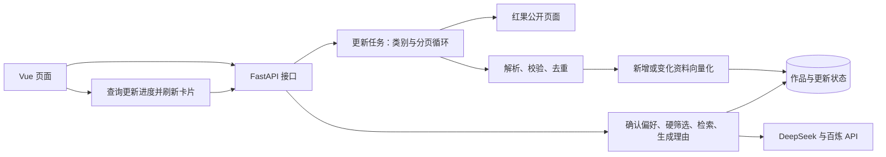

# 奇维 Kiwi · AI 漫剧智能推荐系统技术方案

版本：v1.1 ｜ 日期：2026-10-22 ｜ 对应：[产品设计文档 v1.1](../产品设计文档.md)

本文在现有工程上补充分类翻页采集、增量更新和封面适配方案。上述扩展尚未实施，不能将设计视为已完成能力；现有功能和验证记录见 [实现与验收记录](实现与验收.md)。本次仅更新文档。

## 1. 项目定位与简历能力衔接

已核对当前最新版简历 `00_尹恒-实习简历-Python_Agent项目版_20260920.docx` 及简历连续性记录。求职方向为 Python 开发、大模型应用和 Agent 开发实习，当前有 Python、HTTP/JSON、FastAPI、DeepSeek API、LangChain、Embedding/RAG、Chroma 及 Vue/MySQL 项目基础。

本项目定位为**以真实作品资料为数据来源的 RAG 推荐应用**。采集模块负责持续补充数据，主要展示偏好结构化、硬条件筛选、向量检索、证据校验及接口联调能力。

| 简历中的基础 | 在本项目中的应用 | 本轮需要补充的学习 |
| --- | --- | --- |
| Python、JSON、异常处理和日志 | 请求页面、解析资料、遍历分页、去重与记录错误 | HTTPX 异步请求、HTMLParser、基础 asyncio 任务管理 |
| FastAPI、HTTP/JSON | 启动更新、查询进度、浏览作品、调用推荐接口 | Pydantic 白名单校验、任务状态和失败处理 |
| LangChain、DeepSeek、Embedding/RAG | 解析偏好、作品向量化、检索候选、生成有依据的理由 | 增量索引、三态硬条件、引用校验与评测 |
| Vue 与前后端分离经验 | 更新入口、类别选择、进度轮询、卡片和详情 | TypeScript 类型、响应式海报布局和交互测试 |
| MySQL 项目经验 | 理解作品主键、事务、条件查询与数据更新 | 现有 SQLAlchemy/SQLite；PostgreSQL/pgvector 作为额外实践 |

复用当前单个 FastAPI 服务、Vue 页面和数据库。SQLite 用于本地运行；保留已经建立的 PostgreSQL/pgvector 路径，不再增加一套 Chroma 存储。PostgreSQL 的 SQL 已有独立测试，Docker 与原生部署仍待验收，不能写成已有熟练经验。

本轮采用确定的 Python 流程，不引入分布式爬虫、Redis/Celery、多 Agent 编排或浏览器自动化框架。采集任务不会交给大模型自主决定 URL、翻页或删除数据。

## 2. 现状、目标与系统结构

| 范围 | 当前代码 | 本轮设计目标 |
| --- | --- | --- |
| 采集 | 真人剧分类首页、红果热播榜首页 | 四类内容可选，自动翻页，榜单可作为补充 |
| 更新 | 双页面成功后替换本次红果片单 | 按作品标识新增或更新，不因未抓到而删除 |
| 来源类型 | 真人剧、AI剧、漫剧、未标注 | 增加漫画及其独立标识、阅读链接和章节信息 |
| 任务 | 单进程后台任务、持久化状态、前端轮询 | 补充类别、页数、数量及覆盖范围统计 |
| 页面 | 真实竖版封面放入横版容器 | 竖版海报比例、合理卡片宽度和响应式列数 |
| 推荐 | 偏好确认、硬筛选、向量检索、引用校验 | 保留现有链路，验证扩大后的作品库 |



沿用现有技术栈：Python/FastAPI/Pydantic、HTTPX、SQLAlchemy/Alembic、Vue 3/Vite/TypeScript、LangChain、DeepSeek、百炼 text-embedding-v4（1024 维）。数据库访问沿用同步 SQLAlchemy 的短事务，不为本轮扩展重写整套异步数据库层。

## 3. 分类与翻页采集（待实现）

### 3.1 固定来源及类别

| 请求中的类别值 | 内容类型 | 后端固定入口 |
| --- | --- | --- |
| `real-drama` | 真人剧 | `https://hongguoduanju.com/category/real-drama` |
| `comic-drama` | 漫剧 | `https://hongguoduanju.com/category/comic-drama` |
| `ai-drama` | AI剧 | `https://hongguoduanju.com/category/ai-drama` |
| `comic` | 漫画 | `https://hongguoduanju.com/category/comic` |
| 榜单补充开关 | 红果热播榜 | `https://hongguoduanju.com/rank/hot-drama` |

建议默认勾选漫剧、AI剧，真人剧和漫画由用户选择；热播榜提供独立开关。前端只提交类别值和开关，由后端查表构建 URL，不接收任意目标网址。

“切换类别”是依次请求不同分类入口；“翻页”是根据页面提供的分页信息请求 `?page=2` 等后续页面，无需模拟鼠标点击。公开入口可从 [红果分类页](https://hongguoduanju.com/category/comic-drama) 核对。

### 3.2 页面读取与停止条件

1. 使用同一个 HTTPX `AsyncClient`，按“类别 → 页码”顺序请求，先采用串行采集，便于控制频率和定位错误。
2. 复用现有 HTMLParser，提取页面中的 JSON 和流式数据参数；仅解析数据，不执行网页脚本。将解析结果统一为“作品列表 + 当前页 + 总页数或下一页”。
3. 分类页和榜单分别进行字段适配，漫画单独核对标识和阅读链接，最后统一通过 `WorkInput` 校验。
4. 到达明确末页、页面明确表示没有后续数据，或达到本次采集上限时停止；然后处理下一个所选类别。
5. 无法识别结构、分页重复或后续页反复返回相同数据时标为异常，不能把解析失败当成正常末页。任何下一页地址均须校验同域名、允许路径及合法页码。

以下是**待实施的初始配置**，不代表实测吞吐量：

| 限制 | 初始值 |
| --- | --- |
| 每来源页数 | 默认最多 5 页，配置范围 1～20 页 |
| 全任务上限 | 最多 25 页、500 部去重作品，任一上限达到即停止扩充 |
| 请求频率 | 串行请求，页面之间至少间隔 0.5 秒 |
| 页面请求 | 单次 25 秒超时；临时网络或 5xx 故障最多重试 1 次；每页最多接收 8 MB |
| 时间预算 | 采集最多 300 秒、索引最多 600 秒，整个更新最多 900 秒；各阶段同时受剩余总预算限制 |

遇到访问拒绝或需要登录的页面时停止并返回原因；源站限流按响应提示处理，超过重试或总预算即失败。每次从第一页更新限定范围；本轮不设计断点续采，扩充更深页面通过调整采集范围和上限完成。

## 4. 资料、去重与增量入库（待扩展）

### 4.1 数据结构

沿用 `works` 主表，一部作品对应一条检索记录。保留名称、原始简介、摘要、标签、封面、来源、采集日期、证据、审核状态及向量元数据。

- `source_meta.content_type` 增加“漫画”；内容类别与题材 `genres` 分开保存。
- `source_meta` 保存来源类别、页面集合、排名/热度，以及来源实际提供的集数或章节数。解除当前来源页面最多 2 条的限制，改为与采集上限一致的约束。
- 剧集沿用 `hongguo-<series_id>`；漫画采用 `hongguo-comic-<源站标识>`，避免不同标识体系碰撞。例如源站漫画使用 `/comic/<id>` 阅读地址，不能拼成剧集详情链接，见 [来源示例](https://hongguoduanju.com/comic/7111943588446997534)。
- 分类入口提供明确类型时优先于榜单的缺失标签；来源分类冲突时保留来源记录并提示待核对，不靠标题或封面猜测。
- 同一作品出现在不同页或榜单时按来源标识合并来源信息；名称相同但标识不同不自动合并，保留记录并提示待核对。调整现有导入器“不同 ID 同名即拒绝整批”的规则，允许漫画与剧集等同名条目并存。

优先扩展现有 JSON、Pydantic 和 TypeScript 定义。若后续新增实体列，用新的 Alembic 版本升级，并验证已有 SQLite 数据；不改写已执行的历史迁移。

### 4.2 更新与向量复用

流程为：`采集本批资料 → 字段及证据校验 → 按标识合并 → 比较已有记录 → 必要时生成向量 → 一次事务提交`。

| 记录情况 | 处理方式 |
| --- | --- |
| 新作品 | 新增资料；配置向量服务时创建向量 |
| 标题、简介、摘要或检索标签改变 | 重新形成检索文本并生成向量 |
| 仅封面、热度、排名、日期或来源页面改变 | 更新元数据，复用有效向量 |
| 记录及有效向量均未变化 | 跳过并计入未变化数量 |
| 模型版本不匹配或缺少向量 | 补齐对应模型、维度的向量 |

沿用 `content_hash` 判断记录变化，并比较 `search_text`、模型和维度决定是否重建向量，不因采集日期变化重复调用模型。Embedding 沿用每批 8 条；调用前关闭资料读取会话，网络请求期间不持有写事务。向量数量、维度及数值均通过校验后，使用 SQLAlchemy 事务统一写入，异常时回滚本批更新。

**必须替换当前快照删除逻辑**：现有 `replace_hongguo=True` 会删除本次未出现的红果作品，不能直接用于多类别、有限页数采集。扩展后采用按 ID 新增或更新，未选择的类别、未遍历的页面及榜单外作品保持原状。本轮不自动判定下架；需要移除时另行核对来源。

单页失败、字段校验或向量化失败时，本批不发布，原库仍可浏览。正常达到数量或页数上限的批次可以发布，但必须标记“限定范围更新”，不能显示已同步全部作品。

摘要取来源简介的有限长度，标签优先进行可追溯的规则映射。后宫、虐心、节奏等未说明的特征保持 `null`，不在每次采集时额外调用大模型猜测。保留原文和标签证据。

当前 `approved` 包含用户允许用于开发验证的资料，详情须保留“待人工复核”说明，不等于正式人工审核。采集不能把人工拒绝记录自动改为通过；正式审核界面不在本轮范围。缺少模型密钥时仍可采集浏览，但未索引数据不得冒充具备语义检索能力。

## 5. 更新任务与接口（待扩展）

### 5.1 单进程后台任务

复用 `CatalogManager`：启动接口先登记运行状态，再使用 `asyncio.create_task()` 执行采集；管理器保留任务引用并在应用关闭时处理取消。单进程内用一把锁保护启动检查，运行中请求复用当前任务，结束后保留 30 秒冷却。当前阶段明确使用一个 Uvicorn worker。

更新状态继续保存在 `catalog_refresh.payload`，增加 `run_id`、本次范围、阶段、类别、当前页、完成页数、原始条数、去重条数及结果统计。前端每 2 秒查询一次，终态停止；刷新页面时先读取状态。服务重启将遗留运行状态标为中断，保留最近成功时间；不会自动恢复未完成采集。

主状态沿用 `idle / running / succeeded / failed`；成功结果另设 `coverage=complete|limited`，分别表示所选来源已到末页、或正常达到上限。失败返回明确原因，新增/更新发布数量为 0。统计区分“已读取”“已入库”和“可参与推荐”，不以抓取条数替代成功数量。

### 5.2 接口约定

| 接口 | 本轮变化 |
| --- | --- |
| `POST /api/v1/catalog/refresh` | 增加类别和榜单开关，Pydantic 白名单校验；有效启动返回 202；运行中复用任务并返回其真实范围 |
| `GET /api/v1/catalog/refresh` | 返回阶段、范围、计数、覆盖程度、最近成功时间和错误 |
| `GET /api/v1/works` | 保留分页、题材筛选，增加 `content_type` 类别筛选；每页最多 50 条 |
| `GET /api/v1/works/{id}` | 展示现有资料及扩充的来源元数据 |
| 偏好解析、推荐与健康检查 | 保留现有接口；健康检查继续核对配置、资料和有效向量 |

以下是**待实现的更新请求示例**，不是当前接口已支持的参数：

```json
{
  "categories": ["comic-drama", "ai-drama"],
  "include_hot_rank": false
}
```

类别必须至少选择一项，或明确启用榜单；不传任意 URL、数据库语句或无限页数。页数、频率、数量和时间上限由后端配置控制。前端收到复用任务或冷却结果时显示该任务实际范围，不能显示成刚提交的新范围。

## 6. Vue 页面与海报适配（待实现）

- 保留首页右上角“更新漫剧库”。点击后用简单弹窗选择类别及榜单补充，确认后启动；更新期间禁用重复提交，显示当前类别、页数和阶段。
- 成功后重新请求作品和健康状态，清除依赖旧作品版本的推荐结果、预览和详情；失败保留现有卡片与用户偏好。进度网络请求失败时保留任务信息，允许重试查询，而非重复启动任务。
- 片库新增“全部 / 真人剧 / 漫剧 / AI剧 / 漫画”筛选，与现有题材筛选分别处理；选择或切页时取消旧请求，防止迟到结果覆盖。扩大作品库后使用服务端分页，更新总数与当前页，不一次加载全部作品。
- 收藏页按本机保存的作品 ID 分批加载资料，可复用详情接口；不再从片库当前页中过滤收藏。失效 ID 单独提示，收藏计数不随片库翻页变化。
- `WorkCard.vue` 的封面区改为 `aspect-ratio: 2 / 3`，图片铺满容器并用 `object-fit: cover` 保持比例，必要时小幅裁切；移除当前横版区域配合 `contain` 产生的大面积侧边色块。图片失败时使用同尺寸占位图。
- 卡片宽度以约 200～280px 为桌面起点，网格按容器宽度调整列数；推荐最多三张时保持合理宽度，不将单张拉宽铺满屏幕。窄屏减少列数，标题最多两行、摘要约三行，完整资料放入详情。
- 发现页、片库和收藏页复用同一组件。现有模拟视频预览继续明确标识；漫画不提供“剧集播放”入口，可显示阅读资料预览。保留键盘操作、减少动态效果、详情正文滚动、Esc 和空白处关闭。

## 7. 保留的 RAG 流程与工程约束

`用户描述 → DeepSeek 解析 → Pydantic 校验 → 用户确认/修改 → SQL 硬筛选 → 语义检索 → 排序与去重 → 生成并校验引用 → 最多 3 部`。

偏好结构继续区分软偏好、必须条件和明确排除项，例如：

```json
{
  "schema_version": 1,
  "soft_preferences": {"genres": ["修仙"], "themes": ["逆袭"], "pace": null},
  "required": [],
  "excluded_features": ["harem"],
  "excluded_genres": [],
  "unresolved_constraints": [],
  "conflicts": []
}
```

- 编辑后的偏好直接执行；新输入不继承旧偏好。冲突和未支持的硬条件要求用户调整。
- “不要后宫”使用 `harem IS FALSE`，同时排除 `true` 和 `null`。模型不生成 SQL；程序用字段白名单和参数绑定构建查询。
- SQLite 在 SQL 硬筛选后以 Python 计算余弦相似度；PostgreSQL 使用 pgvector。沿用最多 10 候选、软偏好排序和稳定去重，最终不足 3 部时按实际返回。
- 内容类别筛选先用于作品浏览，不静默改写推荐偏好协议。未来若允许限定推荐类别，应另加明确的界面选项与服务端校验。
- 模型只解释已选作品，名称和链接由数据库填充；校验作品 ID、证据 ID 和逐字引用。理由失败时可返回明确标识的证据模板，解析或向量失败不切换虚构作品。
- 推荐请求沿用 45 秒总预算，与后台更新预算分开。API Key 仅由后端读取；日志记录请求/任务标识、阶段耗时、数量和错误类型，不记录密钥。
- 本地依旧采用 SQLite；PostgreSQL/pgvector 和 Docker Compose 沿用现有工程配置，部署验收不作为本轮采集扩展的前提。LangSmith 保留为按需学习项，当前以已有结构化日志为验收证据。

## 8. 实施顺序与验收

| 顺序 | 主要修改位置 | 完成依据 |
| --- | --- | --- |
| 1. 分类和页面解析 | `crawler.py`、`schemas.py`、采集测试 | 四种类别样例、至少两页、末页和异常可区分；漫画标识及链接正确 |
| 2. 安全增量更新 | `importer.py`、数据层与入库测试 | 停用未出现即删除的逻辑；重复采集无重复记录，变化资料更新，元数据变化复用向量 |
| 3. 任务和接口 | `catalog.py`、`main.py`、配置及 API 测试 | 类别选择、计数、上限、中断和失败保留；运行中无重复任务 |
| 4. 页面和卡片 | `App.vue`、`WorkCard.vue`、`style.css`、TypeScript 类型 | 选择范围、服务端分页、2:3 海报和统一详情交互可用 |
| 5. 新库推荐验证 | 现有推荐测试、评测数据与验收记录 | 新作品可检索，硬条件不放宽，引用有效；数量和效果以实测为准 |

自动测试使用固定页面样例与 HTTPX 模拟响应，不依赖实时网页和付费模型。覆盖跨类别/分页/榜单去重、漫画与剧集同名不同 ID 并存、重复页、缺字段、超时、限流、非法来源、数量上限、任务复用、批次失败回滚，以及未抓到的旧作品仍保留。Vue 测试覆盖轮询恢复、类别和分页切换、收藏跨页保留、迟到响应、失败重试与封面回退。

随后小范围执行真实来源采集和模型入库验收，记录所选类别、页数、原始数、去重数、新增/更新/跳过数、索引数量、覆盖程度、耗时及可获得的调用量。桌面约 1440px 和手机约 390px 检查无封面侧边空白、拉伸、内容溢出或横向滚动。

旧 36 部对应的评测不能套用到新库。重新准备 20～30 条固定需求，先比较标签基线与语义检索，记录硬条件违规、无效引用、相关性及耗时；人工相关性标注完成前，不对外宣称准确率提升。

每次实施补充对应测试，运行现有 Node、pytest、Vue 和独立 PostgreSQL 检查，更新 [README](../README.md) 与验收记录并创建 Git commit。测试通过与真实部署验收分别表述。

## 9. 简历表述与参考

完成对应实现和验证后，可围绕以下内容组织简历：Python/FastAPI 实现作品采集更新接口；按类别分页采集、标识去重和增量索引；结合 LangChain、结构化硬条件与向量检索完成可追溯推荐；通过接口、事务和页面测试验证异常处理。

当前尚不能写“已实现四类自动翻页”“全量抓取红果作品库”“分布式高并发采集”或未经评测的效果提升。先能解释分页停止、去重主键、更新事务、向量复用、未知条件处理和失败恢复，再把实测数据写入简历。本轮不修改简历文件，也不提前填写成果数字。

实现时按项目锁定版本查阅官方资料：

- [HTTPX 异步客户端](https://www.python-httpx.org/async/)、[Python 3.13 asyncio 任务与取消](https://docs.python.org/3.13/library/asyncio-task.html)
- [Pydantic 数据模型校验](https://docs.pydantic.dev/latest/concepts/models/)、[SQLAlchemy 2.0 事务管理](https://docs.sqlalchemy.org/en/20/orm/session_transaction.html)
- [CSS 海报比例](https://developer.mozilla.org/en-US/docs/Web/CSS/aspect-ratio)、[图片适配方式](https://developer.mozilla.org/en-US/docs/Web/CSS/object-fit)
- [LangChain 模型与结构化输出](https://docs.langchain.com/oss/python/langchain/models#structured-output)、[pgvector](https://github.com/pgvector/pgvector)、[百炼 text-embedding-v4](https://help.aliyun.com/zh/model-studio/text-embedding-v4)
