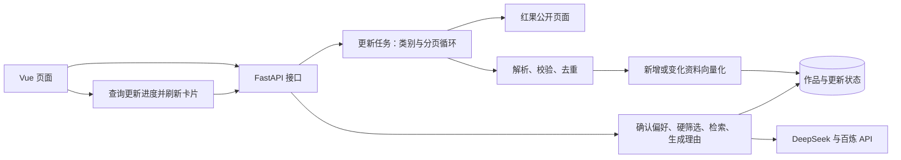

# 奇维 Kiwi · AI 漫剧智能推荐系统技术方案

版本：v3.6 ｜ 日期：2026-10-28 ｜ 对应：[产品设计文档 v2.16](../产品设计文档.md)

产品设计 3.11 的“推荐反馈＋换一批”已按第 14 节完成接口、0007 迁移、页面、规则与本地功能验证；3.12 的“历史片单”已按第 15 节实现服务端快照、0009 迁移、分页、删除及显式沿用偏好。本节文档补齐页面状态、接口示例、异常语义与验收对应，实际范围和部署边界见实现与验收记录。

第 16 节为已实现的“连续调整推荐”：增量操作理解、受控语义校验、差异核对、成功后提交基准、失败保留和账号隔离。沿用 0009，不新增数据库结构；本地回归、浏览器及有限真实 DeepSeek 样例见 16.11，文档检查不替代功能验收。

第 1～9 节记录采集、推荐和页面方案；第 10 节基础账号、第 11 节收藏驱动轮播与提示词均已实施并验证。第 12 节已完成媒体导入、接口、迁移、全库补齐和更新新增作品自动准备；Nginx 配置已补充，部署仍待实测。第 13 节个人空间的接口、迁移、页面及本地功能验证已完成，部署仍待验收。首页收藏标签推荐不增加模型调用或画像存储，权重尚未经人工效果评测；真实片段使用独立媒体与任务表、Node Playwright 和 FFmpeg/ffprobe。实际验证见 [实现与验收记录](实现与验收.md)。

## 1. 项目定位与简历能力衔接

已核对当前最新版简历 `00_尹恒-实习简历-Python_Agent项目版_20260920.docx` 及简历连续性记录。求职方向为 Python 开发、大模型应用和 Agent 开发实习，当前有 Python、HTTP/JSON、FastAPI、DeepSeek API、LangChain、Embedding/RAG、Chroma 及 Vue/MySQL 项目基础。

本项目定位为**以真实作品资料为数据来源的 RAG 推荐应用**。采集模块负责持续补充数据，主要展示偏好结构化、硬条件筛选、向量检索、证据校验及接口联调能力。

| 简历中的基础 | 在本项目中的应用 | 本轮需要补充的学习 |
| --- | --- | --- |
| Python、JSON、异常处理和日志 | 请求页面、解析资料、遍历分页、去重与记录错误 | HTTPX 异步请求、HTMLParser、基础 asyncio 任务管理 |
| FastAPI、HTTP/JSON | 启动更新、查询进度、浏览作品、调用推荐接口 | Pydantic 白名单校验、任务状态和失败处理 |
| LangChain、DeepSeek、Embedding/RAG | 解析偏好、作品向量化、检索候选、生成有依据的理由 | 增量索引、三态硬条件、引用校验与评测 |
| Vue 与前后端分离经验 | 更新入口、类别选择、进度轮询、卡片和详情 | TypeScript 类型、响应式海报布局和交互测试 |
| MySQL 项目经验 | 理解作品主键、事务、条件查询与数据更新 | 现有 SQLAlchemy/SQLite；PostgreSQL/pgvector 作为额外实践 |

复用当前单个 FastAPI 服务、Vue 页面和数据库。SQLite 用于本地运行；保留已经建立的 PostgreSQL/pgvector 路径，不再增加一套 Chroma 存储。PostgreSQL 的 SQL 已有独立测试，Docker 与原生部署仍待验收，不能写成已有熟练经验。

本轮采用确定的 Python 流程，不引入分布式爬虫、Redis/Celery、多 Agent 编排或浏览器自动化框架。采集任务不会交给大模型自主决定 URL、翻页或删除数据。

## 2. 现状、目标与系统结构

| 范围 | 扩展前 | 本轮已实现 |
| --- | --- | --- |
| 采集 | 真人剧分类首页、红果热播榜首页 | 四类内容可选，自动翻页，榜单可作为补充 |
| 更新 | 双页面成功后替换本次红果片单 | 按作品标识新增或更新，不因未抓到而删除 |
| 来源类型 | 真人剧、AI剧、漫剧、未标注 | 增加漫画及其独立标识、阅读链接和章节信息 |
| 任务 | 单进程后台任务、持久化状态、前端轮询 | 补充类别、页数、数量及覆盖范围统计 |
| 页面 | 真实竖版封面放入横版容器 | 竖版海报比例、合理卡片宽度和响应式列数 |
| 推荐 | 偏好确认、硬筛选、向量检索、引用校验 | 保留现有链路，验证扩大后的作品库 |



沿用现有技术栈：Python/FastAPI/Pydantic、HTTPX、SQLAlchemy/Alembic、Vue 3/Vite/TypeScript、LangChain、DeepSeek、百炼 text-embedding-v4（1024 维）。数据库访问沿用同步 SQLAlchemy 的短事务，不为本轮扩展重写整套异步数据库层。

## 3. 分类与翻页采集

### 3.1 固定来源及类别

| 请求中的类别值 | 内容类型 | 后端固定入口 |
| --- | --- | --- |
| `real-drama` | 真人剧 | `https://hongguoduanju.com/category/real-drama` |
| `comic-drama` | 漫剧 | `https://hongguoduanju.com/category/comic-drama` |
| `ai-drama` | AI剧 | `https://hongguoduanju.com/category/ai-drama` |
| `comic` | 漫画 | `https://hongguoduanju.com/category/comic` |
| 榜单补充开关 | 红果热播榜 | `https://hongguoduanju.com/rank/hot-drama` |

建议默认勾选漫剧、AI剧，真人剧和漫画由用户选择；热播榜提供独立开关。前端只提交类别值和开关，由后端查表构建 URL，不接收任意目标网址。

“切换类别”是依次请求不同分类入口；“翻页”是根据页面提供的分页信息请求 `?page=2` 等后续页面，无需模拟鼠标点击。公开入口可从 [红果分类页](https://hongguoduanju.com/category/comic-drama) 核对。

### 3.2 页面读取与停止条件

1. 使用同一个 HTTPX `AsyncClient`，按“类别 → 页码”顺序请求，先采用串行采集，便于控制频率和定位错误。
2. 复用现有 HTMLParser，提取页面中的 JSON 和流式数据参数；仅解析数据，不执行网页脚本。将解析结果统一为“作品列表 + 当前页 + 总页数或下一页”。
3. 分类页和榜单分别进行字段适配，漫画单独核对标识和阅读链接，最后统一通过 `WorkInput` 校验。
4. 到达明确末页、页面明确表示没有后续数据，或达到本次采集上限时停止；然后处理下一个所选类别。
5. 无法识别结构、分页重复或后续页反复返回相同数据时标为异常，不能把解析失败当成正常末页。任何下一页地址均须校验同域名、允许路径及合法页码。

以下配置已落地于 `Settings` 和 `.env.example`，不代表实测吞吐量：

| 限制 | 初始值 |
| --- | --- |
| 每来源页数 | 默认最多 5 页，配置范围 1～20 页 |
| 全任务上限 | 最多 25 页、500 部去重作品，任一上限达到即停止扩充 |
| 请求频率 | 串行请求，页面之间至少间隔 0.5 秒 |
| 页面请求 | 单次 25 秒超时；临时网络或 5xx 故障最多重试 1 次；每页最多接收 8 MB |
| 时间预算 | 采集最多 300 秒、索引最多 600 秒，整个更新最多 900 秒；各阶段同时受剩余总预算限制 |

遇到访问拒绝或需要登录的页面时停止并返回原因；源站限流按响应提示处理，超过重试或总预算即失败。每次从第一页更新限定范围；本轮不设计断点续采，扩充更深页面通过调整采集范围和上限完成。

## 4. 资料、去重与增量入库

### 4.1 数据结构

沿用 `works` 主表，一部作品对应一条检索记录。保留名称、原始简介、摘要、标签、封面、来源、采集日期、证据、审核状态及向量元数据。

- `source_meta.content_type` 增加“漫画”；内容类别与题材 `genres` 分开保存。
- `source_meta` 保存来源类别、页面集合、排名/热度，以及来源实际提供的集数或章节数。单批最多 25 页；跨批合并的历史来源集合最多保留 100 个页面地址，避免元数据无限增长。
- 剧集沿用 `hongguo-<series_id>`；漫画采用 `hongguo-comic-<源站标识>`，避免不同标识体系碰撞。例如源站漫画使用 `/comic/<id>` 阅读地址，不能拼成剧集详情链接，见 [来源示例](https://hongguoduanju.com/comic/7111943588446997534)。
- 分类入口提供明确类型时优先于榜单的缺失标签；来源分类冲突时保留来源记录并提示待核对，不靠标题或封面猜测。
- 本批来源合并后只保留四种明确内容类型，未分类记录在 `collect_hongguo` 清洗结束时剔除；来源同步导入器再次校验类型，避免未分类记录参与向量化。统计 `discovered_count`（去重发现数）、`unique_count`（清洗后数）和 `filtered_unclassified`（剔除数）。同批明确分类可补全榜单类型，只有题材标签不能推断内容类型。
- 同一作品出现在不同页或榜单时按来源标识合并来源信息；名称相同但标识不同不自动合并，保留记录并提示待核对。调整现有导入器“不同 ID 同名即拒绝整批”的规则，允许漫画与剧集等同名条目并存。

优先扩展现有 JSON、Pydantic 和 TypeScript 定义。若后续新增实体列，用新的 Alembic 版本升级，并验证已有 SQLite 数据；不改写已执行的历史迁移。

### 4.2 更新与向量复用

流程为：`采集本批资料 → 字段及证据校验 → 按标识合并 → 比较已有记录 → 必要时生成向量 → 一次事务提交`。

| 记录情况 | 处理方式 |
| --- | --- |
| 新作品 | 新增资料；配置向量服务时创建向量 |
| 标题、简介、摘要或检索标签改变 | 重新形成检索文本并生成向量 |
| 仅封面、热度、排名、日期或来源页面改变 | 更新元数据，复用有效向量 |
| 记录及有效向量均未变化 | 跳过并计入未变化数量 |
| 模型版本不匹配或缺少向量 | 补齐对应模型、维度的向量 |

沿用 `content_hash` 判断记录变化，并比较 `search_text`、模型和维度决定是否重建向量，不因采集日期变化重复调用模型。Embedding 沿用每批 8 条；调用前关闭资料读取会话，网络请求期间不持有写事务。向量数量、维度及数值均通过校验后，使用 SQLAlchemy 事务统一写入，异常时回滚本批更新。

**已移除快照删除逻辑**：`source_sync=True` 只按 ID 新增或更新，未选择的类别、未遍历的页面及榜单外作品保持原状。本轮不自动判定下架；需要移除时另行核对来源。

单页失败、字段校验或向量化失败时，本批不发布，原库仍可浏览。正常达到数量或页数上限的批次可以发布，但必须标记“限定范围更新”，不能显示已同步全部作品。

摘要取来源简介的有限长度，标签优先进行可追溯的规则映射。后宫、虐心、节奏等未说明的特征保持 `null`，不在每次采集时额外调用大模型猜测。保留原文和标签证据。

当前 `approved` 包含用户允许用于开发验证的资料，详情须保留“待人工复核”说明，不等于正式人工审核。采集不能把人工拒绝记录自动改为通过；正式审核界面不在本轮范围。缺少模型密钥时仍可采集浏览，但未索引数据不得冒充具备语义检索能力。

## 5. 更新任务与接口

### 5.1 单进程后台任务

复用 `CatalogManager`：启动接口先登记运行状态，再使用 `asyncio.create_task()` 执行采集；管理器保留任务引用并在应用关闭时处理取消。单进程内用一把锁保护启动检查，运行中请求复用当前任务，结束后保留 30 秒冷却。当前阶段明确使用一个 Uvicorn worker。

更新状态继续保存在 `catalog_refresh.payload`，增加 `run_id`、本次范围、阶段、类别、当前页、完成页数、原始条数、去重条数及结果统计。前端每 2 秒查询一次，终态停止；刷新页面时先读取状态。服务重启将遗留运行状态标为中断，保留最近成功时间；不会自动恢复未完成采集。

主状态沿用 `idle / running / succeeded / failed`；成功结果另设 `coverage=complete|limited`，分别表示所选来源已到末页、或正常达到上限。失败返回明确原因，新增/更新发布数量为 0。统计区分“已读取”“已入库”和“可参与推荐”，不以抓取条数替代成功数量。

### 5.2 接口约定

| 接口 | 本轮变化 |
| --- | --- |
| `POST /api/v1/catalog/refresh` | 增加类别和榜单开关，Pydantic 白名单校验；有效启动返回 202；运行中复用任务并返回其真实范围 |
| `GET /api/v1/catalog/refresh` | 返回阶段、范围、计数、覆盖程度、最近成功时间和错误 |
| `GET /api/v1/works` | 分页、题材、`content_type` 类别与 `q` 剧名包含匹配；`q` 最长 100 字符，每页最多 50 条 |
| `GET /api/v1/works/{id}` | 展示现有资料及扩充的来源元数据 |
| 偏好解析、推荐与健康检查 | 保留现有接口；健康检查继续核对配置、资料和有效向量 |

更新接口已支持以下请求，类别由 Pydantic 白名单校验：

```json
{
  "categories": ["comic-drama", "ai-drama"],
  "include_hot_rank": false
}
```

类别必须至少选择一项，或明确启用榜单；不传任意 URL、数据库语句或无限页数。页数、频率、数量和时间上限由后端配置控制。前端收到复用任务或冷却结果时显示该任务实际范围，不能显示成刚提交的新范围。

## 6. Vue 页面与海报适配

- “更新漫剧库”、最近更新、详细统计及账号区移到桌面左侧栏底部；删除主内容区重复的顶部工具栏。头像使用预设 SVG，账号区可进入第 13 节已实现的个人空间；手机将工具区排在导航下方，避免遮挡正文。点击更新后用简单弹窗选择类别及榜单补充，确认后启动；更新期间禁用重复提交，显示当前类别、页数和阶段。
- 成功后重新请求作品和健康状态，清除依赖旧作品版本的推荐结果、预览和详情；失败保留现有卡片与用户偏好。进度网络请求失败时保留任务信息，允许重试查询，而非重复启动任务。
- 片库提供“全部 / 真人剧 / 漫剧 / AI剧 / 漫画”筛选，不再展示未标注项；与题材分别处理，选择或切页取消旧请求，防止迟到结果覆盖。片库使用服务端分页，不一次加载全部作品。
- 收藏页按第 10 节的服务端账号接口分页，失效 ID 单独提示，收藏计数不随片库翻页变化。
- 片库标题旁的搜索框由 `useCatalog.ts` 管理输入与已提交关键词；300ms 防抖、回车立即提交、查询变化重置页码。输入变化立即取消旧请求并拒绝迟到响应；首页轮播不带搜索条件。`q` 与类别、题材条件共同在 SQL 内执行，使用参数化 `icontains(..., autoescape=True)`，百分号和下划线按字面处理，大小写统一匹配；过滤后再计数和分页。
- `CatalogPagination.vue` 复用片库与收藏页，显示首尾页和当前页邻域，空缺用无操作的省略号表示；`TransitionGroup` 提供数字移动过渡，当前页带 `aria-current`，请求中禁止重复翻页。窄屏保留紧凑数字，减少动态效果设置遵循现有全局规则。
- `WorkCard.vue` 的封面区改为 `aspect-ratio: 2 / 3`，图片铺满容器并用 `object-fit: cover` 保持比例，必要时小幅裁切；移除当前横版区域配合 `contain` 产生的大面积侧边色块。图片失败时使用同尺寸占位图。
- 片库与收藏保持每页 12 部，`.catalog-section` 使用容器查询，根据可用内容宽度选择 1、2、3、4、6 列，完整页的各行排满，避免宽屏 7 列加第二行 5 张的留白。真实末页和少量搜索结果按实际数量显示，不拉伸末行卡片或补虚构数据。标题最多两行、摘要约三行，完整资料放入详情；主动生成的片单保留独立网格。
- 发现页、片库和收藏页复用 `WorkPreview.vue`，浮层只展示媒体与播放／关闭控件，收藏和详情留在原卡片。`previewPosition.ts` 优先右侧、其次左侧，空间有限时收窄，两侧都不足 240px 时通过 Teleport 在原卡片末尾内嵌展开；内嵌模式不用 Popover，避免脱离文档流后覆盖资料。左右浮层与原卡片保持 12px 间距，竖向约束在视口内；布局模式因窗口变化改变时关闭旧预览，等待重新触发。
- 保留 260ms 悬停与 180ms 离开保护，进入浮层不关闭；关闭后抑制指针下方刚露出的卡片自动重开。原卡片被移除时停止并卸载媒体；切卡后的旧播放拒绝与媒体事件不能改写新预览。手动播放按钮消失后将焦点转到稳定的播放／暂停控件，避免焦点变化误触发关闭。正式页面按作品 ID 获取真实片段状态，缺失时不回退模拟视频；漫画预览框仅显示“漫画暂不支持预览”。实现见第 12 节。

首页 `FeaturedCarousel.vue` 复用发现页一次请求的前六条资料，不再将其中前三条展示成默认卡片。轮播从有封面且明确为剧集的条目选择最多六部，使用 Vue 状态及定时器，不引入轮播框架或模型调用。海报容器为 2:3，图片采用 `contain`；手机缩小海报并限制标题行数、保持轮播高度稳定。保留定时切换、前后翻页与键盘操作，移除手动暂停按钮；悬停、焦点、后台、弹窗及减少动态效果保护继续有效，卸载时清理定时器和监听。

口味推荐区使用 `composer.css`：桌面接近等宽双列，超宽屏输入列最多 680px，偏好核对区使用浅绿色独立卡片；700px 以下为单列。`PreferenceSummary.vue` 复用真实偏好分组，分别显示软偏好、必须条件与明确排除；增大标题、标签与主按钮，避免偏好区过窄或低对比。

`App.vue` 用 `requestKind='parse'|'recommend'` 区分识别与生成。解析进行中只显示识别进度，不渲染作品骨架；成功后通过同一请求代次检查和 `nextTick` 打开原生 `recognition-dialog`，展示真实偏好及“核对无误，生成片单／手动调整偏好”。关闭与 Esc 不提交请求，调整入口先关闭识别弹窗再打开既有编辑器；冲突或暂不支持的条件在处理前禁止生成，Ctrl+Enter 同样执行检查。下方保留虚线框并改为等待确认说明，可再次打开核对弹窗；只有确认生成才出现作品骨架。首次显示仍为三步指引，生成成功只渲染 `result.items`，空结果和请求失败保留对应原因及重试，不回退片库卡片。

修改输入或选择提示词时关闭旧提示、取消旧请求并恢复初始状态；修改偏好后进入待确认状态。识别完成后若已离开发现页或请求过期，不弹出提示；重新进入可查看已确认过的页面状态。保留原有偏好解析与推荐接口、用户单独确认及请求序号保护，不新增模型调用。原问号和使用指引弹窗仍已移除，轮播加载错误保留独立重试；首页轮播按第 11 节使用当前账号收藏或公开回退，不恢复默认卡片区。

详情完全移除“判断与推荐依据”、额外引文和定位按钮，删除 `detailEvidence`、`revealDetailReference`、展开状态复位和对应专用样式。共用 `App.vue` 详情保留 `detailIntro`、`detailTags`、明确剧情事实、`detailReason`、资料／片段来源和收藏。`detailReason` 沿用模板“简介摘录”去重及纯复制理由隐藏，正常推荐说明保留。后台原始证据、理由引用校验与历史快照不变，不新增模型调用或数据库迁移。更新成功统计默认折叠，运行和失败信息保持直接可见。

## 7. 保留的 RAG 流程与工程约束

`用户描述 → DeepSeek 解析 → Pydantic 校验 → 用户确认/修改 → SQL 硬筛选 → 语义检索 → 排序与去重 → 生成并校验引用 → 最多 3 部`。

偏好结构继续区分软偏好、必须条件和明确排除项，例如：

```json
{
  "schema_version": 1,
  "soft_preferences": {"genres": ["修仙"], "themes": ["逆袭"], "pace": null},
  "required": [],
  "excluded_features": ["harem"],
  "excluded_genres": [],
  "unresolved_constraints": [],
  "conflicts": []
}
```

- 编辑后的偏好直接执行；新输入不继承旧偏好。冲突和未支持的硬条件要求用户调整。
- “不要后宫”使用 `harem IS FALSE`，同时排除 `true` 和 `null`。模型不生成 SQL；程序用字段白名单和参数绑定构建查询。
- SQLite 在 SQL 硬筛选后以 Python 计算余弦相似度；PostgreSQL 使用 pgvector。按第 14 节在 SQL 中先过滤反馈和本轮记录，再按稳定顺序分窗口补取候选，最终不足 3 部时按实际返回。
- 内容类别筛选先用于作品浏览，不静默改写推荐偏好协议。未来若允许限定推荐类别，应另加明确的界面选项与服务端校验。
- 模型只解释已选作品，名称和链接由数据库填充；校验作品 ID、证据 ID 和逐字引用。理由失败时可返回明确标识的证据模板，解析或向量失败不切换虚构作品。
- 推荐请求沿用 45 秒总预算，与后台更新预算分开。API Key 仅由后端读取；日志记录请求/任务标识、阶段耗时、数量和错误类型，不记录密钥。
- 本地依旧采用 SQLite；PostgreSQL/pgvector 和 Docker Compose 沿用现有工程配置，部署验收不作为本轮采集扩展的前提。LangSmith 保留为按需学习项，当前以已有结构化日志为验收证据。

## 8. 实施顺序与验收

| 顺序 | 主要修改位置 | 完成依据 |
| --- | --- | --- |
| 1. 分类和页面解析 | `crawler.py`、`schemas.py`、采集测试 | 四种类别样例、至少两页、末页和异常可区分；漫画标识及链接正确 |
| 2. 安全增量更新 | `importer.py`、数据层与入库测试 | 停用未出现即删除的逻辑；重复采集无重复记录，变化资料更新，元数据变化复用向量 |
| 3. 任务和接口 | `catalog.py`、`main.py`、配置及 API 测试 | 类别选择、计数、上限、中断和失败保留；运行中无重复任务 |
| 4. 页面和卡片 | `App.vue`、`WorkCard.vue`、`style.css`、TypeScript 类型 | 选择范围、服务端分页、2:3 海报和统一详情交互可用 |
| 5. 新库推荐验证 | 现有推荐测试、评测数据与验收记录 | 新作品可检索，硬条件不放宽，引用有效；数量和效果以实测为准 |

自动测试使用固定页面样例与 HTTPX 模拟响应，不依赖实时网页和付费模型。覆盖跨类别/分页/榜单去重、漫画与剧集同名不同 ID 并存、重复页、缺字段、超时、限流、非法来源、数量上限、任务复用、批次失败回滚，以及未抓到的旧作品仍保留。Vue 测试覆盖轮询恢复、类别和分页切换、收藏跨页保留、迟到响应、失败重试与封面回退。

随后小范围执行真实来源采集和模型入库验收，记录所选类别、页数、原始数、去重数、新增/更新/跳过数、索引数量、覆盖程度、耗时及可获得的调用量。桌面约 1440px 和手机约 390px 检查无封面侧边空白、拉伸、内容溢出或横向滚动。

旧 36 部对应的评测不能套用到新库。本轮已准备 25 条固定需求，使用源站标签规则建立待复核参考，并比较标签基线与语义检索，记录硬条件违规、无效引用、参考匹配与耗时。评测读取同一当前库并核对检索内容指纹，变化后须复核参考。人工相关性标注完成前，不对外宣称准确率提升。

每次实施补充对应测试，运行现有 Node、pytest、Vue 和独立 PostgreSQL 检查，更新 [README](../README.md) 与验收记录并创建 Git commit。测试通过与真实部署验收分别表述。

## 9. 简历表述与参考

完成对应实现和验证后，可围绕以下内容组织简历：Python/FastAPI 实现作品采集更新接口；按类别分页采集、标识去重和增量索引；结合 LangChain、结构化硬条件与向量检索完成可追溯推荐；通过接口、事务和页面测试验证异常处理。

四类自动翻页已实现并验证限定范围，可在掌握实现后如实表述；不能写“全量抓取红果作品库”“分布式高并发采集”或未经评测的效果提升。先能解释分页停止、去重主键、更新事务、向量复用、未知条件处理和失败恢复，再把实测数据写入简历。本轮不修改简历文件。

实现时按项目锁定版本查阅官方资料：

- [HTTPX 异步客户端](https://www.python-httpx.org/async/)、[Python 3.13 asyncio 任务与取消](https://docs.python.org/3.13/library/asyncio-task.html)
- [Pydantic 数据模型校验](https://docs.pydantic.dev/latest/concepts/models/)、[SQLAlchemy 2.0 事务管理](https://docs.sqlalchemy.org/en/20/orm/session_transaction.html)
- [CSS 海报比例](https://developer.mozilla.org/en-US/docs/Web/CSS/aspect-ratio)、[图片适配方式](https://developer.mozilla.org/en-US/docs/Web/CSS/object-fit)
- [LangChain 模型与结构化输出](https://docs.langchain.com/oss/python/langchain/models#structured-output)、[pgvector](https://github.com/pgvector/pgvector)、[百炼 text-embedding-v4](https://help.aliyun.com/zh/model-studio/text-embedding-v4)

## 10. 基础账号与账号收藏技术方案（已实施）

### 10.1 范围与技术选择

对应产品设计 3.5，按“基础账号 → 账号收藏 → 本地收藏导入”实施；收藏风格推荐实现见第 11 节。游客继续浏览作品和主动生成片单；本轮不改变 RAG 的偏好确认、硬筛选和引用校验，不恢复已移除的首页默认卡片。

账号功能围绕本项目已有的接口、数据库和页面能力扩展；原设计阶段对齐的能力如下，本轮不修改简历：

| 已有基础 | 本阶段复用 | 需要补充掌握的内容 |
| --- | --- | --- |
| Python、FastAPI、HTTP/JSON | 请求校验、错误响应、依赖函数、模块拆分 | Cookie、服务端 Session、密码哈希和鉴权依赖 |
| Vue、前后端分离项目 | 登录弹窗、表单状态、fetch、收藏展示 | 登录恢复、账号切换隔离、迟到请求取消 |
| MySQL 项目与当前 SQLAlchemy 实践 | 用户与收藏关系、唯一约束、外键、短事务 | 账号归属校验、重复写入幂等、旧库升级验证 |

确定采用 **FastAPI + SQLAlchemy + 数据库 Session + HttpOnly Cookie**。浏览器只持有随机会话凭据，服务端按数据库会话查用户；退出时可直接删除该会话。复用 SQLite 本地运行及现有 PostgreSQL 路径，不迁回 MySQL，也不增加独立认证服务、Redis、OAuth2、JWT 双令牌或角色权限系统。账号是推荐应用的辅助模块，不让认证工程盖过 RAG 主线。

跨设备收藏恢复要求两台设备访问同一后端和数据库。当前 `127.0.0.1` 启动只用于本机验证，开发阶段用两套独立 Cookie 存储检查身份隔离；实际双设备及 HTTPS 验收随部署另行完成，本期不改变监听地址或发布服务。

已新增 Python 依赖 `pwdlib[argon2]`，在本项目 Python 3.13 环境安装并验证；`pwdlib==0.3.1`、`argon2-cffi==25.1.0` 及间接依赖已同步到 `backend/pyproject.toml` 与 `backend/requirements.lock`。密码哈希的选型参考 [FastAPI 密码哈希说明](https://fastapi.tiangolo.com/tutorial/security/oauth2-jwt/#password-hashing) 和 [pwdlib 官方指南](https://frankie567.github.io/pwdlib/guide/)，不照搬该教程中的 JWT 登录流程。

### 10.2 数据模型与升级

沿用一个业务数据库，增加三张表；不把账号、密码或收藏写入向量库。

以下字段均非空，字符串长度为最大长度，主键、唯一约束和外键由数据库实际执行。

| 表 | 字段与约束 | 用途 |
| --- | --- | --- |
| `users` | `id`：UUID 字符串主键；`username`：20 位显示名称；`username_key`：20 位、非空且唯一；`password_hash`：255 位字符串；`created_at`：UTC 时间 | 稳定用户身份及凭据 |
| `user_sessions` | `token_hash`：64 位字符串主键；`user_id`：用户外键及索引；`created_at`、`expires_at`：UTC 时间，过期时间索引 | 保存会话凭据的摘要，不存原始 Cookie 值 |
| `favorites` | `(user_id, work_id)`：联合主键，分别关联用户和作品；`created_at`：UTC 时间；增加 `(user_id, created_at, work_id)` 索引 | 同账号同作品只能收藏一次，支持稳定分页 |

- 用户名先去首尾空白，校验 `^[A-Za-z0-9_]{3,20}$`，再用小写得到 `username_key`；显示名称保留用户输入的大小写。注册与登录使用同一归一化函数。使用数据库唯一约束与 `INSERT ... ON CONFLICT (username_key) DO NOTHING RETURNING id`；未插入转换为 409，并发时仍只有一个账号。
- 密码按产品约定为 8～64 个字符，区分大小写、不 trim；Pydantic 是最终校验方，前端用 Unicode 字符计数保持一致。确认密码只用于注册一致性校验，不持久化。
- 外键采用删除级联；SQLite 的每个连接显式开启 `PRAGMA foreign_keys=ON`，并验证孤儿收藏无法写入。账号删除不在本期提供入口；真实下架判断仍不交给爬虫。
- 已新增 `backend/migrations/versions/0003_accounts.py`，不修改 0001/0002。PostgreSQL 启动前执行 Alembic 升级；本地 SQLite 沿用 `initialize()` 创建新增表，已有表不重建，检查与迁移脚本生成的约束一致。不对已有 SQLite 盲目 stamp 或重跑建库。
- SQLite 对时区的处理与 PostgreSQL 不同，统一经 UTC 读写辅助函数比较到期时间，覆盖从 SQLite 读取无时区时间的情况。
- 实施升级前备份本地数据库；测试新库和含旧作品、向量及更新状态的数据库。账号模块升级不触发重新采集、重新向量化或旧资料清理。回滚代码前先恢复匹配备份，降级只在一次性测试库验证，不用删除业务账号表作为日常回退方式。

### 10.3 密码与登录会话

注册流程：`校验输入 → 在事务外计算密码哈希 → 事务写入用户及新会话 → 提交成功后设置 Cookie`。用户与首个会话一起提交，失败不返回半成功登录状态。若提交成功后响应丢失，用户可直接登录，不把网络失败解释为账号必定未创建。

密码使用 `pwdlib` 的 Argon2id 实现，库负责随机盐和校验；采用 `PasswordHash.recommended()`，实测 Argon2id 参数为 `m=65536,t=3,p=4`，测量记录见验收文档。保存完整编码哈希，禁止以普通 SHA-256、可逆加密或明文保存密码；参数不能低于所选 [OWASP Argon2id 配置](https://cheatsheetseries.owasp.org/cheatsheets/Password_Storage_Cheat_Sheet.html#argon2id) 的要求。

登录流程：`归一化用户名 → 查用户 → 释放读会话 → 校验哈希 → 事务创建新会话 → 设置 Cookie`。未知用户名也校验预先准备的虚拟密码哈希，登录失败统一返回“用户名或密码不正确”，不在异常响应中回传输入值。耗时哈希在同步路由的工作线程执行，不阻塞 async 事件循环；并发限制见 10.5。

会话采用以下确定规则：

1. 使用 Python `secrets.token_urlsafe(32)` 生成会话凭据，数据库保存原始凭据的 SHA-256 摘要。这里 SHA-256 只处理高熵随机凭据，不处理用户密码。每次登录生成新凭据，不接收客户端指定的会话 ID。随机值生成使用 [Python secrets](https://docs.python.org/3.13/library/secrets.html#generating-tokens)。
2. 初始有效期设为 **7 天固定期限**，Cookie 的 `Max-Age` 与服务端到期时间一致；访问不会续期，不增加刷新令牌。浏览器刷新或服务重启后可恢复数据库中尚未到期的会话。
3. Cookie 名为 `kiwi_session`，设置 `HttpOnly`、`SameSite=Lax`、`Path=/`，省略 `Domain`；正式 HTTPS 环境必须 `Secure=true`。仅本机回环 HTTP 开发配置允许 `Secure=false`，两者由环境配置明确区分。使用 [FastAPI Response Cookie](https://fastapi.tiangolo.com/advanced/response-cookies/) 设置，属性含义见 [MDN Set-Cookie](https://developer.mozilla.org/en-US/docs/Web/HTTP/Reference/Headers/Set-Cookie)。
4. `get_current_user` 从 Cookie 摘要查会话并检查到期时间，再取用户；受保护接口只能使用该依赖得到的 `user.id`。随机伪造、已删除、已过期会话均不能访问收藏；数据库不可用返回 503，不能误判为正常退出。
5. 同账号不同设备各有独立会话；退出删除当前会话，再以相同 Cookie 名和路径清除浏览器凭据。重复退出仍成功。登录时撤销当前浏览器原有会话并换发，不影响其他设备；不提供“退出所有设备”。
6. 启动和登录时限频清理已过期会话，不在每次读请求写表；即使尚未物理清理，鉴权也必须拒绝过期记录。会话设计参考 [OWASP Session 管理](https://cheatsheetseries.owasp.org/cheatsheets/Session_Management_Cheat_Sheet.html)，7 天是本项目选定的初始产品参数，不是通用安全标准。

### 10.4 接口契约（已实现）

统一沿用 `/api/v1` 与已有 `error / request_id` 错误结构。以下接口均已实现；请求不接受 `user_id`、`password_hash` 等额外字段，Pydantic 设置 `extra='forbid'`。

| 方法与路径 | 输入及鉴权 | 成功结果 |
| --- | --- | --- |
| `POST /api/v1/auth/register` | 用户名、密码、确认密码；校验写请求来源 | 201，公开用户字段及 Set-Cookie |
| `POST /api/v1/auth/login` | 用户名、密码；校验写请求来源 | 200，公开用户字段及 Set-Cookie |
| `GET /api/v1/auth/me` | 当前 Cookie，可为游客 | 200，`user: null` 或 `{id, username}`；不返回会话凭据 |
| `POST /api/v1/auth/logout` | 校验写请求来源；允许无有效会话 | 204，撤销当前会话并清 Cookie |
| `GET /api/v1/me/favorites` | 登录；`page>=1`，`page_size` 默认 12、最多 50 | 200，已可展示作品 `items`、有效总数 `total`、页码、`unavailable_count` 及最多 50 个 `unavailable_ids`（供用户取消不可用收藏） |
| `GET /api/v1/me/favorites/ids` | 登录；分页每页默认 200、最多 200 | 200，收藏关系中的作品 ID、关系总数及页码；供卡片收藏状态使用 |
| `PUT /api/v1/me/favorites/{work_id}` | 登录及写请求校验；作品存在且审核通过 | 200，`saved: true`；已存在也成功 |
| `DELETE /api/v1/me/favorites/{work_id}` | 登录及写请求校验 | 204；关系不存在也成功，不影响别的账号 |
| `POST /api/v1/me/favorites/import` | 登录及写请求校验；仅 `work_ids`，每批 1～100 条、单个 ID 最长 80 字符 | 200，本批去重、已存在、新增及不可用统计 |

收藏查询只按当前账号过滤，按 `created_at DESC, work_id ASC` 排序后分页。`total` 是当前可展示的已审核收藏数；`unavailable_count` 是收藏关系仍在但作品不可展示的数量。前端数量使用服务端统计，不把当前页长度当总数；ID 接口的关系总数与作品列表的有效总数分别命名，不混用。硬删除作品通过外键清理对应关系；未审核等不可展示记录仍可由用户取消收藏。

PUT 和导入采用 SQLite/PostgreSQL 各自的 `INSERT ... ON CONFLICT DO NOTHING`，由联合主键处理并发重复；DELETE 始终带上会话用户条件。禁止“查不到就无条件插入”或接收前端账号 ID。会话及收藏响应均设置 `Cache-Control: no-store`，公共作品响应不混入个人收藏字段。

错误约定：422 为格式或字段校验失败，409 为用户名冲突，401 为凭据不正确或未登录，403 为来源校验失败，404 为不可收藏的作品，429 为请求受限，503 为存储或服务异常。字段错误只返回字段名称及安全提示，日志不记录请求正文、密码、Cookie、原始会话凭据或完整哈希。注册查重提示按已确认产品要求提供，登录不另给“用户名不存在”的提示。

### 10.5 浏览器请求保护与运行限制

本期面向同源 Vue 浏览器页面，采用 **自定义请求头 + 严格来源校验** 防护新增账号和收藏写接口，不额外维护一套 CSRF Token。不能只设置 SameSite 就认为已完成 CSRF 防护。该组合适用于当前 JSON API，依据 [OWASP 自定义请求头防护模式](https://cheatsheetseries.owasp.org/cheatsheets/Cross-Site_Request_Forgery_Prevention_Cheat_Sheet.html#employing-custom-request-headers-for-ajaxapi)。

- 新增写接口统一要求 `X-Kiwi-Request: 1`；有正文时只接受 `application/json`。浏览器表单、缺少请求头或错误内容类型在进入业务逻辑前拒绝。GET 只读，不用 GET 完成退出、收藏或导入。
- 优先校验 `Origin`，缺失时检查 `Referer` 的完整来源；按“协议、主机、有效端口”与配置的允许来源精确比较。两者均缺失、`Origin: null`、不同端口或相似域名一律 403，不能沿用当前采集接口只比较 hostname 的规则。
- 生产只允许部署域名；本地允许来源显式列出 8000、Compose 8080 和 Vite 5173 所需地址，临时端口需另外配置。保持相对 URL 经 Vite 代理，浏览器到 API 仍同源，不开放通配 CORS 或跨源携带凭据。来源值不由不可信 Host 或任意代理头推导。
- 注册、登录也应用以上检查，避免跨站登录。自定义头是浏览器请求标记，不是密码或访问令牌；后端身份仍来自会话。以后若改为跨站前后端或开放外部客户端，须重新评估该约束，不能直接放宽来源白名单。
- 单 worker 内用带锁、定期清理且有容量上限的计数器：登录同一 IP+归一化用户名 5 分钟最多 5 次失败；单 IP 登录 5 分钟最多 30 次尝试，注册 10 分钟最多 10 次。超限返回 429 与 `Retry-After`，不永久锁定账号；IP 仅信任直连地址；本地启动和 Docker 命令关闭 Uvicorn 代理头解析，当前 Nginx 后的请求共享代理 IP 额度。可信反代及真实客户端 IP 须部署时单独配置，不能接受任意转发头。
- 密码计算同时最多 2 个，其余立即返回可重试的 429，避免无界排队占满内存；实际哈希延迟已记录于本轮验收；单次测量不代表负载性能。进程重启会清空这些内存限流状态，这是当前单进程方案的范围；不宣称分布式防暴力破解能力。
- 新配置限定为 Cookie 安全开关、Session 有效期、允许来源及上述受限参数；不把数据库和模型密钥加入前端配置。现有全局 24 KB 请求上限继续适用，100 条 ID 的导入批次须在该上限内。

### 10.6 Vue 登录状态与账号收藏

复用 `App.vue` 的账号入口和弹窗，拆出 `AuthDialog.vue`、`useAuth.ts`；将 `library.ts` 从昵称字典调整为账号收藏状态，`useCatalog.ts` 的收藏页改为服务端分页。无需引入 Pinia 或新的 UI 框架。

- 登录状态为 `checking / guest / authenticated / error`。启动先调用 `/auth/me`；明确返回游客才展示登录入口，数据库或网络失败显示重试，不能自动把账号收藏降为本地演示收藏。
- 登录凭据只在 HttpOnly Cookie 中，前端不读取也不写入 localStorage。请求辅助函数增加 PUT/DELETE 和认证写请求头支持，保留现有偏好解析与推荐调用方式；相对路径使用 `credentials: 'same-origin'`。
- 登录或注册成功后读取收藏摘要和分页 ID 集合，内存使用 Set 管理当前账号收藏状态。ID 尚未加载完或加载失败时，相关按钮显示状态未就绪/重试，不先显示错误的“未收藏”；列表本身通过收藏分页接口读取，不逐条请求详情。数量按作品接口的有效总数展示。
- 收藏采用“服务端成功后更新页面”，每部作品提交中禁用重复点击。PUT 网络失败时可再次 PUT，结果仍幂等；不能用不确定的 toggle 请求重试，避免把已经收藏的作品反向取消。
- 复用 `latestRequest`，为所有账号私有请求增加用户代次标记；退出、收到 401 或账号变化时取消在途请求、清空私有收藏缓存及导入提示。上一账号的迟到响应不得写入下一账号界面；进行中的服务端事务可能已经提交，重进该账号时以服务端为准。
- 游客点击收藏时记录单个待收藏作品，成功登录后仅执行这次操作；主动打开账号入口不产生收藏。关闭弹窗清除待操作和密码，不清空观剧输入、偏好或已生成片单。受保护写请求遇到会话失效后不跨账号自动重放，由用户重新确认操作。
- 退出需先请求撤销服务端会话，成功后再显示已退出并返回公开首页；失败时提示重试，不能只清前端状态而声称会话已撤销。保留观剧输入和当次偏好，不将收藏画像混入显式生成片单。

### 10.7 本地演示收藏导入

旧 `kiwi-real-library-v1` 仅是浏览器中按演示昵称组织的作品 ID，不是账号凭证。新账号不能因为用户名相同就获得这些数据；认证成功后单独展示昵称、数量和目标账号，由用户确认选中哪一组。

1. 前端读取旧字典，校验字符串列表并去重，只对明确选择的一组提交 ID；后端既不接收演示昵称作为身份依据，也不信任 localStorage 内的账号声明。
2. 超过 100 条时串行分批。每批先校验输入并查询可用作品，在一个短事务内合并收藏；不可用 ID 跳过并报告，数据库异常回滚该批。多批允许部分成功，页面说明已完成批次和剩余数量；保留全部本地数据，以便重试未完成部分。
3. 响应定义 `requested`（原条数）、`unique`（去重数）、`added`、`already_saved`、`skipped_unavailable`，并满足 `unique = added + already_saved + skipped_unavailable`。重试可能得到 `added=0`，应解释为已经在账号中保存，不能当作失败。
4. 全部批次成功后才标记完成：在单独本地记录中以“服务端用户 UUID + 演示组规范化 JSON 指纹”记导入结果，避免重复提示；该标记只用于界面，不用于鉴权。localStorage 不可写时保留本次内存结果，不阻断登录或正常收藏。
5. “暂不导入”关闭本次提示，后续可在“我的收藏”的旧数据入口主动导入。未确认、跳过、失败或成功均不自动删除旧字典；成功账号数据存于服务器，另一设备登录同一账号即可读取，但不能访问原浏览器未提交的本地数据。

统计示例对应已实现的接口结构：

```json
{
  "requested": 5,
  "unique": 4,
  "added": 2,
  "already_saved": 1,
  "skipped_unavailable": 1
}
```

### 10.8 实施顺序与验收门槛

| 阶段 | 实现位置 | 必须验证 |
| --- | --- | --- |
| 1. 账号存储与密码 | `database.py`、新增 0003 迁移、`auth.py`、配置与依赖锁 | 新旧 SQLite 和 PostgreSQL 升级；用户名并发唯一；密码正确/错误与边界；摘要无明文 |
| 2. 会话和账号接口 | 认证路由、`get_current_user`、`main.py` | 注册即登录、刷新及重启恢复、7 天到期、伪造凭据拒绝、换发、当前设备退出、另一设备不受影响 |
| 3. 收藏接口 | `favorites.py`、Pydantic 请求模型、数据库测试 | 401、账号间隔离、幂等及并发重复、稳定分页、不可用作品统计、数据库失败回滚 |
| 4. Vue 账号联调 | `AuthDialog.vue`、`useAuth.ts`、`api.ts`、`library.ts`、`useCatalog.ts` | 游客使用推荐、表单切换、登录后继续收藏、状态恢复、退出及账号切换、错误重试和迟到响应隔离 |
| 5. 旧收藏导入 | 独立导入函数、收藏页提示和测试 | 显式确认、按组导入、100 条分批、重复导入、失效跳过、部分失败重试、本地记录不丢失 |

每个账号写接口都测试跨来源、相似域名、错误端口、缺失来源、缺自定义头、表单正文及超限请求被拒绝；验证 Cookie 的 HttpOnly/SameSite/Secure/清除属性，错误响应与日志不含凭据。用户 A 的 Cookie 不能读写 B 的收藏，任何额外 `user_id` 字段均拒绝。使用可控时间测试会话过期和限流，不让测试真实等待 7 天。

pytest 使用临时 SQLite 和独立 PostgreSQL 测试库；Vue 模拟网络响应并覆盖状态竞态，不使用个人账号、真实密码或付费模型。至少保留一项真实 Argon2id 哈希/校验测试，其余限流和流程测试可替换哈希组件以控制耗时。浏览器以两套独立 Cookie 存储验证账号隔离，再以同一账号登录验证收藏恢复，覆盖桌面和手机。

本轮已运行 Node、pytest、Vue、独立 PostgreSQL 检查、前端构建及双浏览器上下文验收。新旧 SQLite 升级、实际业务库备份及公有数据不变、Cookie 属性、会话重启恢复与账号隔离均有本轮记录，见 [实现与验收](实现与验收.md)。HTTPS 的 Secure 属性有接口测试，真实 HTTPS、真实双设备、Docker、原生 PostgreSQL 多连接部署仍待验收。

### 10.9 简历表达与阶段边界

这部分用于补足已有 FastAPI 和数据库项目的完整性，需要能讲清“用户名归一化与唯一约束、密码哈希与会话摘要的区别、Cookie 如何恢复登录、服务端如何限制收藏归属、重复收藏为何安全、旧数据为何需要确认导入”。实现并验证后，可表述为“基于 FastAPI 和 SQLAlchemy 实现账号注册登录、服务端 Session 及账号收藏，完成身份隔离、幂等写入和旧收藏导入验证”。

本次完成基础账号实现与本地验证，未修改简历，也不声称掌握生产级身份平台、分布式会话或高并发认证。收藏驱动轮播已按第 11 节实现；密码找回、第三方登录、短信、角色后台及对外部署继续保留为后续范围。

## 11. 收藏风格推荐实现

### 11.1 范围与技术选择

对应产品设计 3.7，实现“账号收藏 → 风格统计 → 作品排序与提示词 → 首页展示”。以下接口、模块和标签算法已接入正式 Vue 页面，替换固定示例；独立离线 Demo 保持演示数据。

| 部分 | 确定采用 | 与简历及现有项目的衔接 |
| --- | --- | --- |
| 前端 | Vue 3、TypeScript、现有 fetch 与请求取消工具 | 复用 Vue 项目经验、首页轮播和账号状态 |
| 后端 | FastAPI、Pydantic | 复用已有 HTTP/JSON 接口与结构校验能力 |
| 推荐算法 | Python `Counter`、集合、标签加权匹配 | 用容器、函数及排序实现可解释的内容推荐 |
| 数据访问 | 同步 SQLAlchemy 短只读会话 | 在现有用户、收藏和作品关系上查询，补充关联查询实践 |
| 数据库 | 本地 SQLite；部署沿用 PostgreSQL/pgvector 路径 | 复用 MySQL 项目中的表关系与 SQL 思路，不为此功能单独迁库 |

不新增 Python/npm 依赖、用户画像表或数据库迁移，画像按请求计算；当前小片库由服务端读取合格候选后在 Python 排序。候选量扩大后根据实测耗时调整预筛，不预先承诺吞吐量。既有 LangChain、DeepSeek 和 Embedding 继续服务用户主动确认的 RAG 片单，本模块不调用模型或向量服务，也不把收藏偏好写入该片单的硬条件。

### 11.2 数据读取与收藏画像

身份只来自服务端 Session。使用 `favorites JOIN works` 读取当前 `user.id` 的**全部收藏**，不能只用收藏第 1 页、浏览器昵称字典或其他账号的数据。另取当前账号全部已收藏 ID，用于去重和排除；用批量查询避免逐个请求详情或 N+1 查询。

- 有效画像来源：`review_status='approved'`，且 `source_meta.content_type` 明确为真人剧、漫剧、AI剧的收藏；漫画、未标注和不可用记录不参与。本条件沿用当前开发资料可用状态，保留待人工复核边界。
- 类型取 `source_meta.content_type`，题材取 `genres`，剧情特色取 `themes`。后两者沿用 `schemas.py` 的 `GENRES / THEMES` 白名单；每部收藏内部先去重，每个特征对该收藏最多计数一次，不重复累计原始 `source_meta.tags`。
- 设有效收藏数为 N；分别以 `Counter` 保存类别 C、题材 G、剧情 T 的频次，归一化为 `p_f(tag)=count_f(tag)/N`。N 为 0 或没有任何有效题材、剧情标签时，判为画像不足，使用默认内容。
- 画像不使用简介猜测属性，不把收藏题材推断为“不要后宫”等排除项，不因来源未知就补成否定事实。图片是否可用不影响收藏贡献风格，但候选轮播必须有封面。

读取必要字段后关闭数据库会话，再交给纯函数打分与生成提示词；不在读会话内做网络请求或写画像。并发收藏或采集变化通过下一次刷新收敛，不把多个普通查询声称为固定快照。

### 11.3 轮播排序与默认补充

候选来自数据库中已可用、有非空封面、类别明确为剧集的作品；私人请求排除当前账号全部已收藏 ID，按作品 ID 去重。只有命中至少一个题材或剧情标签的候选可称为收藏风格匹配，单独命中内容类别不算风格匹配。

首版使用以下确定规则，权重是可调整的工程初值，不是经过效果评测的最优参数：

1. 类别命中分 `C(w)=p_C(w.content_type)`，不存在时为 0。
2. 题材分 `G(w)` 为候选白名单题材中各标签 `p_G` 的平均值；未命中计 0，候选没有题材时整体为 0。剧情分 `T(w)` 同理。分母使用候选去重后的该组标签总数，避免标签越多越占优。
3. 总分 `score(w)=0.2*C(w)+0.4*G(w)+0.4*T(w)`。按分数降序、作品 ID 的 Python 字符串升序稳定排序，选最多 6 部风格匹配作品。
4. 不足 6 部时从剩余合格的公开候选按作品 ID 升序补充，仍排除已收藏和已选 ID；全部候选不足则按实际返回，允许为空，不重新加入已收藏作品凑数。

例如两部有效收藏均为“漫剧／修仙／逆袭”，同特征候选得分为 1；只匹配漫剧类别、题材为都市且主题为成长的候选得分为 0.2，但不进入风格匹配组，只能作为公开补充。游客使用相同的公开候选资格与稳定顺序，无账号收藏排除项。

每条结果标记 `basis='favorites'` 或 `basis='public'`。前者只返回实际命中的类别、题材、剧情标签，理由由这些标签拼成短句；后者匹配标签为空，说明为“片库精选”，不冒充收藏匹配。`carousel_mode` 根据实际返回来源取 `personalized / mixed / default`，无候选时为 `default`。

### 11.4 风格提示词

从有效收藏中统计**同一部作品里实际共同出现**的“题材＋剧情标签”组合，按出现次数降序、标签字符串升序取不同组合，最多 4 条。不足时使用画像里已有的单题材或单剧情标签补充并去重；不为凑满数量编造标签，也不把两个从未共现的高频标签强行拼接。

提示词采用固定模板：组合为“想看{题材}题材，偏好{剧情特色}主题。”；单标签为“想看{题材}题材的故事。”或“想看带有{剧情特色}元素的故事。”。标签来源必须在白名单和当前画像中，标签标题最多 16 字符、正文最多 300 字符。只表达软偏好，不自动添加“只看”、否定条件或未获证实的剧情事实。

个性化提示词最多 4 条，不足可少于 4 条；无有效风格时返回最多 4 条固定通用提示词，`prompts_mode='default'`，文案为“换个口味试试：”。有真实画像来源时为 `personalized`，文案为“根据您的收藏，猜您喜欢：”。两组模式分别判断，允许轮播全为公开补充而提示词仍有收藏依据。真实接口已接通并验证，已移除“示例”标识。

### 11.5 接口与返回契约

| 接口 | 身份及行为 |
| --- | --- |
| `GET /api/v1/home/recommendations` | 公开默认内容，即使浏览器带 Cookie 也不读取收藏；用于游客、启动检查中及失败回退 |
| `GET /api/v1/me/home-recommendations` | 复用 `get_current_user`；缺失或无效会话返回 401；读取当前账号收藏，画像不足时正常返回默认内容 |

两者复用相同服务与响应模型，固定最多 6 部轮播和 4 条提示词，不接收用户 ID、用户画像或客户端打分。额外查询参数按 422 拒绝，所有筛选使用 SQLAlchemy 参数绑定。均为只读 GET；私人接口归属限制沿用第 10 节，不返回完整收藏列表、画像频次、凭据或数据库内部字段。两类响应均设置 `Cache-Control: no-store`，防止个人内容被共享缓存复用。

Pydantic 使用 `HomeRecommendationResponse`、`HomeWorkItem`、`PromptSuggestion`；输出校验数量、枚举及文本长度。`items` 复用完整 `public_work` 字段，再增加 `basis / matched_features / reason`；完整作品由后端数据库提供，不由客户端补名称和链接。以下仅列作品对象的部分字段，展示新增字段结构；示例 ID 和名称不是已入库作品：

```json
{
  "request_id": "home-example",
  "strategy_version": "favorites-tags-v1",
  "carousel_mode": "mixed",
  "prompts_mode": "personalized",
  "items": [
    {
      "id": "example-similar", "title": "相似作品结构示例（非真实作品）",
      "basis": "favorites",
      "matched_features": {"content_type": ["漫剧"], "genres": ["修仙"], "themes": ["逆袭"]},
      "reason": "根据你收藏的修仙、逆袭风格推荐"
    },
    {
      "id": "example-public", "title": "公开补充结构示例（非真实作品）",
      "basis": "public",
      "matched_features": {"content_type": [], "genres": [], "themes": []},
      "reason": "片库精选"
    }
  ],
  "prompts": [
    {"label": "修仙逆袭", "text": "想看修仙题材，偏好逆袭主题。", "basis": "favorites", "genres": ["修仙"], "themes": ["逆袭"]}
  ],
  "warnings": []
}
```

错误沿用 `error / request_id`：401 表示会话失效，422 表示参数不合法，数据库或推荐服务异常返回 503。私人接口失败不能被后端转换成“正常无收藏”；前端仅在具有完整、最近确认的反馈快照且无待提交或未知写入时，独立请求并过滤公开结果后说明回退，公开接口也失败时显示可重试错误，不补虚构内容。首版不增加限流参数或写接口，性能与限流需求在实际运行后评估。

### 11.6 Vue 状态与刷新

`useHomeRecommendations.ts` 管理轮播、提示词、模式和错误；`useCatalog.ts` 继续负责片库分页与搜索，首页不继承其搜索条件。`FeaturedCarousel.vue` 按服务端顺序展示，不再从片库请求前 6 条取个性化候选；原有自动切换、手动翻页和减少动态效果行为保留，不恢复暂停按钮。

- `checking / guest / error` 使用公开接口；只有明确 `authenticated` 才用私人接口。认证检查异常不自动修改账号状态，也不读取本地演示收藏充当真实画像。
- 复用 `auth.scope()` 的账号代次及 `latestRequest` 的请求序号。账号变化或收藏变化立即使旧请求失效；只有当前账号代次和当前请求都匹配的响应可写入，防止同账号旧收藏结果或上一账号内容覆盖新结果。
- 收藏、取消、导入成功及片库更新成功后标记首页数据需刷新；首页可见时刷新，其他页面回到首页再取新数据。同一轮变更合并触发，失败的收藏请求不更新依据；定时翻页本身不重新请求或重排候选。
- 退出成功或账号切换确认后立即清除旧的私人轮播、提示词和理由，再取对应结果；退出失败保留当前账号并提示重试。私人接口 401 复用 `auth.expire()`，提示重新登录后加载公开内容；503 保留账号状态，仅在第 14 节的反馈快照条件满足时过滤公开结果，显示“个性化推荐暂不可用，已显示片库精选，使用上次确认的反馈”并提供重试，公开请求也失败则显示加载错误。不得继续展示上一账号的内容。
- 任何后台刷新都不改 `query`、已确认偏好或当次片单。只有用户主动点击提示词才填入正文、清空旧偏好及片单；随后仍需用户识别并确认，不能自动调用解析或片单生成接口。

### 11.7 修改位置与实施验收

| 阶段 | 实现位置 | 必须验证 |
| --- | --- | --- |
| 画像、打分与提示词 | 新增 `backend/kiwi/home_recommendations.py`，纯函数配合现有查询层 | 全部有效收藏、去重频次、归一化、稳定排序、同收藏共现、无否定推断、最多 6/4 条 |
| 接口与模型 | `schemas.py`、`main.py`、复用 `auth.py` | 公私接口分离、Cookie 归属、401/422/503、no-store、公开补充标识及来源字段，不新增迁移 |
| 首页联调 | 新增 `useHomeRecommendations.ts`，调整 `App.vue`、`types.ts`、`FeaturedCarousel.vue` | 首次加载、收藏/导入/取消后刷新、输入保护、退出/切换、同账号与跨账号迟到响应、失败回退及重试 |
| 完整验收 | 后端、Vue、Node、独立 PostgreSQL 和浏览器 | 相同数据 SQLite/PostgreSQL 结果一致；两个账号收藏不同且不串用；有收藏、无收藏、失效、漫画、无封面及候选不足场景 |

纯函数使用人工构造的小样例验证：给定收藏应命中哪些标签和作品、哪些必须排除，以及并列时的顺序；这些是规则正确性测试，不是推荐准确率。另记录有效收藏数、候选数、耗时、策略版本及错误类型，不记录密码、Cookie、完整画像或用户输入；效果评价仍需独立人工复核。

已运行 pytest、Vue、Node、独立 PostgreSQL、TypeScript/前端构建及双账号浏览器验收，实际数量和场景见 [实现与验收](实现与验收.md)。规则正确性、浏览器联调与人工相关性评估分别记录，当前检查不代表人工推荐准确率。参考：[基于内容的推荐](https://developers.google.com/machine-learning/recommendation/content-based/basics)、[Python Counter](https://docs.python.org/3.13/library/collections.html#collections.Counter)、[SQLAlchemy 关联查询](https://docs.sqlalchemy.org/en/20/orm/queryguide/select.html#joins)。

## 12. 真实片段接入与预览（已实现，全库自动准备）

### 12.1 范围与实现

对应产品设计 3.8，复用 Vue 3、TypeScript、原生 `<video>`、FastAPI、Pydantic、SQLAlchemy 和 Alembic。`preview_importer.py`、`previews.py` 和迁移 `0004_work_previews.py` 提供媒体导入与接口；新增 `preview_jobs.py`、`preview_source.py`、Node Playwright 桥接与迁移 `0005_preview_jobs.py`，在当前后端进程内执行持久化的有界任务队列。无新增播放器 SDK、模型调用或对象存储。FFmpeg/ffprobe 是外部命令行工具，版本与样本结果见 [媒体导入验证](preview-import-validation.json)。

首轮本机按用户指定方式，从红果公开第一集准备《谁让这个文盲修仙的》《高冷千金的贴身高手》《谁说纨绔不能当状元》3 部样本，各取开头 15 秒；现已扩展为第 12.6 节的全库自动准备。对应检查使用源站作品 ID、完整标题和第一集 ID；用户指定的本地开发用途记录为使用依据，不表示来源方授予对外传播许可。独立人工内容复核、真实手机及媒体部署验收仍待完成。源视频和发布文件均保留在忽略提交的 `.local/` 中。

### 12.2 离线导入

流程：`核对作品与使用依据 → 本地源文件及清单 → ffprobe → FFmpeg 裁切、转码与封面 → 校验 → 发布新文件版本 → 短事务切换当前记录`。

使用 `python -m kiwi import-previews --manifest <清单文件>`；`--check-only` 仅检查清单、作品和 ffprobe 结果，不转码、发布或写入媒体记录。可直接改写 [清单示例](../data/preview-manifest.example.json)，完整命令与备份流程见 [媒体操作说明](媒体预览.md)。CLI 不提供远程下载、网页上传或转码写接口。

- 清单保存 `work_id`、本地 `source_file`、HTTPS `source_page_url`、`usage_basis`、`clip_kind=trailer|excerpt`、非负 `start_seconds`、10～20 秒的 `duration_seconds`、布尔 `work_confirmed / usage_confirmed`。来源页允许稳定作品标识，拒绝凭据和临时媒体令牌；漫画、不公开作品及无明确类别作品拒绝导入。
- 只有两项确认均为真时发布 `ready`；否则只登记 `pending`。待核对的新素材不覆盖已有 `ready` 版本。文件、作品匹配或工具检查失败时保留旧素材，报告作品 ID、阶段和错误类型，不返回内部路径或完整工具输出。
- `subprocess` 使用参数数组、`shell=False` 和本地文件协议白名单；不接受远程输入、网络共享或媒体播放列表。初始限制为源文件 200 MB、输出 20 MB，ffprobe 10 秒、单部 FFmpeg 总预算 120 秒，均可通过配置调整。
- 输出 MP4／H.264、`yuv420p`、AAC（原文件无音轨时不新增），保持原画幅，最长边不超过 1280、短边不超过 720；使用 `+faststart` 并生成 JPEG。输出时长、尺寸、编码与大小再次实测，允许 200ms 编码偏差。
- 同一媒体根目录使用操作系统文件锁串行导入，关闭或进程退出自动释放所有权；锁文件可以保留，无须删除。源指纹、选段及处理配置相同时跳过有效旧版本；发布不原地覆盖。转码在非公开暂存目录完成，再以随机 `asset_id` 发布；事务失败的未引用文件写入非公开待清理日志，旧文件保留以便回滚。

### 12.3 数据、迁移和部署

`work_previews` 以 `work_id` 为主键并外键关联作品，只保存每部作品当前记录；`asset_id` 唯一。字段包括状态、片段性质、相对视频／封面路径、实测时长／尺寸／大小、公开来源页、内部使用依据、源与处理指纹、输出 SHA-256 和 UTC 时间。`ready` 必须有输出字段、核对时间、使用依据和指纹，数据库 CHECK 与服务文件校验共同约束；`pending` 允许输出字段为空。媒体不进入作品检索文本或向量指纹。

SQLite 延续本地启动的新增表路径；PostgreSQL 使用 Alembic `0004` 媒体表与 `0005` 准备任务表，不改写历史迁移。`preview_jobs` 按作品保存来源指纹、状态、尝试次数、错误类型与重试时间；`pending / running / ready / unavailable` 有数据库约束。升级前用 SQLite backup API 备份并检查完整性，已验证作品、账号、收藏、会话及向量相关字段整体指纹不变。降级只移除新增表，不自动删除文件；恢复需要匹配的数据库和媒体版本。

`MEDIA_ROOT` 默认 `.local/media/previews/`，相对路径基于项目根目录；文件固定为 `<asset_id>/clip.mp4` 和 `poster.jpg`。`MEDIA_DELIVERY_MODE=app` 默认由 FileResponse 输出。Compose 新增 `kiwi-media` 共享卷，后端读写、Nginx 只读；镜像加入 FFmpeg，内部 `/_kiwi_previews/` location 禁止客户端直接访问。设置 `nginx` 模式时 API 校验后使用 `X-Accel-Redirect`。本机已验证该响应头，Nginx 实际 Range／HEAD、容器构建、卷权限及备份恢复尚未实测，启用前须验收。

### 12.4 公开接口

| 接口 | 行为 |
| --- | --- |
| `GET /api/v1/works/{work_id}/preview` | 游客可访问，按当前作品返回元数据；不下载或转码 |
| `GET / HEAD /api/v1/media/previews/{asset_id}/video` | 当前有效 MP4，应用模式支持 Range；HEAD 无正文 |
| `GET / HEAD /api/v1/media/previews/{asset_id}/poster` | 当前 JPEG；无生成封面返回 404 |

状态为 `ready / missing / pending / unavailable / not_applicable`。不存在或不可公开作品为 404，正常无素材为 200；非法标识和额外查询参数为 422，数据库失败为 503。错误沿用 `error / request_id`。只有 `ready` 的 `preview` 非空；内部路径、使用依据及指纹不公开。以下为接口结构示例，非真实样本地址：

```json
{
  "request_id": "preview-example-ready",
  "work_id": "example-work",
  "status": "ready",
  "message": "真实预告",
  "preparing": false,
  "preview": {
    "asset_id": "00000000000000000000000000000001",
    "clip_kind": "trailer",
    "video_url": "/api/v1/media/previews/00000000000000000000000000000001/video",
    "poster_url": "/api/v1/media/previews/00000000000000000000000000000001/poster",
    "content_type": "video/mp4",
    "duration_ms": 15000,
    "width": 1280,
    "height": 720,
    "source_page_url": "https://example.org/previews/example-work",
    "checked_at": "2026-10-25T00:00:00Z"
  }
}
```

```json
{"request_id":"preview-example-missing","work_id":"example-work","status":"missing","message":"暂无视频预览","preview":null,"preparing":false}
```

读取前确认 `asset_id` 仍为可公开作品的当前 `ready` 版本，路径须匹配固定文件名且解析后仍在 `MEDIA_ROOT` 内；旧版本、停用、文件缺失或路径越界均为 404。元数据和媒体（含异常响应）使用 `Cache-Control: no-store`。应用直出复用 Starlette FileResponse：完整读取 200、合法范围 206、不可满足范围 416，包含正确的范围和长度头，不手写 Range 解析。

### 12.5 前端与验收

真实预览流程取消按题材映射 `workClip()` 的模拟资源回退，正式构建已不包含演示 WebM。独立 Demo 继续明确标为模拟。

- 悬停意图确认或点击后才请求元数据，先显示封面与加载状态；`ready` 才设置视频地址，`preload="metadata"`、默认有声、`playsinline`。底部按钮只切换 `<video>.muted`，不修改音量；暂停继续时保留选择，切卡、重试或重开时恢复有声，忽略旧媒体的音量事件。加载缓冲有提示，减少动态效果或自动播放受限时提供手动播放。
- `preparing=true` 显示“预览准备中”，仅当前打开作品每 3 秒重查元数据，就绪后自动播放；手动待核对的 `pending` 与 `missing` 显示“暂无视频预览”。`unavailable` 或请求／播放失败显示“视频暂不可用”并提供重试；重试重新取得当前元数据，不补其他作品或模拟片段。漫画仅显示“漫画暂不支持预览”，不显示封面或章节画面，也不请求媒体。关闭、切卡及卸载时取消准备状态的计时器。
- 请求绑定作品、序号和 AbortSignal；切卡、关闭、换页、原卡片移除或卸载时取消旧请求、停止并清除媒体地址。迟到元数据与旧媒体事件不能回写；首版不长期缓存。
- 保留左右侧边定位与窄屏下方展开，尺寸按实际画幅适配；原卡片收藏与详情可操作。支持手动播放、Esc、后台关闭与主动关闭后不重开。片段性质显示真实预告／试看片段，来源在详情中查询；预览不修改输入、偏好、片单或收藏。

pytest 覆盖工具失败、输出检查、幂等、事务失败保留旧素材、状态、路径、Range／HEAD 和隐私字段；Vue 覆盖元数据与播放竞态、缺失、失败重试和关闭。独立 PostgreSQL 通过迁移和媒体接口检查。`scripts/verify-real-previews.mjs` 使用真实本地 MP4，分别在 Edge 桌面与独立触屏上下文播放全部 3 部样本；报告见 [真实视频验证](real-preview-validation.json)。布局脚本另检查缺媒体时的左右浮层和窄屏布局。当前这些结果不代表真实手机、Nginx 部署或独立人工内容复核已完成。

技术依据：[FFmpeg 本地协议](https://ffmpeg.org/ffmpeg-protocols.html)、[FFmpeg MP4 与 faststart](https://ffmpeg.org/ffmpeg-formats.html#mov_002c-mp4_002c-ismv)、[FileResponse 与 Range](https://starlette.dev/responses/#fileresponse)、[Nginx internal](https://nginx.org/en/docs/http/ngx_http_core_module.html#internal)。

### 12.6 全库补齐与新增作品自动准备

服务启动时扫描全部已批准且类别明确的 AI剧、漫剧和真人剧；作品更新在资料事务提交后入队，媒体失败不回滚作品资料。跳过当前有效片段，缺少文件的记录重新准备；更新时重试失败任务，已确认来源 404 的记录保持不可用，来源标识或链接改变后再排队。漫画不入视频队列。`python -m kiwi sync-previews --retry-failed` 可独立补齐，无须重新采集资料。视频裁切不调用模型；同源资料变化时按既有入库逻辑更新检索索引。

自动来源仅接受作品 ID 与详情链接完全对应的红果作品。Node Playwright 正常打开公开首集播放器，在独立访客上下文中等待真实视频就绪，并核对作品 ID、完整标题、当前集与首集 ID；不能用短占位视频代替真实首集。同一作品更名时额外打开 canonical 详情页，要求两个页面的作品 ID、源站现名及首集一致，才通过规则清洗同步当前标题、简介、封面、标签、集数、热度和排名；不采集评论或账号信息。沿用已有明确内容类别与来源记录，通过 `import_works` 原子更新同一 ID，保留收藏关联及人工审核限制。配置向量服务时重新生成变化文本的向量；未配置时清除过时向量，等待后续索引。提交时以预期内容指纹执行原子条件更新，拒绝覆盖同步期间更新的资料。

仅下载允许的 HTTPS 视频 CDN，逐跳校验重定向、限制总大小和超时，临时签名地址不写入公开响应或任务日志。源视频落入临时目录，再复用离线导入器截取开头 15 秒、保留原音轨、检查并发布；处理结束释放临时文件。发布前重新确认当前作品和来源仍匹配。后台准备从运行转为完成后，前端重新读取片库与首页资料，保留用户需求、偏好及当前片单，不自动提交推荐。同源同步的实际检查见 [源站同步验证](source-sync-validation.json)。

默认 2 个任务并发（上限 3），每个任务最多 3 次尝试，间隔为配置秒数乘尝试次数；来源不支持、作品不匹配或明确不可访问等失败停止重试。处理中断恢复为待处理；同一媒体目录的进程锁避免多个服务重复消费，发布另由导入锁串行保护。这是单机后端的持久任务队列，不提供跨主机分布式调度。

更新查询返回 `previews` 聚合状态：总数、就绪、待处理、处理中、不可用及服务错误类型；不公开下载地址、内部路径或用户信息。前端在资料更新完成后继续查询媒体进度，侧栏展示真实数量。未就绪作品由 `preparing` 标记区分后台处理中与手动待核对。来源不可用时保留封面与提示，不宣称全库已有可播放文件。

Node 依赖随 `npm ci` 安装；Windows 默认复用已安装 Edge，Linux 使用 Playwright Chromium，Compose 镜像包含 Node、浏览器与 FFmpeg。开关、工具路径及重试配置见 [媒体预览操作说明](媒体预览.md)。隔离新作品验证从空库更新开始，实际完成首集解析、下载、H.264/AAC 编码、Range/HEAD 与重复更新复用，见 [自动准备验证](auto-preview-validation.json)；当前片库的实际覆盖及来源失败计数见 [片库媒体检查](preview-library-validation.json)。

## 13. 用户个人空间技术方案（已实现）

对应产品设计 3.10 和验收 6.1，补充个人资料、收藏概览、只读兴趣画像、修改密码和退出入口。本节记录已实施契约；新增字段、迁移、接口、页面及功能测试已完成，本地验证结果见 [个人空间实现记录](实现与验收.md) 和 [浏览器验收](personal-space-browser-validation.json)。第 10～12 节的已实现能力继续沿用，不能用文档检查替代个人空间的功能验收。

### 13.1 技术选择与学习范围

以 **Python + FastAPI + 现有 Vue 3 页面**为实现主线，在现有项目内扩展。本地继续使用 SQLite，部署沿用已有 PostgreSQL 路径；不为个人空间迁库或更换前端框架。Python、FastAPI、HTTP/JSON、Vue 和 MySQL 项目经验是已核实的学习基础；仓库已经使用某个工具，不代表已经掌握该工具。

| 部分 | 本功能采用 | 学习与实施边界 |
| --- | --- | --- |
| 业务接口 | Python、FastAPI、Pydantic 2 | 优先理解请求校验、当前账号查询、资料更新和字段错误 |
| 页面 | Vue 3、现有 TypeScript、fetch 和样式 | 从已有组件扩展表单和状态；类型声明随修改补充，不先安排完整 TypeScript 课程 |
| 关系数据 | 现有 SQLAlchemy 2.0、SQLite；保留 PostgreSQL | 用已有 SQL、主键和事务基础理解查询、唯一索引和回滚，不新增数据库体系 |
| 结构升级 | 现有 Alembic | 按本次新增列和索引学习迁移、备份与旧库验证；不把完整迁移框架作为前置学习目标 |
| 登录与密码 | 现有服务端 Session、HttpOnly Cookie、pwdlib Argon2id | 复用实现，随改密功能理解密码核验、会话撤销和并发提交 |
| 验证 | 现有 pytest、Vue/Vitest、Node 和 Playwright | 按具体业务场景补测试；不将完整测试工具栈写成已经熟练掌握 |

先完成“读取个人资料 → 修改昵称与头像 → 保存与刷新恢复”，再接入统计、画像和密码修改。唯一约束、事务、账号归属与密码核验是实现中必须理解的内容；PostgreSQL 部署和复杂工程工具可以后续深化。本功能不增加模型调用、Agent 编排、Redis、画像数据库或独立认证服务；照片头像按 13.10 扩展，不修改简历中的能力表述。

### 13.2 数据模型、昵称唯一与迁移

在 `users` 表增加以下字段，不增加独立资料表或持久化兴趣画像表：

| 字段 | 实际存储 | 默认与用途 |
| --- | --- | --- |
| `nickname` | 可空 Unicode 字符串，应用限制 1～20 个字符 | 旧账号为 NULL；保留去除首尾空白后的展示文本与字母大小写 |
| `nickname_key` | 可空 Text，唯一索引 `uq_users_nickname_key` | 旧账号为 NULL；只用于服务端判重，不返回前端 |
| `avatar_id` | 非空短字符串 | 默认 `kiwi-default`；只接受随前端打包的预设头像标识 |

昵称统一由一个 Python 函数处理，所有写入口复用：

1. 先拒绝换行及控制字符，再去除首尾空白；展示文本长度按 Python Unicode 码点计为 1～20。前端使用同一计数口径，后端为最终判定；不能只依赖 HTML `maxlength` 的 UTF-16 长度。
2. 生成 `nickname_key = unicodedata.normalize("NFKC", nickname).strip().casefold()`，再次检查结果非空且没有控制字符。显示值和判重值分开保存；判重值可能因归一化或大小写折叠变长，不能简单截成 20 个字符。
3. `Kiwi`、`kiwi`、`Ｋｉｗｉ` 得到相同判重值。NFKC 与 casefold 也会统一部分 Unicode 等价写法；不额外去掉标点、合并中间空格或做拼音、相似字匹配。昵称通过 Vue 文本插值展示，不作为 HTML 渲染。
4. 数据库对 `nickname_key` 建唯一索引，SQLite 使用二进制比较、PostgreSQL 使用确定的 `C` 排序规则，避免依赖不同数据库的 `lower()` 或语言排序实现。多个 NULL 表示尚未设置昵称；不能用空字符串代替 NULL，也不把用户名自动回填为昵称。
5. 可提前查询其他用户是否占用以提供提示，但并发正确性由唯一索引保证。保存本人当前昵称允许成功；两个账号争用同一判重值时仅一人成功，命中该索引的完整性错误回滚后返回 `409 nickname_taken`，字段 `nickname`，提示“昵称已被使用，请换一个”。其他数据库错误不得一律冒充重名。

昵称和判重值必须同时为空或同时写入，保存头像与昵称属于同一事务，任一失败均不部分保存。未设置昵称时页面显示用户名；用户名与昵称使用独立命名空间，不改变登录用户名或原有用户名唯一规则。预设头像固定为 6 款本地 SVG，前后端共享 `data/avatar-presets.json` 允许列表；`avatar_id` 仅接受预设标识，未知值返回 422，不接受远程 URL 或路径。照片通过 13.10 的 `avatar_image` 单独输入。

已新增 `backend/migrations/versions/0006_user_profiles.py`，声明 `revision="0006"`、`down_revision="0005"`，衔接现有 `0005_preview_jobs.py` 中的实际迁移标识。旧账号增加可空昵称、默认头像和唯一索引；新注册账号使用相同默认值。`Base.metadata.create_all()` 不能为已有 `users` 表补齐这些列或索引，本地通过 `profile_upgrade.py` 把 SQLite 的既有初始化与 Alembic 升级路径衔接：先识别旧库结构和版本，只对结构相符的已知旧库建立迁移基线，再升级；未知结构拒绝自动盖章或重建。

SQLite 优先使用新增列和创建唯一索引，避免不必要地重建被 `favorites`、`user_sessions` 外键引用的 `users` 表；确需 Alembic batch 时，必须验证复制、外键及级联行为。迁移前在无写入状态建立一致性备份，在旧库副本和空库分别验证升级、重复启动及失败恢复。用户 ID、用户名、密码摘要、会话、收藏关系、作品和向量须保持不变；`created_at` 继续作为内部账号记录保留，个人空间不展示注册时间，相关响应也不返回它。回退应用或数据库结构前先备份新增资料，不把删列降级称为无损恢复。

### 13.3 接口契约与错误处理

新增 `backend/kiwi/personal_space.py`，复用 `get_current_user`、`problem`、数据库会话和现有请求保护；路由注册到当前 FastAPI 应用。所有归属只取**服务端 Session**，不接受昵称、用户名或客户端 `user_id` 指定操作对象；请求模型 `extra="forbid"`，GET 拒绝额外查询参数，所有响应设置 `Cache-Control: no-store`。

| 接口 | 输入与成功响应 | 约束 |
| --- | --- | --- |
| `GET /api/v1/me/profile` | 无参数；200 返回 `request_id` 和 `profile` | 只读当前账号公开资料；不返回注册时间、判重值或凭据 |
| `PATCH /api/v1/me/profile` | JSON 可包含 `nickname`、`avatar_id` 或 `avatar_image`，至少一项；200 返回已提交的完整资料 | 照片与预设头像只能选择一种；省略字段保持原值，昵称和头像原子保存 |
| `GET /api/v1/me/space-summary` | 无参数；200 返回收藏统计和只读标签统计 | 单次读取当前账号全部收藏的必要字段；不返回作品列表或其他账号数据 |
| `POST /api/v1/me/password` | JSON 为 `current_password`、`new_password`、`confirm_password`；成功 204 | 原密码核验、新密码规则通过后原子改密并撤销全部会话，清除当前 Cookie，不自动签发新会话 |
| `POST /api/v1/auth/logout` | 沿用现有无正文请求；204 | 只删除当前会话，不改成全设备退出；无有效会话时继续允许幂等清理 Cookie |

资料请求只提交用户实际修改的字段；未设置昵称且仅修改头像时省略 `nickname`。已设置昵称的保存继续提交有效文本，本期不新增“清空昵称”动作。采用 PATCH，与现有 PUT 收藏接口无正文的约定区分；不能为新增接口全局放开 PUT、DELETE 正文限制。写请求沿用同源 Origin/Referer 校验、`X-Kiwi-Request`、JSON 内容类型和正文大小限制，不以禁用保护来解决联调问题。扩充全局字段错误映射，覆盖昵称、头像和三个密码字段，错误不得回显原始密码输入。

个人资料响应示例说明当前结构，不代表已有该账号：

```json
{
  "request_id": "space-profile-example",
  "profile": {
    "id": "00000000-0000-4000-8000-000000000001",
    "username": "kiwi_example",
    "nickname": "Kiwi小剧场",
    "avatar_id": "kiwi-default",
    "avatar_url": null
  }
}
```

注册、登录及 `/api/v1/auth/me` 的 `user` 对象保留现有 `id / username`、可空 `nickname` 和 `avatar_id`，并增加可空 `avatar_url`，供账号区直接显示已保存照片；同步更新 TypeScript 类型、调用方和测试夹具。`GET /me/profile` 和资料保存复用同一资料序列化函数，防止两处字段漂移。不返回照片二进制、密码摘要、会话摘要、Cookie 或 `nickname_key`。

| 情况 | HTTP／错误码 | 页面行为 |
| --- | --- | --- |
| 登录缺失、过期或已撤销 | 401 `login_required` | 清除当前私有状态，展示重新登录入口 |
| 当前密码错误 | 400 `invalid_current_password` | 定位当前密码字段；保留有效会话，不触发全局 401 处理 |
| 昵称占用 | 409 `nickname_taken` | 保留草稿并提示占用，原资料不变 |
| 格式、确认不一致、新旧密码相同、非法字段 | 422 `validation_error` | 展示对应字段错误，不提交部分改动 |
| 修改期间密码已被其他请求更新 | 409 `password_changed` | 本次不覆盖新密码，要求重新登录核实 |
| 限流或哈希并发已满 | 429 `rate_limited / hash_busy` | 遵守 `Retry-After`，不自动循环提交 |
| 已确认数据库失败或锁等待超时 | 503 `service_unavailable` | 回滚并给出重试提示，不能伪造零统计或保存成功 |

错误外层沿用 `error / request_id`，例如：

```json
{
  "error": {
    "code": "nickname_taken",
    "message": "昵称已被使用，请换一个",
    "fields": ["nickname"],
    "field_messages": {"nickname": "昵称已被使用，请换一个"}
  },
  "request_id": "space-conflict-example"
}
```

断网、超时或中断可能发生在服务端提交之后，前端不能据此声称写入一定失败。资料保存提供“重新读取资料”以确认结果；改密显示“修改结果暂未确认，请重新登录验证”，不自动重放密码请求。重新读取确认结果时保留本地草稿供比较，不能悄悄覆盖用户的新输入。

### 13.4 收藏概览与只读兴趣画像

复用第 11 节 `home_recommendations.py` 的 `build_profile`、内容类别与标签白名单。通过一次 `favorites LEFT JOIN works` 查询读取当前账号全部收藏的必要字段，按作品 ID 去重，在 Python 中计算各项统计；不取收藏分页第一页，不逐条请求详情，不调用大模型。单次查询得到的这批数据共同产生计数与标签，避免同一响应内分开查数量和资料导致口径不一致。

- `favorites.total` 为账号保留的全部收藏关系数，包含漫画和不可用资料；`available` 为资料可用收藏，`unavailable = total - available`。现有收藏列表响应的 `total` 仅指可展示资料，因此新概览总数对应其 `total + unavailable_count`，也对应 `/favorites/ids` 的 `relation_total`，不能直接复用旧 `total` 而漏掉不可用收藏。
- `interest.analyzed_count` 为 `review_status='approved'` 且来源类别为真人剧、漫剧、AI剧的有效收藏数。漫画、未标注或不可用记录不参与；无封面、缺少视频预览本身不影响资料有效性。沿用现有开发资料审核边界，不将 AI 核对记录称为人工复核完成。
- 分别统计 `content_types / genres / themes`，每部作品每个标签最多贡献 1 次；每组按数量降序、标签 Python 字符串升序取最多 5 项，类别组最多实际的 3 类。返回真实 `label / count`，单项数量不得大于 `analyzed_count`；不编造比例、未知标签或明确排除项。
- `status` 为 `ready / no_favorites / no_valid_favorites / no_tags`。总数为 0、总数大于 0 但有效剧集为 0、有效剧集没有白名单题材及剧情标签时分别返回后三种；`no_tags` 可保留已知类别统计，但说明风格依据不足。空态仍返回真实总数，不能把只有漫画说成“没有收藏”。
- 本期按请求计算，不落画像表；收藏、取消、确认导入和片库资料更新成功后将概览与画像标记需刷新。个人空间可见时合并刷新，否则再次进入时读取；刷新失败保留同账号最近确认值并说明可能未更新。操作失败不提前加减确认数值。

SQLite 自动升级在写入锁内识别旧结构，使用独立只读连接创建 `*.before-profiles-*.bak` 一致性备份并检查完整性；已知无版本库建立 0005 基线后执行 0006，结构与版本相符的已版本库沿迁移链升级。历史安装可能已通过 `create_all()` 补全 0005 表，但版本仍为 0001；只有完整列、类型、空值、主键、外键、索引与约束均匹配既知结构时，才校正为 0005 后升级。未知或部分升级结构拒绝启动，不删除重建账号表。升级前应停止旧服务，备份不含后续新资料；回退前另外导出新资料。

下例表示共 8 条收藏，其中 6 条资料可用、2 条不可用，可用资料中只有 4 条为参与画像的剧集。示例不对应真实账号：

```json
{
  "request_id": "space-summary-example",
  "favorites": {"total": 8, "available": 6, "unavailable": 2},
  "interest": {
    "status": "ready",
    "analyzed_count": 4,
    "content_types": [{"label": "漫剧", "count": 3}, {"label": "AI剧", "count": 1}],
    "genres": [{"label": "修仙", "count": 3}],
    "themes": [{"label": "逆袭", "count": 2}]
  }
}
```

页面注明“根据 X 部有效剧集收藏整理”，收藏概览只保留数量和既有收藏页入口；画像只解释真实收藏，不覆盖用户当次输入、已确认偏好或当前片单。“去发现好剧”只导航，不自动填入、提交需求或启动推荐。无需重算作品向量或调整第 11 节排序权重。

### 13.5 改密、会话撤销与并发边界

密码沿用 8～64 个字符规则，区分大小写，不 trim、不做 Unicode 归一化。服务端检查确认一致、新旧不同，再用现有 pwdlib 核验当前密码、生成 Argon2id 摘要；不比较哈希字符串来判断两个密码是否相同。明文密码只存在于请求处理与表单内存，不写日志、localStorage、URL、统计或异常详情。

改密限流复用现有有界 `RateLimiter`，按账号每 10 分钟最多 5 次、来源 IP 每 10 分钟最多 20 次计入全部尝试，参数放入 Settings；哈希操作复用 `hash_slots`，并发满立即返回 429。采用现有同步路由／受控线程执行方式，避免在异步事件循环直接运行高耗时哈希。该限制沿用当前单进程运行边界，多进程共享限流仍属部署待解决事项。

单次成功改密执行以下流程：

1. 先验证会话，读取该账号当时的密码摘要，在数据库写锁之外核验当前密码并生成新摘要；不在长事务内计算 Argon2id。
2. 开启短写事务，以同一用户行作为协调点：PostgreSQL 锁定当前 `users` 行 `FOR UPDATE`；SQLite 从新的写事务使用 `BEGIN IMMEDIATE`，不在已开始的事务里重复 BEGIN。设置有限锁等待，繁忙失败回滚返回 503。
3. 锁内重新核对当前会话仍存在且未过期，并比较当前数据库密码摘要与步骤 1 读取值；不再有效返回 401，摘要已变化返回 409。更新密码摘要与删除该用户**全部 `user_sessions`** 在同一事务提交，包含本次请求的会话；失败则两项一起回滚。
4. 仅在提交成功后返回 204，并以与设置相同的 path、Secure、HttpOnly、SameSite 属性清除 Cookie。不自动登录或签发替代会话；前端清除私有状态、密码输入，回到公开发现页并提示“密码已修改，请重新登录”。昵称、头像、收藏和公共观剧状态保留。

需同时调整现有登录签发会话的事务，不能只给新改密接口加锁：登录可先在锁外验证密码，但签发前须按相同锁顺序重新读取用户摘要，确认仍等于已验证摘要，再写入会话。若登录先提交，其会话会被随后改密删除；若改密先提交，已验证旧密码的登录不能在撤销后补发有效会话。不能把“先校验旧密码、随后无条件 issue”继续用于此场景。

个人资料保存及既有收藏写入、导入在提交前也须按相同用户锁与会话复查规则处理；普通退出协调当前用户后再删除本次会话，以免已撤销会话的在途写请求继续提交。统一锁顺序为“用户行 → 会话校验或变更 → 对应资料或收藏”，避免不同入口反向取锁。已有只读请求可能在撤销前获准读取，撤销后的下一次私有请求必须为 401；不承诺把已到达浏览器的数据远程收回。上述并发修改已接入所有相关写入口；SQLite 受控屏障测试验证旧密码登录竞争和撤销后在途资料／收藏写入，PostgreSQL 验证实际锁语句、唯一约束及事务流程；原生多连接并发与部署仍待验收。

### 13.6 Vue 页面、状态与样式

在现有视图状态中增加 `personal-space`，新增 `PersonalSpace.vue` 与 `usePersonalSpace.ts`，继续由 `App.vue` 组织导航，复用 `api.ts`、`useAuth.ts`。检查 `useCatalog.ts` 等所有视图分支，明确哪些视图需要加载片库，避免新增页面被默认当作片库发起请求。登录后的账号区改成可聚焦按钮，显示昵称回退用户名与对应头像；游客继续使用原登录入口。登录来源区分个人空间与待继续收藏，保留原收藏续接的优先级。

| 模块 | 状态与交互 | 视觉约定 |
| --- | --- | --- |
| 个人资料 | 保存快照与编辑草稿分离，保存中禁重复提交，取消还原；未确认成功不更新快照 | 头像、昵称和只读用户名集中展示，头像按钮有选中边框、标记及可访问名称 |
| 收藏概览 | 与资料独立加载／重试；显示真实总数及不可用提示，跳转已有收藏页 | 突出一组统计与入口，不重复铺作品卡片 |
| 兴趣画像 | 复用概览响应，以真实标签数量展示；缺数据、加载失败分别说明 | 标签按类别分组，低对比浅绿底配清晰文字；无虚构进度条或百分比 |
| 账号安全 | 修改密码默认收起，三个字段各自可切换可见；退出沿用现有流程 | 控件有清晰标签、焦点和字段错误，主次按钮一致，不重复展示个人资料 |

桌面采用有明确留白的双列卡片，资料与收藏概览可并列，兴趣与安全区根据内容跨列；窄屏改为单列，按钮与标签自然换行。沿用当前字体、绿色主按钮、细边框和圆角，避免重复页头、大块空白和横向溢出。页面不展示注册时间；用户名不是可编辑输入；画像没有手动编辑入口。收藏与兴趣可共用一个汇总请求，但不依赖资料请求成功后才能显示；重试汇总不重置正在编辑的资料草稿。

每次私有请求获取 `auth.scope()`，同时使用模块级 `latestRequest`；只有账号代次和请求序号均匹配才能更新数据、错误、保存结果或 busy 状态。旧账号的迟到 401 或改密成功响应不能退出新账号。账号退出、切换或当前账号 401 时取消请求并立即清除旧资料、统计、画像及草稿，下一账号不沿用。离开个人空间清空密码并终止页面请求；中止请求不代表服务端回滚，重进页面重新读取真实状态。

保存资料成功后，只在同一账号 scope 内合并返回的昵称和头像到 `auth.user`；不能用重新登录式 `reset` 增加账号代次、清空收藏或抹掉其他模块状态。同一账号多个浏览器同时修改时，以数据库最后成功提交的字段值为准；重新进入或主动刷新读取最新资料，首版不增加实时推送。同账号后台刷新不得覆盖编辑中的草稿。密码修改成功使用认证失效清理路径，但成功文案单独保留，不能被通用“登录状态已失效”覆盖。

### 13.7 模块改动与实施顺序

| 顺序 | 已完成改动 | 本阶段完成条件 |
| --- | --- | --- |
| 1. 资料与昵称 | `database.py`、`0006_user_profiles.py`、`personal_space.py`、资料序列化与 Settings；Vue 资料表单 | 旧库不丢数据；昵称规范化、并发唯一、头像保存和跨浏览器读取通过 |
| 2. 概览与画像 | 复用 `home_recommendations.py` 的纯函数与必要查询，接入汇总接口与页面 | 全部收藏和有效剧集口径一致；空态、变更刷新、独立错误和不重复列表通过 |
| 3. 密码与生命周期 | `auth.py`、账号写事务共享辅助函数、资料及收藏写入口；密码表单 | 改密原子性、全部会话撤销、登录竞争及普通退出语义通过 |
| 4. 页面联调与交付 | `App.vue`、`useAuth.ts`、`useCatalog.ts`、响应模型调用方、样式及测试 | 输入保护、账号隔离、迟到响应、窄屏、键盘及回归通过后更新实现记录并提交 |

各步可分别提交，但未完成改密与会话竞争验证前不能宣称完整个人空间已交付。实施时复用当前依赖范围，不顺带升级框架；先理解本步业务和必需工具，再补充相应知识。全程不改用户真实密码来验收、不修改简历，也不因产品不展示注册时间而删除数据库历史。

### 13.8 测试与验收

以下功能场景已纳入本地自动检查及独立浏览器验收，文档检查仅负责文字契约与示例结构；各项实际范围和未验证边界见实现记录：

- **迁移与存储**：空库、既有 SQLite 和 PostgreSQL 分别升级；旧库结构识别、默认头像、多个 NULL 昵称、索引实际存在、重复执行及失败恢复；核对账号、会话、收藏、作品与向量未被迁移改写，使用备份副本验证，不在运行库试删列。
- **资料与接口**：中文、全半角、大小写折叠、首尾空白、20 字边界、控制字符、纯空白及非法头像；本人同昵称保存、两账号并发争用仅一成功、失败不部分保存；拒绝客户端身份或只读字段注入、错误正文脱敏和 no-store。SQLite 与 PostgreSQL 均验证唯一性，不能只测前端预查。
- **统计与画像**：全量超过一页、重复 ID、漫画、不可用或未知类别、无题材标签、并列排序和每组最多 5 项；关系总数与现有收藏页统计相符，有效数量可小于总数；不调用模型、不改需求和当前片单。
- **密码与安全**：至少一次真实 Argon2id 校验；错误当前密码不退出，格式／确认／相同密码拒绝，限流与哈希并发满；更新失败回滚保留原会话，成功后当前及其他会话下一次访问为 401，旧密码登录失败、新密码成功；用受控屏障复现“旧密码已核验的登录晚于改密签发”和撤销后的在途收藏／资料写入，验证没有补发会话或过期提交。
- **前端状态**：快照、草稿、保存、取消、占用、结果未知、独立重试和空态；保存更新账号区且不改变身份代次；账号切换、同账号迟到请求、离开页、401、提交后断网等不能覆盖新资料或泄露草稿，密码在离开／退出时清空，所有认证响应夹具同步更新。
- **浏览器与回归**：使用临时库的两个独立账号和同账号两个独立浏览器上下文，实际检查持久化、昵称冲突、普通退出不影响另一会话、改密撤销所有旧会话及重新登录；覆盖 1440、768、390、320 像素宽度和键盘操作。继续验证游客浏览／生成片单、登录后续收藏、显式旧收藏导入和真实预览。测试结束关闭临时服务，真实双设备、HTTPS 和原生部署另行记录。

实施交付前运行相应 pytest、Vue/Vitest、Node 文档与回归、独立 PostgreSQL 验证、TypeScript 与前端构建，完成浏览器验收，记录实际通过数和未验证项；按项目 AGENTS 要求创建对应 Git commit。本地功能验证已完成；独立 PostgreSQL 采用 PGlite 单后端，不代表原生多连接并发、Docker 或 HTTPS 部署验收。

### 13.9 官方参考与阅读范围

先围绕本功能阅读相应小节，不要求先学完全部文档。以下资料核对日期为 2026-10-27，实施仍以仓库锁定的依赖版本验证：

- [Python 3.13 Unicode 归一化](https://docs.python.org/3.13/library/unicodedata.html#unicodedata.normalize) 与 [str.casefold](https://docs.python.org/3.13/library/stdtypes.html#str.casefold)：理解展示值和判重值为何分开，不手写全半角映射。
- [SQLAlchemy 2.0 UNIQUE 约束](https://docs.sqlalchemy.org/en/20/core/constraints.html#unique-constraint)：理解数据库为何必须在并发写入时最终判重，区分该唯一索引冲突和其他完整性错误。
- [Alembic SQLite batch 迁移](https://alembic.sqlalchemy.org/en/latest/batch.html)：只读结构变更、复制和外键注意事项；本次优先新增列及索引，不直接照搬整表重建。
- [FastAPI 密码哈希](https://fastapi.tiangolo.com/tutorial/security/oauth2-jwt/#password-hashing)：只复用哈希与校验思路，登录方式仍用现有数据库 Session，不切换为教程中的 JWT。
- [PostgreSQL 17 行锁](https://www.postgresql.org/docs/17/explicit-locking.html#LOCKING-ROWS) 与 [SQLite 事务](https://www.sqlite.org/lang_transaction.html)：结合登录与改密竞争理解短事务、统一锁顺序及 BEGIN IMMEDIATE；不声称两种数据库具有相同行锁实现。

### 13.10 照片头像与个人空间布局

新增 `user_avatars` 表及 `0008_user_avatars.py`，`revision="0008"`、`down_revision="0007"`。每账号一条当前照片，`user_id` 主键并级联关联用户，另存唯一随机 `asset_id`、重新编码的 JPEG 二进制及更新时间；不重建用户表，不修改原收藏、反馈及作品资料。SQLite 对既知 0007 结构建立一致性备份后升级，重复启动核对 0008，未知或部分升级结构拒绝盖章；PostgreSQL 使用相同迁移链。照片随数据库备份，不增加独立媒体目录或对象存储。

前端 `avatar.ts` 接受 JPG、PNG、WebP，原文件不超过 5 MB、2400 万像素；浏览器先按方向解码，居中裁切并压缩为不超过 16,000 字节的小图，必要时由 256 缩至 192、128 像素。原文件名和原照片不上传，`avatar_image` 只提交压缩后的 Base64；客户端用 TextEncoder 检查整个 JSON，继续执行既有 24,000 字节正文限制，不放宽中间件或增加 multipart 依赖。

服务端 `avatars.py` 使用锁定的 Pillow 13.0.0 校验 Base64、真实图片格式、文件字节和不超过 1024×1024 的尺寸，拒绝多帧、损坏或非法图片；在短写事务外解码并重新编码为 256×256 JPEG，移除 EXIF 等元数据。保存昵称与照片复用 `auth.write()` 原子提交，冲突或数据库失败一起回滚；每账号每分钟最多处理 20 次照片保存。`avatar_id` 和 `avatar_image` 不能同时提交，显式选择预设头像会在同一事务删除当前照片。

`GET /api/v1/me/avatar/{asset_id}` 只返回当前 Session 所属账号的当前版本，其他账号或过期版本为 404，未登录为 401；响应 `image/jpeg`、`Cache-Control: no-store`、`X-Content-Type-Options: nosniff`，不接受额外查询字段。`avatar_url` 为这个受保护的相对路径，昵称单独保存不改变照片版本，照片替换或改回系统头像后旧路径失效。此接口不构成公开头像托管。

`usePersonalSpace.ts` 保留本机照片草稿和预览，选文件不发送保存请求；“保存资料”一起提交，“取消修改”还原服务器快照。照片处理有独立请求代次，选择预设头像、离开页面或切换账号取消旧处理，迟到结果不能写回。保存失败保留草稿并提示，结果未知仍按既有重新读取流程核对；不写入 localStorage。`PresetAvatar.vue` 同时支持照片与六款预设 SVG，读取失败回退所选系统头像。

`PersonalSpace.vue` 采用资料和 `space-side` 两列，右列独立排列收藏、反馈和兴趣卡片，取消短反馈卡占用整行的布局；手机单列。轮播增加同组候选的缩略海报导航、柔和封面背景和更大的主海报，宽屏横向排列缩略图，手机收起缩略图；不新增默认片单或模型调用。反馈组件使用两个带可访问名称及焦点提示的 SVG 图标按钮。正式页面与独立 Demo 的禁用指针统一为 `not-allowed`，提交进度仍通过文字说明。

## 14. 推荐反馈与换一批技术方案（已实现）

对应产品设计 3.11、验收 6.2。目标是保存“不感兴趣／已看过”，在首页及主动推荐中排除对应作品，并按本轮已确认偏好继续发现新作品。本节接口、数据表、迁移和页面已实施并完成本地验证，详见实现与验收记录；既有账号、收藏、画像及口味识别提示继续复用。

### 14.1 技术选择与学习衔接

沿用 **Python + FastAPI + 现有 Vue 3 页面**。已核对的简历基础包括 Python、HTTP/JSON、FastAPI、Vue/MySQL 项目和 LangChain/RAG；本功能围绕这些基础扩展，不更换现有框架或数据库路径。

| 部分 | 本功能采用 | 实施重点 |
| --- | --- | --- |
| 接口 | Python、FastAPI、Pydantic 2 | 明确状态写入、参数校验、当前账号查询与错误处理 |
| 页面 | Vue 3、现有 TypeScript、fetch、组合式函数 | 反馈菜单、撤销、换批及请求状态，不增加页面框架 |
| 数据 | SQLAlchemy 2.0；本地 SQLite、部署 PostgreSQL | 复合主键、事务、查询过滤，复用已有 SQL 基础 |
| 升级 | 现有 Alembic | 新增 0007 迁移，校验旧库、备份及版本衔接 |
| 身份 | 现有服务端 Session、HttpOnly Cookie、`auth.write()` | 账号隔离，复用改密撤销后的写请求复查 |
| 推荐 | 现有 SQL 筛选、向量检索、LangChain 模型适配及 DeepSeek | 先过滤后选候选；理由继续使用现有证据校验与模板回退 |
| 验证 | pytest、Vitest、Playwright、独立 PostgreSQL 入口 | 数据唯一、撤销、跨批去重、异常与账号竞态 |

反馈保存、状态撤销和去重采用 Python／SQL 规则，不调用大模型。换批复用已经确认的结构化偏好，不重新解析原始描述；新候选的向量检索和理由生成仍沿用 live／baseline 两种现有运行模式。首版不增加 Redis、独立画像存储、模型训练或新的 Agent 编排。SQLAlchemy、Alembic、TypeScript 与异步状态管理属于随本功能深化的内容，不将仓库已有依赖等同于已熟练掌握。

### 14.2 反馈表、唯一性与升级

已新增 `user_work_feedback`，只保存账号对作品的当前反馈，不增加反馈历史表：

| 字段 | 存储及约束 | 用途 |
| --- | --- | --- |
| `user_id` | 外键 `users.id`，与 `work_id` 组成复合主键 | 只取服务端 Session，构成账号与作品的联合唯一约束 |
| `work_id` | 外键 `works.id`，最多 80 字符 | 关联稳定作品 ID，更名不改变关系 |
| `status` | 非空短字符串，CHECK 限定 `not_interested / watched` | 分别表示不感兴趣、已看过，首版均排除单部作品 |
| `revision` | 非空 32 位小写十六进制随机标识 | 记录状态版本，防止迟到撤销删除较新的反馈 |
| `updated_at` | 非空 UTC 时间 | 管理列表排序和保存时间说明 |

主键 `(user_id, work_id)` 保证一部作品在同一账号下最多一条记录；另加 `(user_id, status, updated_at, work_id)` 索引支持管理页。两项外键沿用 `ON DELETE CASCADE`；作品仅改为未审核或资料不可用时保留反馈，真正删除作品时才由外键清理。收藏、昵称和兴趣画像不随反馈改写，“已看过”也不转化为负面题材权重。

所有反馈写入复用 `auth.write()`，按“用户行 → 会话复查 → 反馈行”顺序执行，提交前确认 Session 仍有效；不在事务中运行模型。首次保存、切换状态、撤销均原子提交。相同目标状态重复保存直接返回当前记录，不更新时间和版本；状态确实改变时才生成新 `revision`。数据库失败一起回滚，不把失败显示为成功，也不把任意完整性错误解释为重复反馈。

已新增 `backend/migrations/versions/0007_user_work_feedback.py`，声明 `revision="0007"`、`down_revision="0006"`，衔接实际 `0006_user_profiles.py`。迁移新增表、索引及约束，不重建用户、作品或收藏表。旧库升级前停止写入并建立一致性备份，在副本验证作品、向量、账号、会话和收藏原值不变；回退前另行导出新增反馈，删表降级不称为无损恢复。

本地初始化已调整：`profile_upgrade.py` 对 0006 和 0007 均验证完整列、类型、空值、主键、外键、索引及 CHECK；0006 不再直接返回，而是在一致性备份后通过 Alembic 升至 head，再进行后续初始化；完整的无版本 0006 结构可在验证后建立 0006 基线。空库执行完整迁移链，既有 0006 库执行 0007，重复启动不重复建表；未知或部分升级结构拒绝自动盖章。不能只靠 `Base.metadata.create_all()` 创建反馈表却留下旧版本号。

### 14.3 反馈接口与撤销语义

已新增 `backend/kiwi/feedback.py`。所有 `/api/v1/me/` 接口只认服务端 Session；写模型使用 `extra="forbid"` 和严格类型，不接受客户端 `user_id`、用户名或昵称指定归属。GET 仅接受表中声明的分页和筛选参数，其余参数返回 422；响应含 `request_id`，设置 `Cache-Control: no-store`，不返回账号 ID、凭据或内部存储信息。

| 接口 | 输入与成功响应 | 约束 |
| --- | --- | --- |
| `GET /api/v1/me/feedback` | `status` 可选；`page≥1`，`page_size` 默认 12、最大 50；200 返回 `items / total / page / page_size` | 按 `updated_at DESC, work_id ASC` 排序；包含不可用作品的反馈 |
| `GET /api/v1/me/feedback/state` | 无参数；200 返回 `items / complete` | 一次读取轻量状态，默认最多 1000 条；多取一条判断完整性，截断时 `complete=false` |
| `GET /api/v1/me/feedback/{work_id}` | 无参数；200 返回该作品 `feedback` 或 NULL | 用于结果未知后的核对，不将不存在的反馈报为保存失败 |
| `PATCH /api/v1/me/feedback/{work_id}` | JSON 为 `status` 和必填的 `expected_revision`；200 返回已提交的 `feedback` | 首次保存预期版本为 NULL；仅允许已审核作品，失效返回 404；漫画可反馈，其预览仍不适用 |
| `DELETE /api/v1/me/feedback/{work_id}` | 无正文，`If-Match` 为响应中版本加双引号；成功 204 | 当前记录不存在时视为已撤销；仍存在但版本不符时返回 412 |

固定 `/state` 路由先于 `/{work_id}` 注册。状态和单条响应只包含 `work_id / status / revision / updated_at`；管理列表另提供最小作品展示字段和 `available`。未审核或不可用资料输出 `work=null, available=false`，仍可撤销，不借管理页泄漏未审核简介；`total` 统计当前筛选下的真实反馈关系数。

状态快照只保存在当前账号代次的页面内存，退出、切换或 401 后立即清空。`complete=false` 时不能把未返回 ID 当作“没有反馈”，对具体作品按单条接口核实；管理页继续正常分页，服务端推荐过滤不受快照上限影响。不将反馈快照保存到 localStorage 或昵称字典。

PATCH 请求示例，不对应真实账号或作品：

```json
{
  "status": "not_interested",
  "expected_revision": null
}
```

保存响应示例：

```json
{
  "request_id": "feedback-save-example",
  "feedback": {
    "work_id": "work-feedback-example",
    "status": "not_interested",
    "revision": "71f80baef34d4d8896b5aa0621be4e21",
    "updated_at": "2026-10-27T10:00:00Z"
  }
}
```

版本用于比较当前状态，不承担身份认证。PATCH 若当前状态已等于目标状态，可直接返回当前记录，保证重复请求安全；若需要改变状态，预期版本必须等于当前版本，双方均无记录时均为 NULL，否则返回 `409 feedback_changed`。DELETE 的 `If-Match` 必填、格式严格校验，版本不符返回 `412 precondition_failed`；无记录时可返回 204 表示撤销目标已经成立，但不宣称本次删除过记录。撤销表示清除当前反馈并恢复后续推荐资格，不回滚为历史上的另一种状态。版本变化时先读取最新状态，再由用户决定是否继续，不能自动覆盖或删除别的浏览器刚保存的选择。

写请求沿用 `X-Kiwi-Request: 1`、Origin／Referer 校验、JSON 内容类型和正文限制。选择 PATCH 是为了兼容当前中间件对 PUT／DELETE 无正文的约定，不全局放开 PUT／DELETE 正文；DELETE 条件放在 `If-Match` 头，`api.ts` 和账号请求封装须增加对应的受控请求头参数。网络中断时提示“保存结果暂未确认，请重新读取核对”，保留上次确认状态及草稿，不自动循环重试。429 遵守 `Retry-After`；沿用有界限流，每账号每分钟最多 60 次反馈写入，参数已放入 Settings，范围仍为当前单进程。

### 14.4 主动推荐接口与批次状态

游客继续使用 `POST /api/v1/recommendations`；登录用户使用新增的 `POST /api/v1/me/recommendations`。二者复用推荐服务：公开接口即使带 Cookie 也不读取私有反馈，私人接口必须验证会话并查询本账号反馈，失效为 401。私人接口失败不偷偷改用无反馈过滤的公开结果；用户明确以游客身份重新发起时才走公开路径。

在现有 `RecommendationRequest` 中增加 `exclude_work_ids`，默认空数组，表示本轮已经成功展示过的作品；`preferences` 和 `limit=1～3` 继续沿用。每个 ID 长度 1～80，先校验原始条数再去重，默认最多 200 个；非法额外字段返回 422。服务端权威反馈从数据库取，不允许客户端提交一组反馈 ID 来代替身份查询。两种推荐响应均禁止缓存，现有调用方、TypeScript 类型和夹具须随接口一起更新。

换批请求示例：

```json
{
  "preferences": {
    "schema_version": 1,
    "soft_preferences": {"genres": ["修仙"], "themes": ["成长"], "pace": null},
    "required": [],
    "excluded_features": [],
    "excluded_genres": [],
    "unresolved_constraints": [],
    "conflicts": []
  },
  "limit": 3,
  "exclude_work_ids": ["work-feedback-example"]
}
```

响应保留既有推荐字段，已增加可空的 `batch`，用于说明检索状态；`candidate_ids` 不扩展为账号反馈清单，不输出其他账号信息。下表与示例描述已实现的响应约定：

| 条件 | 根 `status` | `batch` | 页面处理 |
| --- | --- | --- | --- |
| 返回 1～3 部合法作品，未证明候选耗尽 | `success` | `state=ready, has_more=null` | 替换为新批，仍可尝试换批；不承诺一定还有下一批 |
| 已完整核对剩余候选，只剩本次 1～3 部 | `success` | `state=exhausted, has_more=false` | 展示实际作品，说明本轮暂无更多 |
| 完整核对后没有新候选 | `empty` | `state=exhausted, has_more=false` | 保留上批并标为上次结果，提供调整或重新浏览 |
| 偏好冲突、待确认或无明确条件 | `needs_confirmation` | NULL | 沿用既有偏好核对流程，不记入已展示记录 |

以下为耗尽响应片段，省略既有 `preferences / timings_ms / mode / usage` 等字段：

```json
{
  "request_id": "batch-exhausted-example",
  "status": "empty",
  "items": [],
  "warnings": ["没有更多符合当前条件的作品"],
  "batch": {"state": "exhausted", "has_more": false}
}
```

`has_more=null` 表示尚未确认，不等于还有作品。只有完整检索证明耗尽才能返回 `exhausted`；向量服务失败、模型超时、数据库异常或扫描未完成都不能伪装为耗尽。扫描不足返回 `503 search_incomplete`，整体请求超时沿用 504；保留上批且不推进本轮记录。其他反馈错误沿用 `error / request_id`：401 登录失效、403 来源不符、404 作品不可反馈、409 状态冲突、412 撤销版本不符、422 参数不符、413 正文过大、429 限流、503 服务不可用。前端不自动重放私人推荐或反馈写入。

### 14.5 先过滤再检索，正确判断耗尽

沿用 `repository.constrained_query()` 的审核、必须条件及三态排除规则，在取候选之前追加两种作品级排除：客户端本轮 `exclude_work_ids`，以及通过 `NOT EXISTS` 关联当前账号 `user_work_feedback` 的两种状态。过滤在 SQL 查询中执行，然后再做向量距离或标签排序；不能先取当前前 10 条再删反馈作品，否则会漏掉后面的合格候选。SQLite 和 PostgreSQL 应对相同数据返回相同资格与稳定顺序。

旧 `retrieve()` 固定返回最多 10 个候选，后续 `satisfies()`、软偏好门槛和证据可用性还可能继续排除。现已支持稳定顺序的补取，按距离／标签分数及作品 ID 排序，每批默认 50 条，直到凑够最多 3 部合法作品或核对完剩余集合；不能把一个候选窗口为空当作全库耗尽。已有无封面、无视频规则保持各入口原口径：主动片单不因缺视频而排除可用资料，首页仍需要封面与明确剧集类型。

扫描默认最多 500 条且受现有请求时间预算约束，参数已放入 Settings。达到扫描上限而仍不能完成本次选择时，返回 `search_incomplete`，不输出伪造的空结果或丢弃已有批次；该上限与本轮 200 个排除 ID 的容量是两种不同限制。只有已经完整核对当前过滤后的集合，才允许给出耗尽结论。模型理由验证失败继续使用现有证据模板；向量服务故障不静默切成 baseline。

模型调用前先完成作品资格和去重，只为最终新候选生成理由，反馈保存与撤销不触发模型。候选补取针对同一次一致读取的资料范围，获取必要数据后释放读会话再运行模型，避免长事务阻塞反馈写入；发布前批量复核候选的反馈及 `content_hash`。生成期间新标记排除时返回 `409 feedback_changed`，资料变化则返回 `409 catalog_changed`，供重新读取状态，不用旧结果覆盖当前操作。已在变更前获准完成的只读响应，不能承诺远程收回；同页面通过请求代次保护拒绝迟到写回，跨浏览器通过重新进入、刷新及服务端复核同步，不声称实时推送。

耗尽结论只针对本次成功读取的资料范围。片库更新成功时取消依赖旧资料的在途换批，保留本轮已展示 ID，使耗尽提示可重新尝试；新请求可纳入新增作品，不自动重置去重或提交推荐。

首页 `GET /api/v1/me/home-recommendations` 同样在选取六部之前过滤反馈，但仍按全部有效收藏构建原有正向画像，不修改标签、权重及提示词口径；两种反馈只排除对应作品。`GET /api/v1/home/recommendations` 继续保持公开纯函数，不读取 Cookie 对应的私人数据。

`useHomeRecommendations.ts` 的私人 503 回退现已受反馈快照约束。只有同账号内存中有完整、最近确认的反馈快照，且无待提交或结果未知的反馈写入时，才可先过滤公开回退；不足六部按实际显示，并说明使用上次确认的反馈。没有可靠快照、快照不完整或账号已变化时，暂不展示未过滤推荐，提示重试，片库浏览仍可使用。跨浏览器新改动在下次成功读取前可能尚未同步，此回退不宣称实时一致。

### 14.6 前端轮次、反馈与撤销

已新增 `useFeedback.ts`、`useRecommendationBatches.ts`、`FeedbackMenu.vue` 和 `FeedbackManager.vue`，由现有 `App.vue` 组织；反馈管理仍在个人空间内导航，不复制收藏列表。`WorkCard.vue`、`FeaturedCarousel.vue` 通过两个独立图标提供“不感兴趣／已看过”，鼠标悬停和键盘焦点有文字提示，保留原收藏、详情和预览入口。卡片反馈成功才移出当前推荐、同步实际数量并提供撤销，不自动补位；没有作品时解释已标记范围，不显示虚假的作品卡片。

本轮状态保存在 App 生命周期内的组合式函数中，包括只读的确认偏好快照、轮次代次、`shownIds: Set<string>`、上一批成功结果和请求状态。仅切换到片库、收藏或个人空间再回来不重置；浏览器刷新开始新轮，不写 localStorage；历史片单按第 15 节保存独立服务端快照，不持久化或恢复 `shownIds`。新输入、选择提示词、保存偏好修改、主动重新生成或明确“重新浏览本轮”才开始新轮；条件或轮次改变就取消旧请求。

首次成功输出后，把实际展示的作品 ID 加入 `shownIds`。换批发送这些 ID 和同一份确认偏好；期间保留上批、显示“正在换一批…”并禁用重复换批。只有同一账号、同一轮次的成功且非空结果才替换批次并合并 ID；错误、`needs_confirmation` 或空耗尽响应不推进集合。最后一批不足三部按实际展示；空耗尽时上批明确标为上次结果。“重新浏览本轮”须用户主动点击，只清本轮去重，账号反馈和硬条件仍生效。

本轮最多记住 200 个 ID；发送前另用 `TextEncoder` 核对完整 JSON 的 UTF-8 字节数，沿用服务端 **24,000 字节**正文限制，Unicode ID 不能只按字符数估算。当 `shownIds.size + limit > 200`、当前记录已到上限或正文超限时，单独提示“本轮记录达到容量上限，请重新浏览本轮或调整偏好”，不称候选耗尽，不截断 `shownIds` 以偷偷重复。服务端仍校验条数、长度及实际字节数，不能通过放宽全局请求保护解决。

撤销与状态切换提交明确目标，不使用 toggle。当前卡片仍属于原批次、需求未变且服务器确认撤销时，通过已有作品详情接口复核资料仍可用、与原快照相符，再按原位置恢复；资料变化、不可用或用户已经换批／换轮时仅恢复后续资格，不回填旧作品。前端保留单条 `revision` 供 `If-Match` 撤销，409／412 先重新读取，网络未知不提前移除或恢复卡片。反馈写入成功后使首页及相关反馈快照失效，并取消依赖旧反馈的在途换批，不自动追加一次模型请求。

游客反馈续办独立于已有待收藏操作，记录单个作品 ID、目标状态、需求版本和当前批次。登录成功后捕获新的账号 scope，重新核对目标仍有效、仍在原需求和批次内，才继续该次明确操作；用户取消登录、已经改需求或换批则清空续办，不凭昵称自动归并。收藏续办保留既有优先级，主动登录不新增任何收藏或反馈。

每次私有请求复用 `auth.scope()`，同时捕获账号代次、反馈修订号、轮次代次和 `latestRequest` 序号，全部匹配才能更新结果、错误和 busy。退出、切换或 401 立即取消请求，清空旧反馈快照、待反馈操作及换批上下文，保留需求、用户确认条件和现有公开作品展示；旧展示标为上次结果，由用户按当前身份重新生成成功后再开放换批，新账号不能继承旧账号去重依据。旧 401 或旧成功响应不能使新账号退出。管理页在进入、筛选或撤销后读取真实状态，支持不可用作品、分页、空态、独立重试和键盘操作。

### 14.7 实施位置与顺序

| 顺序 | 已完成改动 | 完成条件 |
| --- | --- | --- |
| 1. 存储和反馈接口 | `database.py`、`0007_user_work_feedback.py`、初始化升级辅助函数、`feedback.py`、`main.py` | 备份与旧库升级、联合唯一、状态更新、条件撤销、账号隔离通过 |
| 2. 服务端过滤和批次契约 | `schemas.py`、`repository.py`、`service.py`、`home_recommendations.py`、Settings | 公私接口分开，排除在候选截取之前，补取、耗尽与扫描失败区分正确 |
| 3. 页面与生命周期 | `api.ts`、`types.ts`、新增组合式函数和管理组件、卡片、轮播、`useHomeRecommendations.ts`、App | 反馈菜单、续办、撤销、换批、公开回退过滤、输入保护和迟到响应通过 |
| 4. 联调与交付 | pytest、Vitest、Node 文档、独立 PostgreSQL、Playwright 及实现记录 | 通过实际功能验证后更新状态、创建 Git commit；不提前改简历能力表述 |

### 14.8 功能验收

- **升级与保存**：空库、无版本既知 0006 库、当前版本库、副本备份和重复启动；实际主键／CHECK／外键存在；旧字段及向量指纹不变；未知结构拒绝、失败回滚与恢复；SQLite 和 PostgreSQL 均验证。
- **接口与并发**：无会话、身份注入、非法状态和版本、未审核作品拒绝、漫画及缺视频作品可反馈、分页与 no-store；重复相同状态不增加记录或改版本；同账号并发修改仅有效版本可改变目标；迟到 DELETE 不删除较新选择；结果未知后读取核实；改密撤销后的在途反馈写入不能提交。
- **过滤与耗尽**：两种反馈同时作用于首页及私人主动片单；公开接口即使带 Cookie 也不读取反馈；原收藏与画像不变。构造前 10 条全部被排除、后面仍有合格作品的样例，验证先过滤与补取；覆盖跨批去重、最后不足三部、真实耗尽、扫描上限、向量失败、理由模板与生成期间反馈变化，不能把异常当作没有更多。
- **前端与边界**：首次生成、换批保留上批、重复点击、失败不推进 ID、200 条边界和 Unicode 正文字节限制、明确重新浏览；反馈保存／撤销／409／未知结果；同轮恢复卡片、换轮不回填、页内导航不丢轮次、刷新重置；私有 503 回退须过滤，快照不完整或不可用时不展示未过滤推荐。
- **账号与浏览器**：两个账号及同账号两个独立 Cookie 上下文验证保存恢复、状态切换和条件撤销；游客可生成及换批，反馈登录续办与原收藏续办正确；退出、切换、401、迟到响应及并行换批不串账号。覆盖 1440、768、390、320 像素、键盘、反馈菜单和真实预览，保留正在编辑的需求、确认偏好及收藏。
- **交付**：使用临时库和合成账号执行，不改真实密码或业务反馈；关闭测试服务，运行相关 pytest、Vue/Vitest、Node、独立 PostgreSQL、TypeScript 与前端构建，记录实际数量及未验证项。人工推荐相关性、原生 PostgreSQL 多连接和 HTTPS 部署单独验收；文档检查只验证契约与示例，不代替接口、迁移、并发和浏览器验证；实际通过数见实现记录。

### 14.9 官方参考

资料核对日期为 2026-10-27；实施继续使用仓库锁定版本，不顺带升级依赖。

- [FastAPI PATCH 更新](https://fastapi.tiangolo.com/tutorial/body-updates/)：对应反馈状态接口和字段校验；请求保护仍执行本项目既有规则。
- [HTTP If-Match 条件请求](https://www.rfc-editor.org/rfc/rfc9110.html#name-if-match)：对应撤销版本检查和 412 响应，避免迟到删除覆盖新选择。
- [SQLAlchemy 2.0 联合唯一约束](https://docs.sqlalchemy.org/en/20/core/constraints.html#unique-constraint) 与 [SQLite 冲突处理](https://docs.sqlalchemy.org/en/20/dialects/sqlite.html#insert-on-conflict-upsert)：理解数据库唯一性、重复目标状态与条件更新的区别；状态版本复查仍在事务内完成。
- [pgvector 筛选](https://github.com/pgvector/pgvector#filtering)：结合 WHERE、排序及 LIMIT 理解先过滤再取候选；本期沿用精确检索，不把近似索引扫描不足当作耗尽。
- [Vue 组合式函数](https://vuejs.org/guide/reusability/composables.html)：组织反馈和换批状态，复用现有生命周期与账号请求保护。
- [Alembic 运行时与迁移环境](https://alembic.sqlalchemy.org/en/latest/api/runtime.html)：理解当前初始化和新增版本的衔接，升级、基线校验及备份必须单独验证。


## 15. 历史片单技术方案（已实现）

### 15.1 保存边界与数据结构

对应产品 3.12、6.3，已实施并完成本地验证。复用现有 FastAPI、SQLAlchemy、SQLite／PostgreSQL、Vue 3 和账号会话，不新增模型调用或依赖。`POST /api/v1/me/recommendations` 在成功生成非空结果后自动保存；`POST /api/v1/recommendations` 保持公开，不因 Cookie 保存私有历史。首页轮播、空结果、待确认和生成错误不保存；历史从功能启用后的成功请求开始，不补写旧记录或游客结果。服务端生成成功但浏览器随后断开时，该次结果仍可能已保存，不把浏览器关闭当作事务撤销。

新增 `recommendation_history` 与 `0009_recommendation_history.py`，`revision="0009"`、`down_revision="0008"`：

| 字段 | 类型及含义 |
| --- | --- |
| `id` | 随机 32 位十六进制字符串，主键 |
| `user_id` | 当前 Session 账号，外键 `users.id ON DELETE CASCADE` |
| `query` | 原始描述，最多 300 字符，可为空；不参与排序或替代确认条件 |
| `snapshot` | SQLite JSON／PostgreSQL JSONB；确认偏好、实际返回顺序与作品公开字段、理由、引用、提醒、模式及作品 `content_hash` |
| `created_at` | 服务端 UTC 生成时间 |

联合索引 `ix_history_user_created(user_id, created_at, id)` 支持账号内倒序分页。作品 ID 保存在快照中，不设置指向作品的级联外键；删除作品后仍可保留历史位置。每账号最近 100 份，保存与移除超额旧记录在同一事务完成，按 `created_at DESC, id DESC` 排序。每次成功请求（包括换批或用户再次生成相同条件）独立保存，不把相同偏好合并为一个可变片单。

### 15.2 接口、鉴权与事务

- 推荐输入新增可选 `query`，严格字符串且最多 300 字符；`preferences` 仍是唯一执行条件。公开输入兼容该字段但不持久化。原有 **24,000 字节**正文上限和 Origin／`X-Kiwi-Request` 保护继续执行。
- `history.py:save_history()` 只接收服务端完成检索、反馈和引用校验后的结果，不提供上传快照的 POST 接口。通过 `auth.write()` 按用户→会话→业务数据加锁，再验证会话及当前作品版本，原子写入快照与执行保留策略。改密或退出撤销后的在途写入不能提交；账号外键级联删除历史。
- 推荐成功响应增加 `history={"status":"saved","id":"..."}`；历史存储 SQL 异常回滚，在会话仍可校验时保留推荐成功响应与作品，返回 `history={"status":"failed"}` 和明确提醒。空结果及待确认响应为 `history=null`。会话失效仍为 401，不通过保存失败分支伪装推荐成功；资料竞争沿用 409。
- `GET /api/v1/me/history?page=1&page_size=12` 返回 `items / total / page / page_size / retention_limit`。列表只返回时间、描述、确认偏好、模式、数量、标题与历史 ID；`page>=1`、`page_size<=50`，拒绝额外查询参数。
- `GET /api/v1/me/history/{id}` 返回 `history`，包含上述摘要、提醒，以及每个位置的 `id / title / available / changed / work`。`work` 为当时的公开资料及已校验理由，不向前端返回内部版本指纹。读取当前片库比对 `content_hash`；资料撤回或删除时 `available=false, work=null`，仅保留历史标题和位置。资料改变时 `changed=true`，页面明确区分历史理由与当前详情；历史查看不应用新反馈来改写旧片单。
- `DELETE /api/v1/me/history/{id}` 在 `auth.write()` 内只删除当前账号指定记录；成功 204，已删除或其他账号 ID 均为 404。不能携带正文或归属字段，删除不影响收藏、反馈和当次片单。页面重试收到 404 时按目标已不存在核对并刷新列表。
- 所有接口使用服务端 Session，私有响应及错误均 `Cache-Control: no-store`；不接受 `user_id`，不返回其他账号是否拥有记录。UUID 随机性不代替账号过滤。描述与快照随数据库和备份保存，不写 localStorage、访问日志或共享缓存；备份按账号私有数据管理。

### 15.3 前端状态与交互

`useHistory.ts` 管理列表、详情、分页、删除及各自的加载／错误状态，`HistoryPanel.vue` 在 App 内提供独立页面。主导航和个人空间都有入口；登录续办仅导航，不替游客补录。`auth.scope()`、`latestRequest()` 保护所有请求，退出或切换账号同步清空历史状态并取消旧请求；旧响应和旧 401 不得覆盖或退出新账号。离开页面销毁请求，发现页结果不被查看历史改写。历史作品点击详情时重新读取当前公开资料，并独立取消迟到请求。

`useRecommendationBatches.ts` 在首批生成时固定描述和确认偏好；换批、重新浏览沿用这份描述，完整 JSON 经 `TextEncoder` 核对 24,000 字节限制。保存反馈时历史快照不被当前卡片移除操作改写。账号变化保留公开作品展示，但清除旧账号的私有历史 ID，防止新账号误用旧入口。

点击“沿用偏好，再次推荐”才载入快照确认条件，并弹出原有偏好核对框；不自动解析或推荐。用户确认后按当前片库与当前账号反馈开始新轮，旧 `shownIds` 不恢复。描述为空时用说明文字代替，确认偏好仍原样带回。列表失败保留最近确认的数据并说明；详情失败可独立重试；删除需要二次按钮确认、期间禁止重复提交，失败或未确认时保留页面记录供核对，成功刷新页码与总数。

`history.css` 提供两列卡片、大屏三列和手机单列；详情用编号、明确的生成时间与模式、确认条件及历史理由。窄屏四项导航单独一行，避免增加历史入口后挤压品牌或产生横向溢出。所有禁用控件延用禁止点击指针，原照片头像和推荐反馈入口继续保留。

### 15.4 升级与验证

SQLite `profile_upgrade.py` 识别完整既知 0008 结构，使用只读连接建立一致性备份后升级至 0009；当前 0009 仍逐表核对列、类型、主键、外键和索引。历史表只能由本次迁移建立，不让 legacy `create_all()` 抢先建表；部分结构或版本不符拒绝盖章。失败回滚后可重试，既有作品、账号、会话、收藏、反馈、头像不重建。PostgreSQL 启动前执行 `alembic -c backend/alembic.ini upgrade head`；测试覆盖 JSONB、会话与账号过滤。回退会删除历史表，须先导出新增历史并保留匹配的数据库备份。

后端 `test_history.py` 验证保存范围、真实快照、分页、保留策略、删除、SQL 失败、作品变化、跨账号与跨 Cookie、改密撤销竞争及升级失败回滚；`test_postgres.py` 复核真实 PostgreSQL 协议下的迁移与持久化。前端 `history.test.ts` 验证账号代次、迟到 200／401、请求替换、返回取消、列表／详情失败、删除重试、正文限制、沿用偏好再次确认以及最新资料读取。

浏览器验收 `node scripts/verify-history.mjs` 使用公共作品副本、合成账号和 baseline 模式，覆盖真实点击链、独立浏览器恢复、故障注入、作品变更、320～1920 像素及截图。升级副本验证 `python scripts/verify-personal-space-upgrade.py --history` 以只读方式打开业务源库；副本和备份含私有数据，只留在 `.local`。实际数量与报告见[实现与验收](实现与验收.md)，文档检查不能替代功能测试；真实双设备、原生 PostgreSQL 多连接及 HTTPS 部署仍单独验收。

### 15.5 请求与响应示例

以下为协议示例，作品名和 ID 仅用于字段说明，不代表新增片库资料。推荐响应示例明确标为片段；历史列表与详情为完整响应结构。时间使用带时区的 ISO 8601，页面用浏览器当地时间展示；`created_at` 记录推荐完成后写入历史的时刻。

登录生成仍由 `POST /api/v1/me/recommendations` 发起；浏览器携带同源 Session Cookie、`Content-Type: application/json`、`X-Kiwi-Request: 1`，并接受既有 Origin 校验。首次生成的 `exclude_work_ids` 为空，换批携带本轮已展示 ID；不能提交 `user_id`、历史 ID 或自造的 `snapshot`。

```json
{
  "query": "只看修仙，不要后宫",
  "preferences": {
    "schema_version": 1,
    "soft_preferences": {"genres": [], "themes": [], "pace": null},
    "required": [{"field": "genres", "value": "修仙"}],
    "excluded_features": ["harem"],
    "excluded_genres": [],
    "unresolved_constraints": [],
    "conflicts": []
  },
  "limit": 3,
  "exclude_work_ids": []
}
```

成功生成且历史事务已提交时，推荐响应增加以下片段。历史 ID 与本次请求的 `request_id` 不同用途，不能作为鉴权凭证。

```json
{
  "history": {"status": "saved", "id": "0123456789abcdef0123456789abcdef"}
}
```

`GET /api/v1/me/history?page=1&page_size=12` 示例。`count` 为快照原始作品数量，`titles` 顺序与快照一致；列表不携带完整作品正文或推荐理由。

```json
{
  "request_id": "11111111111111111111111111111111",
  "items": [{
    "id": "0123456789abcdef0123456789abcdef",
    "query": "只看修仙，不要后宫",
    "created_at": "2026-10-28T02:00:00+00:00",
    "count": 1,
    "mode": "baseline",
    "preferences": {
      "schema_version": 1,
      "soft_preferences": {"genres": [], "themes": [], "pace": null},
      "required": [{"field": "genres", "value": "修仙"}],
      "excluded_features": ["harem"],
      "excluded_genres": [],
      "unresolved_constraints": [],
      "conflicts": []
    },
    "titles": ["协议示例作品"]
  }],
  "total": 1,
  "page": 1,
  "page_size": 12,
  "retention_limit": 100
}
```

`GET /api/v1/me/history/0123456789abcdef0123456789abcdef` 示例：作品后来撤回或删除，历史仍保留原始位置和数量。

```json
{
  "request_id": "22222222222222222222222222222222",
  "history": {
    "id": "0123456789abcdef0123456789abcdef",
    "query": "只看修仙，不要后宫",
    "created_at": "2026-10-28T02:00:00+00:00",
    "count": 1,
    "mode": "baseline",
    "preferences": {
      "schema_version": 1,
      "soft_preferences": {"genres": [], "themes": [], "pace": null},
      "required": [{"field": "genres", "value": "修仙"}],
      "excluded_features": ["harem"],
      "excluded_genres": [],
      "unresolved_constraints": [],
      "conflicts": []
    },
    "titles": ["协议示例作品"],
    "warnings": [],
    "items": [{"id": "example-work", "title": "协议示例作品", "available": false, "changed": false, "work": null}]
  }
}
```

当 `available=true` 时，`work` 保留推荐响应中该作品的完整公开字段与理由字段，包括原简介、摘要、来源、证据、`reason / reason_mode / caveats / evidence_ids / quotes` 及原有评分；不会替换成当前资料。`changed` 只在作品仍可用时比较版本，不能将 `changed=false` 单独理解为作品可用。服务端快照中的 `catalog_hash` 来自 `Work.content_hash`，两种内部字段均不放入历史公开响应。

生成成功、会话复查仍通过，但保存历史的 SQL 操作失败时，推荐请求仍返回 HTTP 200；`items` 和生成状态不变，响应含以下片段。该响应只说明本次历史未提交，不提供客户端上传结果补存的接口。

```json
{
  "history": {"status": "failed"},
  "warnings": ["本次片单未保存到历史，请保留当前结果；稍后生成的片单会再次尝试保存。"]
}
```

私人推荐空结果的响应片段如下；待确认同样不保存，`history=null`。公开推荐接口不增加历史元数据，不以 Cookie 自动转成私人保存。

```json
{
  "status": "empty",
  "items": [],
  "history": null
}
```

删除使用 `DELETE /api/v1/me/history/{id}`，无请求正文、不需要 `If-Match`，响应 204 无 JSON。历史快照不可编辑，也没有客户端覆盖更新，因此不复用反馈修改的版本契约；缺失、已删除和其他账号的 ID 都返回 404。请求仍须经过既有写保护和会话校验。

### 15.6 保存顺序与异常语义

保存顺序为：`偏好检索及理由校验 → 反馈与片库变化复查 → 会话复查 → auth.write() 内再次校验账号、会话与作品资料 → 写入快照 → 删除本账号超额旧记录 → 提交事务 → 响应保存状态`。不在模型等待期间持有用户写锁；历史事务失败回滚新增快照和保留策略，不能只移除旧记录却漏写新记录。历史读操作不调用解析、检索或理由模型。

| 场景 | HTTP／数据语义 | 前端处理 |
| --- | --- | --- |
| 非空成功结果并保存完成 | 200，`history.status=saved` | 展示结果和直接查看入口 |
| 生成成功且会话复查通过，历史 SQL 操作失败 | 200，`history.status=failed`，明确警告 | 保留生成结果，提示未保存，不自动重放生成 |
| 空结果或待确认 | 200，私人响应 `history=null` | 不创建空片单；换批耗尽时保留原批次 |
| 生成本身失败／超时 | 沿用既有非 2xx，尚未进入历史保存 | 不增加历史；维持既有生成失败处理 |
| 会话不存在、过期或已撤销 | 401 | 提示重新登录并清除旧账号私有历史；旧 401 不能退出新账号 |
| 私有写请求来源或标识不合规 | 403 | 拒绝保存／删除，不转换为成功提示 |
| 历史不存在、已删除或属于其他账号 | 404，`history_unavailable` | 详情可返回列表；删除重试按目标已不存在刷新核对 |
| 生成后的作品资料发生竞争变更 | 409，`catalog_changed` | 不保存不一致快照，明确提示重新生成 |
| 字段、额外参数、ID 或分页非法 | 422 | 显示参数错误；不接收归属字段或删除正文 |
| 请求正文超过实际字节上限 | 413 | 不截断字段或放宽全局限制 |
| 历史列表、详情或删除出现数据库异常 | 503 | 列表保留最近读取数据；详情可重试；删除保留页面记录供核对 |

网络中断与服务端明确失败须分别说明：删除请求可能已提交，界面保留旧记录不证明数据库仍有该记录；刷新列表或重试收到 404 后按目标已不存在处理。推荐响应丢失时也可能已经保存，用户可重新登录同一账号检查历史；本期无自动重放、独立补存或幂等请求键，每次重新成功生成都可能新增一份片单。

历史页销毁只取消页面请求，不删除服务端记录；返回发现页不恢复某份历史为当前结果。显式沿用条件才调用 `reuseHistory()`：取消旧请求和轮次，设置历史描述，等待输入监听完成后放入确认偏好并弹出核对框；用户确认后再通过现有生成函数提交。沿用旧条件不恢复历史去重集合，也不把当年的反馈状态作为当前账号状态。

### 15.7 模块职责与验收对应

| 模块 | 本期职责 |
| --- | --- |
| `backend/kiwi/main.py` | 私人推荐调用完成后触发保存，区分生成失败与历史保存失败 |
| `backend/kiwi/history.py` | 生成快照、保留策略、账号过滤、列表／详情序列化和删除事务 |
| `backend/kiwi/database.py`、迁移 0009、`profile_upgrade.py` | 新表、联合索引、账号外键、既知结构校验与备份迁移 |
| `frontend/src/useRecommendationBatches.ts`、`App.vue` | 固定描述快照、保存提示、账号切换清除私有历史 ID、显式沿用与最新资料读取 |
| `frontend/src/useHistory.ts`、`components/HistoryPanel.vue` | 独立列表／详情／删除请求、状态及分页、二次确认和返回 |
| `frontend/src/history.css`、个人空间和导航样式 | 历史卡片与详情、偏好并列／单列、入口及窄屏四项导航 |

对应产品验收 6.3 的编号，现有验证证据如下；同一场景的不同层次分别验证，不把文档示例当成功能测试。

| 产品编号 | 自动验证及证据 |
| --- | --- |
| H01、H02 | `backend/tests/test_history.py` 保存范围、真实响应快照及批次独立保存；浏览器报告的游客和登录生成两组检查 |
| H03 | 后端保留上限和倒序分页；`frontend/tests/history.test.ts` 页码修正；浏览器列表分页与布局检查 |
| H04 | 前端查看不生成、沿用后独立确认、正文与描述快照测试；浏览器完整点击流程 |
| H05 | 后端作品更新／撤回／删除快照测试，前端不可用与变化提示，浏览器更新隔离库后读取最新详情 |
| H06 | 后端插入／删除 SQL 异常回滚；前端失败保留与删除 404 核对；浏览器 503 注入及重试 |
| H07 | 后端跨账号、独立 Cookie 和改密期间在途写入测试；前端迟到 200／401；独立 PostgreSQL 账号过滤 |
| H08 | 后端 0008 迁移失败回滚和重复初始化；业务库只读副本升级检查；320～1920 像素布局与原有页面回归 |

证据入口：[历史浏览器报告](history-browser-validation.json)、[只读副本升级报告](history-upgrade-validation.json)、[实现记录](实现与验收.md#历史片单2026-10-28)、[后端测试](../backend/tests/test_history.py)、[前端测试](../frontend/tests/history.test.ts)、[PostgreSQL 验证](../backend/tests/test_postgres.py)。浏览器报告为 baseline 功能验证，不代表本次调用过付费模型或已经验证线上部署；真实双设备、原生 PostgreSQL 多连接压力与人工相关性仍待独立验收。

## 16. 连续调整推荐技术方案（已实现）

对应产品 3.13 和验收 6.4。本节已按用户实施要求完成接口、纯函数、模型适配、组件和测试；既有账号、历史、反馈、换批及 RAG 契约保持，实际验证范围见 16.11。

### 16.1 简历基础与技术选择

已重新读取 `00_尹恒-实习简历-Python_Agent项目版_20260920.docx` 和 `简历连续性对话.md`。简历中列有 Python 类型注解、JSON、异常与日志，HTTP/JSON、FastAPI、DeepSeek API，LangChain Prompt、结构化输出、AgentState 与 RAG，以及 Vue/MySQL 项目经验；同时列有 Checkpointer、Store 和多 Agent 相关学习内容。以下按已有基础选择一条可逐步解释、实现和验证的路线，不把学习经历或仓库现成代码等同于已经熟练掌握全部工具。

采用 **Python + FastAPI + LangChain 结构化输出 + 现有 Vue 3**：模型只提出本次调整操作，Python 校验并合并，用户确认后进入现有 RAG 推荐。连续状态只保留当前有效偏好和本次调整，不将完整聊天历史交给模型。

| 简历中的基础 | 本功能采用 | 随实施补学与事实边界 |
| --- | --- | --- |
| Python、类型注解、JSON、异常处理 | 纯函数执行增量操作、规范化偏好、计算差异及错误分类 | 学习可判别的操作类型、不可变副本和完整失败回滚；先用固定输入验证 |
| FastAPI、HTTP/JSON | 一个无业务写入的调整理解接口，确认后复用推荐接口 | 补学 Pydantic 2 严格校验、嵌套模型及超时，保留既有请求保护 |
| LangChain Prompt、结构化输出、DeepSeek | 复用 `ChatPromptTemplate`、`ChatOpenAI`、`PydanticOutputParser` 和现有异步调用 | 理解输出结构合法与语义可信是两层校验，不让模型直接覆盖完整条件 |
| AgentState、Checkpointer、Store 的学习 | 借用“当前有效状态／待确认状态”的划分理解本次流程 | 首版无完整对话或跨会话记忆，不新增 `create_agent`、Checkpointer、Store 或多 Agent 执行链 |
| Embedding、Chroma、Retriever、RAG | 条件确认后复用现有检索、硬筛选、向量及证据校验 | 保留当前 SQLite／PostgreSQL/pgvector，不为此功能另建 Chroma 或重新索引作品 |
| Vue 与前后端分离、MySQL | 在既有页面增加输入与差异确认，历史复用既有表 | TypeScript、组合式函数和测试随本次状态变更学习；无新增会话表或数据库迁移 |

已核实本机环境与锁文件一致：FastAPI 0.156.8、Pydantic 2.14.1、langchain-core 1.6.12、langchain-openai 1.7.2。本期复用这些已锁定依赖，不新增框架、向量存储或消息队列；用户密钥继续只在服务端配置。简历文件仅作为能力参照，本次不更新简历表述。

### 16.2 现状差距与处理流程

现有 `LiveAI.parse()` 明确“不继承历史”，`parse_baseline()` 处理独立描述；直接把“加点重生”送给旧解析接口会遗漏旧条件。简单拼接原始描述则可能让已取消的条件重新出现。因此保留 `POST /api/v1/preferences/parse` 的新需求语义，单独增加调整理解入口。

首次生成仍先 `reset()` 并写入请求快照，`snapshot` 不代表请求已经成功执行。已新增 `committedPreferences` 与 `baseRevision`，以及保留旧状态的 `applyRefinement(candidate, text)`；只有合法成功或空结果才一次性提交新基准、片单和去重。


调整理解不检索作品、不读写账号关系或历史，不生成理由；用户确认才发起一次既有推荐请求。live 理解会调用现有 DeepSeek 链，baseline 理解为本地受控规则；live 出错不自动切为 baseline，也不自动用多轮 Agent 重新解释或放宽条件。

### 16.3 调整操作与语义保护

新增 `RefinementRequest`、`RefinementPlan`、操作模型和 `RefinementResponse`。请求与模型输出均 `extra="forbid"`，字符串和布尔值严格区分；操作按 `op` 使用 Pydantic 可判别联合类型，目标类型再由验证器检查。`RefinementPlan` 仅含 `operations` 与 `unresolved_constraints`，不接受模型返回完整 `preferences` 作为最终答案。

| 字段或限制 | 约定 |
| --- | --- |
| `operations` | 最多 20 个自定义业务操作，不采用任意 JSON Patch 路径或数组下标 |
| `op` | 仅 `add / remove / replace` |
| `target` | 仅下表中的受控偏好槽位；不接受账号、作品 ID、反馈、历史、任意对象路径 |
| `values` | 非空的严格字符串或严格布尔值列表；按目标白名单、容量和类型校验并去重 |
| `old_values` | 仅 `replace` 允许且必填；必须是该目标当前确实存在的非空子集；只替换明确列出的旧值 |
| `evidence` | 必填、非空，最长 300 字符，须逐字出自本次调整文字，不得引用更早需求或作品资料 |
| `unresolved_constraints` | 最多 10 条，每条最多 200 字符；任一项未解决则整次操作不能应用 |

| 目标槽位 | 值与映射 |
| --- | --- |
| `soft.genres / soft.themes` | `GENRES / THEMES` 字符串；映射 `soft_preferences` 中相应列表，每组最多 10 项 |
| `soft.pace` | 快／舒缓；规范化为零或一个值，零值映射 `pace=null` |
| `required.genres / required.themes` | 对应题材／主题值；映射 `required` 中匹配 `field` 的条目 |
| `required.pace` | 快／舒缓，不能同时保留两个不同值 |
| `required.harem / required.romance / required.tragic` | 严格布尔值；`false` 与字符串 `"false"` 不等价，同一槽位不能同时要求 true 和 false |
| `excluded_features` | harem／romance／tragic，最多 3 项 |
| `excluded_genres` | `GENRES` 中的题材，最多 10 项；不扩展为当前未支持的主题排除 |

`add` 追加去重且不删旧值；`remove` 仅移除列出的值，不存在时可形成无变化；`replace` 只移除 `old_values` 后加入 `values`，不能整段覆盖其他槽位。清空某槽位必须明确列出要取消的旧值，不提供全局清空操作。普通题材替换不能自动删除同名必须条件。

语义验证独立于模型的结构化输出，按以下顺序执行：

1. 深复制并规范化 `base_preferences`：题材、主题、排除项去重；必须条件按字段和严格类型去重。基准必须有效、有实际意义，且无冲突或待确认项；不能由客户端提交空基准冒充已完成推荐。
2. 检查操作证据、值、极性和完整句意。逐字引用只是必要条件，不能单凭出现“后宫”或“修仙”就认定修改已获表达。为明确句式维护受控识别规则与同义表，先识别“取消不要后宫”，再处理普通否定；“不要取消”“不要把……改成……”不能误判为取消或替换。
3. 移除或替换必须包含明确的取消／不再限定／改为意图，并能唯一定位被修改条件；“其他不变”不授予额外删除权限。同一概念同时存在普通偏好与必须条件、而描述未指出修改哪一层时，返回待确认。模型提出本次文字未提及的旧条件删除一律不应用。
4. 对正向追加也检查否定、支持范围及句子覆盖；“不要重生”“必须完结”等不能被丢弃后只应用可识别部分。无法确认的子句、模糊表达、作品指代或试图“忽略全部旧条件”的指令均列入待确认，不能只因模型遗漏而当作已处理。
5. 在副本按顺序执行全部已验证操作，再重新构建现有 `Preferences`，计算冲突并执行原有意义、白名单及容量校验。`required` 总数继续最多 20；不能截断条件来满足容量。任一不明确或冲突使整个调整不生效，不部分提交；服务器原始基准始终不变。
6. 从基准与候选的语义差异生成 `changes` 和 `preserved`，不信任模型提供的差异说明。`changes` 每项含 `kind / target / before / after`，`kind` 为 added／removed／replaced；`preserved` 按槽位列出保留的值。所有槽位值统一用数组表达，标量节奏也使用零或一个元素。

单纯排序或重复值不算改变。只有能够确认是保持原样、重复已有条件或取消不存在项，且没有待确认文本时，才返回 `no_change`；模型无故返回空操作不能让未知调整静默消失。首版只承诺受控语义范围，不能把子串命中包装为通用自然语言理解能力。无法验证的表达引导用户重述或手动调整。

### 16.4 接口契约与示例

新增 **`POST /api/v1/preferences/refine`**，使用当前 FastAPI 服务，无查询参数。它对游客开放但不读取 Cookie 确定账号，也不读私有数据；携带 Cookie 不改变其纯解析语义。继承原有 **24,000 字节**实际正文上限，调用既有 `protect_write()` 校验 Origin／Referer、`X-Kiwi-Request: 1` 与 JSON；在中间件为该路径及错误响应补充 `Cache-Control: no-store`，不修改旧 `/preferences/parse` 的语义。

| 输入字段 | 校验与用途 |
| --- | --- |
| `base_preferences` | 现有 `Preferences` 完整结构，须 meaningful 且 conflicts／unresolved_constraints 为空；服务端只将其视为调用方提供的偏好，不证明其历史归属 |
| `text` | 严格字符串，去首尾空白后非空，最多 300 个 Unicode 码点 |
| `base_revision` | 1～2,147,483,647 的严格整数，前端已执行基准的本地版本；原样返回以核对迟到响应，不作为认证或服务端存储版本 |

调整文字先确认是严格字符串，再去除首尾空白、按 Unicode 码点计数；前端计数不能只使用 JavaScript UTF-16 长度。理解和确认生成的完整正文都用 `TextEncoder` 核对字节上限，不截断调整、基准条件或排除记录。

200 响应固定返回 `request_id / status / base_revision / preferences / changes / preserved / issues / mode / timings_ms / usage`：

- `ready`：有有效变化，`preferences` 为完整可核对候选，`changes` 非空、`issues` 为空；此时仍未应用、未生成推荐。
- `no_change`：`preferences` 与规范化基准相同，`changes=[], issues=[]`；不重置轮次、不发起推荐。
- `needs_confirmation`：存在语义不明确、冲突、空泛或不支持的调整，`preferences=null, changes=[]`，`preserved` 返回原基准，`issues` 明确原因；保留文字，可手动从基准修改后重新核对。不会返回可误用的“部分成功”候选。

错误区分：非法输入或无有效基准为 422；正文过大 413；来源／标识不合规 403；服务配置或上游失败 503，整体超时 504。模型输出结构非法经现有有界重试后仍无效，或解析后发现越权目标、引用伪造，返回 `503 refinement_invalid_output`，不能当作无变化；解析后的校验不增加第二层自动修复或重试循环。语义待确认属于上述 200 状态，不冒充上游故障。

理解入口复用现有有界限流器，新增 `PREFERENCE_REFINE_IP_LIMIT`，默认每 IP 每分钟 20 次，仅作用于新路径；使用实际连接来源，不信任任意转发头。429 带 `Retry-After`，前端等待后由用户重试，不自动重放。模型调用沿用 `request_timeout=45s`、`call_timeout=18s` 及现有最多一次重试的默认配置；不得因本功能扩大重试或输出预算。

以下是合成协议示例，实际接口与有限模型调用证据见 16.11。前三个阶段“理解调整”“核对候选”“确认生成”分别发生，不能把 ready 响应视为生成完成。

调整理解请求：

```json
{
  "base_preferences": {
    "schema_version": 1,
    "soft_preferences": {"genres": ["修仙"], "themes": [], "pace": null},
    "required": [],
    "excluded_features": ["harem"],
    "excluded_genres": [],
    "unresolved_constraints": [],
    "conflicts": []
  },
  "text": "加点重生",
  "base_revision": 7
}
```
内部操作计划示例（模型或基线规则提出，仍须服务端校验，不是浏览器提交内容）：

```json
{
  "operations": [{"op": "add", "target": "soft.themes", "values": ["重生"], "evidence": "加点重生"}],
  "unresolved_constraints": []
}
```
理解成功的 ready 响应示例；旧题材与排除项保留，尚未调用推荐：

```json
{
  "request_id": "11111111111111111111111111111111",
  "status": "ready",
  "base_revision": 7,
  "preferences": {
    "schema_version": 1,
    "soft_preferences": {"genres": ["修仙"], "themes": ["重生"], "pace": null},
    "required": [],
    "excluded_features": ["harem"],
    "excluded_genres": [],
    "unresolved_constraints": [],
    "conflicts": []
  },
  "changes": [{"kind": "added", "target": "soft.themes", "before": [], "after": ["重生"]}],
  "preserved": [
    {"target": "soft.genres", "values": ["修仙"]},
    {"target": "excluded_features", "values": ["harem"]}
  ],
  "issues": [],
  "mode": "baseline",
  "timings_ms": {"refine": 0},
  "usage": {"calls": 0, "tokens": 0}
}
```
上一轮重生偏好已成功生效、基准版本变为 8 后，再说“加点重生”的 no_change 响应：

```json
{
  "request_id": "22222222222222222222222222222222",
  "status": "no_change",
  "base_revision": 8,
  "preferences": {
    "schema_version": 1,
    "soft_preferences": {"genres": ["修仙"], "themes": ["重生"], "pace": null},
    "required": [],
    "excluded_features": ["harem"],
    "excluded_genres": [],
    "unresolved_constraints": [],
    "conflicts": []
  },
  "changes": [],
  "preserved": [
    {"target": "soft.genres", "values": ["修仙"]},
    {"target": "excluded_features", "values": ["harem"]},
    {"target": "soft.themes", "values": ["重生"]}
  ],
  "issues": [],
  "mode": "baseline",
  "timings_ms": {"refine": 0},
  "usage": {"calls": 0, "tokens": 0}
}
```
基准仍为版本 7、本次改说“再轻松一点”时的 needs_confirmation 响应；整次保持未应用：

```json
{
  "request_id": "33333333333333333333333333333333",
  "status": "needs_confirmation",
  "base_revision": 7,
  "preferences": null,
  "changes": [],
  "preserved": [
    {"target": "soft.genres", "values": ["修仙"]},
    {"target": "excluded_features", "values": ["harem"]}
  ],
  "issues": ["暂不能把轻松直接映射为现有条件，请明确题材、剧情特色或节奏。"],
  "mode": "baseline",
  "timings_ms": {"refine": 0},
  "usage": {"calls": 0, "tokens": 0}
}
```
用户单独确认 ready 候选后，向现有推荐接口提交的完整正文：

```json
{
  "preferences": {
    "schema_version": 1,
    "soft_preferences": {"genres": ["修仙"], "themes": ["重生"], "pace": null},
    "required": [],
    "excluded_features": ["harem"],
    "excluded_genres": [],
    "unresolved_constraints": [],
    "conflicts": []
  },
  "query": "加点重生",
  "limit": 3,
  "exclude_work_ids": []
}
```
`changes`、`preserved` 和本地版本不提交给推荐接口。确认生成时，游客使用既有 `POST /api/v1/recommendations`，登录用户使用 `POST /api/v1/me/recommendations`，按服务端 Session 执行当前账号反馈及历史保存。新条件使用空 `exclude_work_ids`，成功后才建立新轮去重；原始主需求不拼接历次文字来重新解析。

### 16.5 模型适配与确定的执行顺序

在 `providers.py` 给 `LiveAI`、`BaselineAI` 增加 `refine(base, text)`，保留旧 `parse(text)`。

- live 使用现有 `LiveAI.structured()` 链路，仅传规范化基准、本次文字、槽位／值白名单和操作格式。系统指令与待分析数据继续分开；不传收藏、历史列表、作品正文或其他轮消息。新增独立调整提示版本标签，`kiwi-refine-2026-10-28-v2`，不悄悄改写原始解析提示。
- 模型只提出 `RefinementPlan`；新增 `refinement.py` 中的纯函数负责语义校验、规范化、合并和差异。所有必要检查结束后才构造 ready 响应，模型不能自行调用推荐、写反馈或保存历史。
- baseline 使用独立 `parse_refinement_baseline()`，先做取消／替换的完整句式匹配，再做追加，输出同一种计划并经过同一合并器。支持产品列出的明确样例与固定同义表达；其余返回待确认。不能把旧 `parse_baseline()` 的新需求结果与基准做简单字典覆盖。
- 识别记录 calls／tokens 和耗时；baseline 为 0 次模型调用，live 按实际调用和重试记录。日志只保留请求 ID、模式、状态、版本、计数和耗时，不打印原始调整、完整偏好、Prompt、Cookie 或密钥。LangSmith 虽在简历出现，本期不默认开启上传用户偏好的完整追踪。

语义授权器对整段文字的每个子句做完整匹配，并检查每个操作的本地 evidence；同一槽位的操作顺序必须与原句一致。live 也受这套受控表达边界约束；模型提出但无法独立确认的表达返回待确认，不部分应用。

执行链为 `校验基准 → 获取操作计划 → 结构与语义校验 → 副本合并 → 完整 Preferences 复核 → 计算差异 → 返回候选 → 等待用户确认`。理解阶段不调用 Embedding、不检索或排序作品，也不启动 SQL 写入；后续推荐完全复用现有硬筛选与理由引用校验，未知事实仍严格处理。

### 16.6 前端有效基准与提交状态

新增 `useRefinement.ts` 和 `RefinementComposer.vue`，由 App 组织，复用已有 `PreferenceSummary`、`PreferenceEditor`、API 工具、样式和核对交互。状态必须区分三份内容：

| 状态 | 内容及更新时机 |
| --- | --- |
| 当前已执行基准 | `committedPreferences / baseRevision`；仅推荐成功或合法空结果后更新，初次识别和请求快照不能赋值 |
| 本次理解与草稿 | `text / status / pendingPreferences / changes / preserved / issues`；理解或手动修改只写此处 |
| 既有批次展示 | 当前结果、轮次、shownIds、exhausted 等，由现有批次模块管理；解析与失败不覆盖 |

`useRecommendationBatches.ts` 新增只读已执行基准，并新增 `applyRefinement(candidate, text)` 暂存路径：先保留旧结果、条件和去重，发送新候选及空排除列表；仅同一账号、源基准、本次请求仍有效且返回 success／合法 empty 时，一次性更新已执行基准、请求快照、描述、结果、轮次、去重和耗尽状态。无匹配时提交新条件与空状态，不保存空历史。错误、needs_confirmation、无效重复结果、反馈竞争和取消均不提交。

首次推荐也只在有效结果后建立 committed 基准。正常“重新开始需求”仍走原流程并清空旧基准；换批只更新本轮展示和去重，不把待应用条件带进去。首次请求的 `snapshot` 先于成功赋值，入口仅使用成功后建立的 `committedPreferences`。手动编辑候选先重新计算完整偏好和差异；无变化或仍有冲突时不能确认推荐，服务端收到最终推荐时再次校验。

提交成功时同步 App 的偏好展示为新生效条件；失败时顶层偏好继续显示旧基准，候选只留在待应用区域。主需求文字不因增量输入被悄悄改写；用户主动重新理解主需求时视为新需求，而非恢复此前已取消条件的连续调整。

请求所有权复用 `latestRequest()`、`auth.scope()` 及账号代次，另核对源 `baseRevision`、轮次与输入序号。输入变化、重新开始、历史沿用、账号切换或新基准生效都使旧候选过期；旧成功和旧 401 均不得改写新状态。成功提交会改变轮次和基准版本，`finally` 必须按本请求所有权释放 busy，不能再用已经变化的源版本作为释放条件而永久卡住按钮。

| 交互或事件 | 状态处理 |
| --- | --- |
| 理解中／待确认 | 保留当前条件和片单，展示本次差异；旧条件与待应用条件分区标识 |
| 确认生成中 | 保留旧片单并说明正在应用新条件，禁用重复确认、换批及冲突提交 |
| 解析或生成失败 | 保留旧有效基准与片单，本次文字和可重试草稿保留；不新增本地成功轮次 |
| 关闭核对／Esc／放弃 | 清除未提交候选，不生成；在途理解取消并使迟到结果失效 |
| 离开发现页 | 取消本次调整请求、收起核对并清除未提交候选，保留调整文字供返回重试和已执行基准；返回不自动弹窗或调用模型 |
| 刷新／关闭页面／重新开始 | 当前调整上下文清空；不写 localStorage 或拼接旧描述恢复 |
| 账号代次变化／401 | 取消理解和生成，清除草稿与旧身份基准；保留主需求及公开作品展示，当前身份重新确认执行后再调整 |
| no_change | 显示条件未变化，保留原 shownIds、轮次和片单，不调用推荐或保存历史 |

退出或账号切换即使发生在公共理解请求期间，也用前端账号代次取消旧结果；理解接口无状态并不等于可以把旧候选应用给新账号。离开或取消后服务端已完成的推荐可能仍保存到原账号历史，沿用现有网络未确认语义，不将前端取消当作服务端事务撤销。

### 16.7 历史、反馈与数据范围

首版不新增数据库表、Alembic 版本、`conversation_id` 或聊天存储，迁移链仍为现有 0009。确认后推荐的 `query` 使用本次最多 300 字符的调整文字，完整有效偏好随现有推荐快照保存；旧历史不改写，不把多轮文字拼成长描述再截断。模型理解调用不产生历史，no_change／待确认／生成失败或空结果也不新增历史。

当前账号反馈仍由私人推荐接口从 Session 读取。连续调整不增删收藏、不修改兴趣画像、不自动写作品反馈；基线或公开理解都不读取这些私有数据。历史“沿用偏好”先完成既有确认与推荐，再建立当前基准；不直接恢复旧历史的对话、账号状态或去重记录。游客保留相同的理解、手动调整与确认体验，账号写入继续按现有登录边界处理。

### 16.8 实施顺序与学习任务

| 步骤 | 文件与改动 | 最小验证与学习目标 |
| --- | --- | --- |
| 1. 纯函数与类型 | 新增 `backend/kiwi/refinement.py`，在 `schemas.py` 增加输入、操作和响应模型 | 先用“修仙＋不要后宫→加点重生→取消不要后宫”固定数据解释复制、继承、合并和差异；覆盖冲突与无变化 |
| 2. 理解接口 | `providers.py`、`main.py`、`config.py` 及新增后端测试 | 先跑 baseline 受控句式，再用模型替身验证 live 结构和语义失败、超时、限流、正文及缓存；原 parse 契约保持 |
| 3. 页面与暂存提交 | 新增组合式函数和组件，扩展 App、types 与批次模块 | 练习 ref／computed／watch、不可变快照和请求取消；展示旧→新差异，确认后成功才提交新基准 |
| 4. 账号与功能回归 | 现有历史、反馈、换批及对应测试；新增浏览器验证脚本 | 使用独立库和合成账号检查游客、跨账号、失败保留、页内往返、迟到 200／401 与窄屏键盘操作 |
| 5. 实际模型及交付 | 在配置与调用额度允许时进行有限 live 样例，记录模型调用和用量 | 不用 baseline 通过代替 live 验收；通过后更新文档状态、记录范围并创建对应 Git commit |

先理解本功能的数据与状态变化，再补充对应工具用法；不以完整学习 TypeScript、LangGraph 或数据库部署作为当前前置任务。上述业务文件与验证脚本已建立；本次不更新简历，不将有限样例夸大为通用自然语言理解。

### 16.9 验证与产品验收映射

新增 `backend/tests/test_refinement.py`、`frontend/tests/refinement.test.ts`、`scripts/verify-refinement.mjs` 和共享的调整样例数据。以下为实际测试覆盖映射，结果与证据见 16.11。

| 产品编号 | 验证内容 |
| --- | --- |
| C01 | 未执行基准拒绝、仅首次解析不激活、非空成功和合法空结果后才激活；base_revision 严格整数及无意义偏好校验 |
| C02 | 两次追加保留排除条件；前一轮成功后成为新基准；输入副本不被修改，排序或重复不算变化 |
| C03 | 追加／移除／替换、old_values 子集校验、显式层级与布尔类型、取消排除不反转为必须包含；差异由服务端计算 |
| C04 | 新旧冲突、混合支持与不支持子句、伪造 evidence、任意路径、未提及删除、否定取消、模糊表达及作品指代；全部不部分应用 |
| C05 | 理解不生成、关闭／Esc／放弃、手动重算差异、空操作误报及 no_change 不重置去重或新增历史 |
| C06 | 新条件从空去重开始、旧作品可重复、严格排除未知事实、候选不足和合法空结果提交；不以旧片单冒充新结果 |
| C07 | live 非法输出／提供方失败、413／429／503／504、推荐 409、失败保留旧状态、提交后 busy 正常释放、历史保存失败保留成功结果 |
| C08 | 换批不携带草稿、重新输入或选择提示词重置、历史沿用重新执行，旧响应不得复活取消的条件 |
| C09 | 公共理解携带 Cookie 仍无账号读写，游客可用；私人确认推荐使用当前 Session，历史存本次文字和完整偏好，旧历史／收藏／反馈不变 |
| C10 | 退出、切换账号和过期会话取消旧候选；晚到 200／401 不能覆盖或退出新账号，后端仍按原会话写历史 |
| C11 | 快速改字、并行请求、导航离开返回、刷新、提示关闭、源版本变化及重复点击，仅当前请求可提交 |
| C12 | 320／390／768／1440 像素，差异换行、键盘与 Esc、禁用指针 not-allowed，无横向溢出或旧提示遮挡 |

纯 Python 测试验证操作的确定性及原输入不变；API 使用基线和模型替身隔离错误，live 语义另外执行有限样例，记录实际 calls／tokens、未识别和需人工核对项。前端验证一次提交全部关联状态，不能只检查新卡片出现；既有历史、账号、反馈、首次推荐和换批必须回归。SQLite 与独立 PostgreSQL 的原有历史路径仍需检查，但本功能不制造新迁移验证结果。

文档检查只验证状态、契约、JSON 和映射完整性；功能实现后已运行 pytest、Vitest、Node、TypeScript、生产构建与浏览器检查，清理测试服务并记录实际数量。未知模型表达、人工推荐相关性、真实双设备和部署压力仍按实际证据说明，不承诺准确率提升或生产上线。

### 16.10 官方参考与核对范围

资料核对日期：2026-10-28。接口设计以本仓库锁定依赖和实际代码为准，不因在线文档出现新版本而升级框架。

- [LangChain ChatPromptTemplate](https://reference.langchain.com/python/langchain-core/prompts/chat/ChatPromptTemplate)：本期复用 system／human 模板，数据与系统要求分离。
- [LangChain PydanticOutputParser](https://reference.langchain.com/python/langchain-core/output_parsers/pydantic/PydanticOutputParser)：本期复用输出模型解析；结构通过后仍须执行产品语义校验。
- [Pydantic 可判别联合](https://docs.pydantic.dev/latest/concepts/unions/)、[严格模式](https://docs.pydantic.dev/latest/concepts/strict_mode/)与[验证器](https://docs.pydantic.dev/latest/concepts/validators/)：约束操作类型、目标对应值和合并后的完整模型，防止把字符串布尔或任意字段当成有效条件。
- [FastAPI 嵌套请求体](https://fastapi.tiangolo.com/tutorial/body-nested-models/)：用于完整基准偏好与本次调整的结构声明；来源保护、字节限制和账号归属仍遵守本项目既有规则。

### 16.11 实现与验证记录

本次新增 `refinement.py`、Pydantic 调整模型、公开无业务写入的理解接口、live／baseline 适配、Vue 调整输入及核对组件。采用整句受控规则独立授权、同槽位操作顺序检查与不可变副本合并；模型不能删除未表达的条件，任何不明确项都使整次保持未应用。理解不调用向量或推荐，不访问账号关系；确认阶段复用现有私人／公开推荐和历史快照，无新增迁移。

已执行纯函数、API 与 Vue 状态测试，覆盖首次请求失败不能建立基准、合法空结果、追加／替换／取消、冲突与混合未知子句、伪造证据、顺序与层级、严格布尔、正文／限流／来源保护、账号切换、迟到 200／401、导航和取消、重试及 busy 释放。共享样例为 `tests/fixtures/refinement-cases.json`。测试客户端需要本机回环连接；Windows 使用 `python -X utf8`，避免媒体测试按系统编码读取中文清单失败。

[浏览器报告](refinement-validation.json)以 9 条合成作品和合成账号在新数据库完成 10 组检查，含独立核对、Esc、手动修改、失败重试、未变条件的批次去重、连续继承、当前文字历史保存和账号隔离；320／390／768／1440 像素无横向溢出或页面错误。[手机核对](screenshots/refinement-review-390.png)、[桌面核对](screenshots/refinement-review-1440.png)。既有偏好流程 6 组、反馈与换批 10 组、历史 8 组浏览器回归另行通过。

[有限真实模型报告](refinement-live-validation.json)使用明确授权的合成基准与文字，最终提示版本 `kiwi-refine-2026-10-28-v2`：六组追加、必须、替换、取消、无变化、混合未知条件全部通过，实际 6 次调用、9,992 tokens，未调用 Embedding。此前开发调试中发现非法目标和将追加动词误标待确认的问题，收紧提示后复核；未放宽操作校验、重试上限或输出预算。此前两轮脚本复核另有 13 次调用、20,197 tokens；两次独立样例定位未保存调用量与 token。最终报告仅列最终六组复核，不作为开发全过程总量。

复现：`python -X utf8 -m pytest backend/tests -q`、`npm --prefix frontend test`、`npm --prefix frontend run build`、`npm test`、`node scripts/verify-refinement.mjs`；真实模型样例使用 `python -X utf8 scripts/verify-refinement-live.py`，会按服务端配置发生实际调用。PostgreSQL／pgvector 使用独立 PGlite 实例回归，测试默认端口不可用时可设 `KIWI_PG_TEST_PORT=15432`。测试服务均在脚本结束后关闭。更广表达覆盖、人工相关性、原生 PostgreSQL 多连接与实际部署仍需另行评估。
